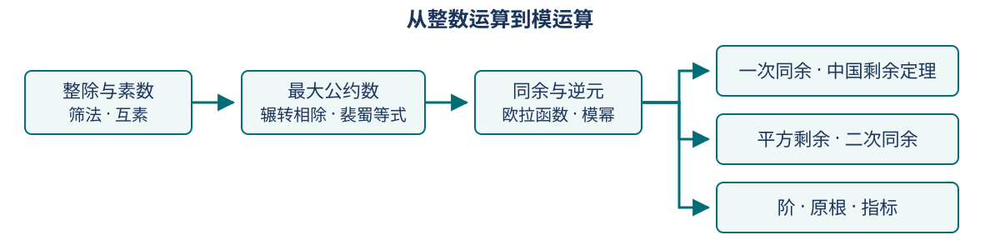

# 初等数论讲义（课件整理版）

本讲义整理自李老师《初等数论》期末突击课课件；原资料为速成复习材料，未提供对应课程大纲、版本日期及适用专业。配套练习见[题目与解答](题目与解答.md)。

## 阅读说明与学习路线

本讲义适合具备整数运算、基本代数和初等证明基础的读者作第一轮复习。先理解“整除”和最大公约数，再学习用同余处理余数；在此基础上学习一次同余、平方剩余，最后用阶和原根研究幂的周期。题册中注明“整理补充”的解答由整理者编写，原图解法与补充解法分别标识。

学完本材料后，应能解释整除与互素、计算最大公约数和模幂、判断一次同余的可解性、识别二次剩余，并用阶和指标处理部分幂同余。这个目标是**整理者根据本次资料拟定**的学习路线，不是已核实的课程考核要求。

图 0-1 初等数论知识路线（根据 S-B107-01 第 2 页和各节内容整理，自绘）。从左到右先建立整除工具，再进入模运算；右侧三个分支分别处理同余方程、平方剩余和幂的周期。

**课件自列范围和难度（来源 S-B107-01 第 2 页）：** 整数的可除性标为 2 星；同余、同余式、二次同余式、原根与指标各标为 3 星。课件没有解释星级的具体含义；这些是课件自评，不能当作本校课程或考试难度。

## K-3500 整除

图 1-1 整除知识地图（整理自 S-B107-01 第 3 页，自绘）。

**学习目标与先修：** 会把“a 整除 b”翻译为“b 是 a 的整数倍”，并使用整数乘法和分配律；这是后面同余定义的基础。

**是什么。** 对整数 a、b，如果存在整数 k，使 a=bk，就说 b 整除 a，记作 b∣a。例如 3∣12，因为 12=3×4；4∤10，因为不存在整数 k 使 10=4k。

**怎样使用。** 若 a∣b 且 b∣c，则 a∣c；若 a∣b 且 a∣c，则 a 整除 bx+cy，其中 x、y 是任意整数。为什么？由 b=au、c=av 可得 bx+cy=a(ux+vy)，括号内仍是整数。特别地，任意整数 a 都满足 1∣a；任意非零整数 a 都满足 a∣0。

**三句话带走：** 整除表示一个整数是另一个整数的整数倍。传递性和线性组合都能从整数倍关系直接推出。证明前先分清除数和被除数。

| 要解决的问题 | 关键做法 | 回看与练习 |
| --- | --- | --- |
| 判断整除 | 写成 b=ak，再检查 k 是否为整数 | [C-34000](题目与解答.md#c-34000)、[C-34001](题目与解答.md#c-34001) |
| 组合条件 | 从已知整除式构造所需线性组合 | [C-34000](题目与解答.md#c-34000) |

**本节核对手记**

| 条目 | 来源与位置 | 核对及补充 |
| --- | --- | --- |
| K-3500 | S-B107-01 第 3 页 | 已初步对照；原页线性组合中的 x、y 取正整数，这里依据整数乘法和加法的封闭性推广到整数。原页列举非零正整数的整除性质，正文进一步写出适用于整数的情况。 |

## K-3501 素数与互素

图 2-1 素数与互素知识地图（整理自 S-B107-01 第 4 页，自绘）。

**学习目标与先修：** 区分“一个数是素数”和“两个数互素”，需要先会找整数的因数。两个合数也可以互素，例如 8 和 9；1 不是素数，但 1 与任何整数互素。

大于 1 的自然数若只有 1 和自身两个正因数，就叫素数；若一组整数的最大公约数为 1，称它们互素。

**素数有无穷多个。** 假设素数只有 p₁,…,pₙ，构造 N=p₁⋯pₙ+1。N 除以每个已列素数都余 1，所以它不能被清单上的任何素数整除。接下来要看 N 的素因数，而不是断言 N 本身一定是素数；课件中的相关差异见本节核对手记。

**整理说明：证明。** N>1，因此 N 自身是素数，或有素因数 q。无论哪种情况，都有素数 q 整除 N；但没有列出的任何 pᵢ 能整除 N，所以 q 不在原列表中，与列表已包含全部素数矛盾。N 不一定是素数，例如 2×3×5×7×11×13+1=30031=59×509。

**三句话带走：** 素数只含两个正因数，互素则指一组数的最大公约数为 1。反证素数无穷时，构造数的素因数必有一个不在原清单中。构造出的数本身不一定是素数。

| 要解决的问题 | 关键做法 | 回看与练习 |
| --- | --- | --- |
| 分清概念 | 单数看正因数，两个数看最大公约数 | K-3501 |
| 无穷性证明 | 构造新数并检查它的素因数 | [C-34002](题目与解答.md#c-34002) |

**本节核对手记**

| 条目 | 来源与位置 | 核对及补充 |
| --- | --- | --- |
| K-3501 | S-B107-01 第 4 页 | 已初步对照。课件在素数无穷性的证明中断言 N 必为素数；正文用 N 的素因数补全论证，并给出反例。互素例子与修正推理为整理补充。 |

## K-3502 筛法与试除

图 3-1 筛法与试除知识地图（整理自 S-B107-01 第 5、8 页，自绘）。

**学习目标与先修：** 理解素数定义后，能区别“筛出一个范围内所有素数”和“判断单个整数是否为素数”。

想知道 1 到 20 中有哪些素数，逐个试除比较费事；可以先划掉 2 的倍数，再划掉 3 的倍数。这就是筛法的想法：一次排除一批合数。

**埃拉托斯特尼筛法。** 列出 2 至 N，依次找出不超过 √N 的素数 p，划去 2p、3p，直到不超过 N 的最大倍数 ⌊N/p⌋p；p 本身不能划掉。剩下的数就是不超过 N 的素数。不必事先知道完整素数表：从最小的未划去数开始，依次处理即可。

**自编例子：** N=20 时，√20 小于 5，只需处理 2 和 3：划去大于 2 的偶数，再划去大于 3 的 3 的倍数，留下 2、3、5、7、11、13、17、19。

**试除法。** 对单个整数 N>1，只需检查不超过 √N 的素数是否整除 N：若 N 是合数，写成 N=ab，其中 1<a≤b，就有 a≤√N；a 的某个素因数也不大于 √N。若这些素数都不能整除 N，N 就是素数。N≤1 时直接按定义排除，不进入这一步。

例如，11<√137<12；2、3、5、7、11 均不整除 137，所以 137 是素数。试除范围的原文表述及补充条件见本节核对手记。

**三句话带走：** 筛法找出范围内的素数，试除法判断给定数是否为素数。合数总有不大于其平方根的素因子，因此只需筛或试除到该界限。N≤1 时先按定义排除，不能当作素数。

| 要解决的问题 | 关键做法 | 回看与练习 |
| --- | --- | --- |
| 列出素数 | 筛掉素数在范围内的倍数 | K-3502 |
| 判断单个数 | 对 N>1 试除至平方根 | [C-34019](题目与解答.md#c-34019) |

**本节核对手记**

| 条目 | 来源与位置 | 核对及补充 |
| --- | --- | --- |
| K-3502 | S-B107-01 第 5 页图 1、第 8 页 | 已初步对照筛法流程及 137 的例子。第 8 页试除范围未明确排除候选因数等于 N 的情形；若把 N 自身当候选，素数会被错判。正文补充 N>1、试除至 √N 的条件及证明；20 以内筛法为自编例子。 |

## K-3503 裴蜀等式与带余除法

图 4-1 裴蜀等式与带余除法知识地图（整理自 S-B107-01 第 6–7 页，自绘）。

**学习目标与先修：** 能用带余除法反复缩小数字求最大公约数，并理解为什么可以反向代入得到线性组合。先修是整除与互素。

**裴蜀等式。** 对不全为零的整数 a、b，存在整数 x、y 使 gcd(a,b)=ax+by；这样的 x、y 不唯一。特别地，当 gcd(a,b)=1 时，ax+by=1 有整数解。

**为什么成立。** 在所有为正数的整数线性组合 ax+by 中取最小值 s；这样的组合存在，因为 a、b 不全为零，可取其中非零数的绝对值。将 a 除以 s，令 q=⌊a/s⌋，则余数 r=a−qs=a(1−qx)+b(−qy) 仍是 a、b 的整数线性组合，且 0≤r<s；由 s 的最小性，r=0，所以 s∣a。同理 s∣b。设 d=gcd(a,b)，则 s≤d；另一方面，d 整除每个线性组合，故 d∣s，得到 d≤s。因此 d=s。

**带余除法。** 对整数 a 和正整数 b，存在唯一整数 q、r，使 a=qb+r，且 **0≤r<b**；q 是商，r 是余数。例如 12=3×4+0，故不能排除 r=0。课件中的条件和称呼差异见本节核对手记。

**辗转相除为什么有效。** 若 a=qb+r，a、b 的公因数也整除 r；反过来，b、r 的公因数也整除 a。因此两组公因数相同，gcd(a,b)=gcd(b,r)。不断用除数和余数替换原数对，直到余数为 0，最后一个非零余数就是最大公约数。

例如，85=55+30、55=30+25、30=25+5、25=5×5，所以 gcd(85,55)=5。沿等式反向代入可得 5=2×85−3×55；这给出了裴蜀等式中的一组系数。

**三句话带走：** 带余除法把被除数写成商乘除数再加余数。辗转相除不改变最大公约数，反向代入得到裴蜀等式。余数可以为 0，最后一步不能省略。

| 要解决的问题 | 关键做法 | 回看与练习 |
| --- | --- | --- |
| 求最大公约数 | 反复用除数和余数替换原数对 | [C-34003](题目与解答.md#c-34003) |
| 求整数系数 | 从最后一个非零余数开始回代 | [C-34004](题目与解答.md#c-34004) |

**本节核对手记**

| 条目 | 来源与位置 | 核对及补充 |
| --- | --- | --- |
| K-3503 | S-B107-01 第 6 页图 1 | 已初步对照裴蜀等式证明；正文补充正线性组合存在的理由。 |
| K-3503 | S-B107-01 第 7 页图 1 | 原页将余数范围写为 0<r<b，并将 r 称为除数；正文按带余除法写为 0≤r<b，r 是余数。原图仅给出最大公约数不变性的一个方向，正文补全反向论证；图中未说明的 m=r/d 不影响这一证明。该图不是带余除法存在性与唯一性的完整证明。回代例子的系数为整理补充。 |

## K-3504 同余与欧拉函数

图 5-1 同余与欧拉函数知识地图（整理自 S-B107-01 第 12–16 页，自绘）。

**学习目标与先修：** 先把同余理解为差被模数整除，再用它简化计算；欧拉函数与定理依赖互素和素数分解。

时钟走过 12 小时会回到相同位置：17 点和 5 点在 12 小时钟面上指向同一位置。数论把这种“绕一圈又回来”的关系叫作同余。

整数 a、b 模正整数 m 同余，是说 m∣(a−b)，记为 a≡b (mod m)。可以把它理解为两数除以 m 的余数相同；同模同余式可以相加、相减、相乘和取非负整数次幂。

同余具有**自反性、对称性和传递性**：a≡a；若 a≡b，则 b≡a；若 a≡b 且 b≡c，则 a≡c，以上同余均取模 m。其原因是 m 分别整除 0、−(a−b) 和 (a−b)+(b−c)。例如 17≡5 (mod 12)，因为 17−5=12；但 17≠5，不能把同余号当作通常的等号。

模 m 的剩余类 [a]ₘ={a+km∣k∈ℤ}；这些类把整数分为 m 组，每个整数恰好属于其中一组。从每个剩余类各取一个代表得到完全剩余系，最常见的是 0,1,…,m−1。例如模 4 可取 −1、0、1、2，不可同时取 −2 和 2，因为它们属于同一剩余类。课件中的符号和端点问题见本节核对手记。

**整理说明：模逆元和约分。** 对模数 m>1，若整数 a、u 满足 au≡1 (mod m)，就称 u 是 a 的模 m 逆元。它存在当且仅当 gcd(a,m)=1：有逆元时，au−1 是 m 的倍数，所以 1 可写成 a、m 的整数线性组合；反过来，裴蜀等式给出 au+mv=1，u 就是所求逆元。例如 3×4≡1 (mod 11)，因此 3 的模 11 逆元为 4，3x≡7 (mod 11) 两边乘 4 可得 x≡6 (mod 11)。

**易错对比：** 乘数与模数不互素时不能直接在原模数下约去。例如 2×1≡2×3 (mod 4)，但 1 与 3 不模 4 同余；若 c、x、y 为整数，m>0，且 d=gcd(c,m)，则 cx≡cy (mod m) 等价于 x≡y (mod m/d)。这来自 m∣c(x−y)：将 c、m 都除以 d 后，互素条件保证 m/d 整除 x−y。这里 m/d=1 时，后一同余对任意整数 x、y 都成立。

**算术基本定理：** 每个大于 1 的整数都能表示为素数的乘积；除了因子的排列顺序外，这种分解是唯一的。把相同素数合并，即 $n=p_1^{a_1}\cdots p_k^{a_k}$，其中 p₁,…,pₖ 是不同素数，a₁,…,aₖ 是正整数。例如 120=2³×3×5；不同排列仍是同一种分解。这一定理是计算欧拉函数和把合数模数拆成素数幂的基础。

欧拉函数 φ(n) 是 1 到 n 中与 n 互素的整数个数，φ(1)=1；若 p 为素数，则 φ(p)=p−1、φ(pᵃ)=pᵃ−pᵃ⁻¹；互素的 u、v 满足 φ(uv)=φ(u)φ(v)。例如 120=2³×3×5，所以 φ(120)=(8−4)(3−1)(5−1)=32。

**整理说明：为什么能这样计数。** 在 1 至 pᵃ 中，不与 pᵃ 互素的数恰是 p 的倍数，共 pᵃ⁻¹ 个，去掉它们就得 φ(pᵃ)=pᵃ−pᵃ⁻¹。若 u、v 互素，中国剩余定理把模 uv 的剩余类与“模 u、模 v 的剩余类对”一一对应；一个数与 uv 互素，恰好等价于它分别与 u、v 互素，所以满足条件的组合数是 φ(u)φ(v)。这也说明计算前必须先检查各因子两两互素。

费马小定理：p 为素数且 p∤a 时，aᵖ⁻¹≡1 (mod p)；对任意整数 a，aᵖ≡a (mod p)。欧拉定理：n>1 且 gcd(a,n)=1 时，$a^{\varphi(n)}\equiv1\pmod n$。Wilson 定理指出素数 p 满足 (p−1)!≡−1 (mod p)。

**整理说明：欧拉定理的思路。** 取模 n 的全部 φ(n) 个互素剩余类代表 r₁,…,rₖ。因为 a 与 n 互素，乘以 a 后得到 ar₁,…,arₖ，仍是同一组剩余类的重新排列：若 arᵢ≡arⱼ，便可利用 a 的逆元得到 rᵢ≡rⱼ。两组代表的乘积同余；每个 rᵢ 都与 n 互素，可以约去它们，便得到 aᵏ≡1 (mod n)。取素数模 n=p 即得费马小定理；当 p∣a 时，aᵖ≡a 两边均为 0，因此后一形式对任意整数 a 成立。

**模重复平方。** 对整数 a、正整数 b 和正整数模数 m，计算 aᵇ (mod m) 时，先把 b 写成二进制。从最高位到最低位扫描：每读一位就将当前结果平方并取模，如果该位为 1，再乘 a 并取模。开始时结果取 1；过程始终只需保存模 m 的余数。例如 b=13=1101₂，计算 3¹³ (mod 5)：依次得到 3、2、4、3，最终余数为 3。每一步为何成立：已扫描的二进制数值设为 t，下一位为 c，则新指数是 2t+c，故新幂是旧幂的平方再乘 aᶜ。

**三句话带走：** 同余表示两个整数之差被模数整除。欧拉函数计数与模数互素的剩余类，欧拉定理可帮助化简模幂。约分或使用逆元前必须检查互素条件。

| 要解决的问题 | 关键做法 | 回看与练习 |
| --- | --- | --- |
| 计算模幂 | 先约简底数，再按定理或重复平方计算 | [C-34007](题目与解答.md#c-34007)、[C-34010](题目与解答.md#c-34010) |
| 计算欧拉函数 | 分解成素数幂，利用互素乘法 | [C-34006](题目与解答.md#c-34006) |
| 同余约分 | 检查乘数与模数的最大公约数 | K-3504 |

**本节核对手记**

| 条目 | 来源与位置 | 核对及补充 |
| --- | --- | --- |
| K-3504 | S-B107-01 第 12—13 页 | 已初步对照同余与剩余类。原页用等号表示同余、集合中误写 m∈ℤ；偶数模数下，原页绝对最小代表区间同时包含同余的两个端点，正文予以修正。 |
| K-3504 | S-B107-01 第 14—15 页 | 已初步对照素数分解、欧拉函数及定理。原页将 φ(n) 写成集合，正文写为元素个数；欧拉定理原页模数写 p、前提使用 n，正文按 n 表示。计数和欧拉定理证明为整理补充。 |
| K-3504 | S-B107-01 第 16、21 页 | 第 16 页含重复平方方法，第 21 页使用逆元但未展开存在条件；正文补充逆元、约分的条件与解释，以及重复平方的例子。 |

## K-3505 一次同余式

图 6-1 一次同余式知识地图（整理自 S-B107-01 第 19–24 页，自绘）。

**学习目标与先修：** 会先判断有没有解，再求解和计数；先修为最大公约数、互素与同余。

**先判断，再求解。** 对于整数 a、b 和正整数 m，求解 ax≡b (mod m)，令 d=gcd(a,m)：有解当且仅当 d∣b；有解时恰有 d 个模 m 不同的解。先检查 d∣b，再将 a、b、m 同除以 d，求简化方程模 m/d 的一个解，最后在模 m 下列出 d 个解。

例如 10x≡25 (mod 65)，d=gcd(10,65)=5，且 5∣25，所以有解。约去 5 得 2x≡5 (mod 13)，由于 2 的模 13 逆元是 7，x≡7×5≡9 (mod 13)。回到模 65，五个解为 9、22、35、48、61。把它们分别代回原式，余数都为 25。

**整理说明：为什么先查 d。** 同余式等价于存在整数 y，使 ax+my=b；由于 d 同时整除 a 和 m，必然要有 d∣b。反过来若 d∣b，约去 d 后得到 a′x≡b′ (mod m′)，其中 gcd(a′,m′)=1。当 m′>1 时，裴蜀等式保证 a′ 在模 m′ 下有逆元，因此可求出唯一的模 m′ 解 x₀；当 m′=1 时，约化同余对所有整数成立，只有一个模 1 剩余类。回到模 m 时，x₀、x₀+m′、…、x₀+(d−1)m′ 恰是 d 个互不相同的模 m 解。

**边界例子：** 6x≡5 (mod 9) 中 d=3，但 3∤5，因此无解。只有确认有解后，才能说模 m 有 d 个不同解；课件中的条件见本节核对手记。

**中国剩余定理。** 设模数 m₁,…,mₖ 均大于 1 且两两互素，它保证任意指定的余数能组合成一个模 M=m₁⋯mₖ 的唯一剩余类。令 Mᵢ=M/mᵢ，选 yᵢ 使 Mᵢyᵢ≡1 (mod mᵢ)，则 x≡ΣaᵢMᵢyᵢ (mod M)，其中 aᵢ 是指定的第 i 个余数。计算 yᵢ 时，可用 [K-3503](#k-3503) 的辗转相除和回代找到 Mᵢyᵢ+mᵢz=1。若模数中有 1，对应条件恒成立，去掉后再计算即可。

**为什么这样构造：** 对第 i 个模数，Mᵢyᵢ≡1，而其他每个 Mⱼ 都含因子 mᵢ，故 Mⱼ≡0 (mod mᵢ)。因此求和式在模 mᵢ 下只留下 aᵢ；每个条件都成立。若两个解满足同一组条件，其差被每个两两互素的模数整除，因而被乘积 M 整除，所以它们属于同一个模 M 的剩余类。

**自编例子：** 解 x≡2 (mod 3)、x≡3 (mod 5)。这里 M=15，M₁=5，M₂=3；5 模 3 的逆元是 2，3 模 5 的逆元也是 2。代入构造式得 x≡2×5×2+3×3×2=38≡8 (mod 15)。检验：8 除以 3 余 2、除以 5 余 3。

**合数模数下的多项式同余。** 若 m=m₁⋯mₖ 且各 mᵢ 两两互素，则整数系数多项式 f(x)≡0 (mod m) 等价于每个 f(x)≡0 (mod mᵢ) 同时成立。若各式分别有 Tᵢ 个模 mᵢ 的解，则原式有 T₁⋯Tₖ 个模 m 的解：每一种局部解的组合由中国剩余定理对应唯一一个模 m 的解。这里的“解数”是相应模数下不同剩余类的数量。例如 x²≡1 (mod 15) 分别在模 3 和模 5 下有 2 个解，故模 15 有 4 个解：1、4、11、14。

**三句话带走：** 一次同余要找满足 ax≡b 的剩余类。最大公约数 d=gcd(a,m) 整除 b 时有解，且模 m 有 d 个不同解。合并多条同余前要检查模数是否满足所用定理的条件。

| 要解决的问题 | 关键做法 | 回看与练习 |
| --- | --- | --- |
| 判断有无解 | 先算 d，再检查 d 是否整除 b | [C-34008](题目与解答.md#c-34008) |
| 合并余数条件 | 两两互素时使用中国剩余定理 | [C-34009](题目与解答.md#c-34009) |
| 模数不互素 | 先检查余数差是否被模数的最大公约数整除 | [C-34017](题目与解答.md#c-34017) |

**本节核对手记**

| 条目 | 来源与位置 | 核对及补充 |
| --- | --- | --- |
| K-3505 | S-B107-01 第 19、23 页 | 已初步对照解数结论和 10x≡25 例题。原页说“d>1 则有 d 个不同的解”，应以 d∣b 为前提；正文补充判断步骤、推导和反例。例题解答为整理补充。 |
| K-3505 | S-B107-01 第 20—22 页 | 已初步对照中国剩余定理及解数结论；原页部分等号和逆元的模数记号不完整，正文补明，并将解数解释为不同剩余类数。构造说明和两个数值例子为整理补充。 |

## K-3506 二次同余与平方剩余

图 7-1 二次同余与平方剩余知识地图（整理自 S-B107-01 第 25–34 页，自绘）。

**学习目标与先修：** 能判断平方根是否存在，并区别素数模下的 Legendre 符号和奇合数模下的 Jacobi 符号；先修是同余、素数分解和模幂。

**问题是什么。** 普通方程 x²=a 问一个数的平方是否等于 a；同余式 x²≡a (mod m) 问的是平方除以 m 后是否与 a 余数相同。本节沿用课件的约定：m>1 且 gcd(a,m)=1 时，如果该式有解，就称 a 是模 m 的平方剩余。

例如模 7 时，1²≡6²≡1、2²≡5²≡4、3²≡4²≡2，所以 1、2、4 是非零平方剩余，而 3、5、6 不是。0²≡0；是否把 0 也叫平方剩余取决于定义约定，本节将它单独处理。

对奇素数 p 和 p∤a，Euler 判别法说：a 为模 p 的平方剩余，当且仅当 $a^{(p-1)/2}\equiv1\pmod p$；为平方非剩余，当且仅当此幂同余 −1。若是平方剩余，则 x²≡a (mod p) 恰有两个不同解；若 p∣a，则唯一解是 x≡0 (mod p)。

二次式 ax²+bx+c≡0 (mod pᵏ)，当 p 是奇素数、k 是正整数且 p∤a 时，两边乘以 4a 并配方，得到 (2ax+b)²≡b²−4ac (mod pᵏ)。因为 2a 在模 pᵏ 下有逆元，代换 y=2ax+b 可逆，所以可以转为求 y 的平方根，再反求 x。p=2 或 p∣a 时不能直接套用这个可逆代换。

**边界例子：** 3x²+x≡0 (mod 3) 中，首项系数被 3 整除，化简后是 x≡0 (mod 3)。因此，把模数拆成素数幂后，应分别检查每个素因子与首项系数的关系；不能因为能拆分模数就自动假定 p∤a。课件中的条件差异见本节核对手记。

**Legendre 符号。** 对奇素数 p，记 (a/p)：p∣a 时取 0；p∤a 且 a 是平方剩余时取 1，否则取 −1。它可以用 Euler 判别法计算：$(a/p)\equiv a^{(p-1)/2}\pmod p$，左边只取 0、1、−1。它对分子乘法满足 (ab/p)=(a/p)(b/p)，且只取决于 a 模 p 的剩余类。特别地 $(1/p)=1$、$(-1/p)=(-1)^{(p-1)/2}$；若 p∤a，则 (a²/p)=1。

**Gauss 引理与二次互反律。** p 为奇素数、gcd(a,p)=1 时，将 a、2a、…、((p−1)/2)a 分别取模 p 的最小正剩余；其中大于 p/2 的个数设为 t，则 (a/p)=(−1)ᵗ。若 p、q 是不同奇素数，则 $(p/q)(q/p)=(-1)^{((p-1)/2)((q-1)/2)}$。它能把较大的分子与分母交换，配合取余和分解来算符号。

**整理补充：2 的符号。** 题册 [C-34021](题目与解答.md#c-34021) 的证明还用到二次互反律的补充公式：对奇素数 p，$(2/p)=(-1)^{(p^2-1)/8}$。因此 p 除以 8 的余数为 1 或 7 时取 1，为 3 或 5 时取 −1。推导要点：在 Gauss 引理中取 a=2，数列 2、4、…、p−1 均为模 p 的最小正剩余，其中大于 p/2 的个数为 $(p-1)/2-\lfloor p/4\rfloor$；分别令 p 除以 8 余 1、3、5、7，即得到上述四种符号。

**Jacobi 符号的区别。** 对大于 1 的奇数 m，把其素因子按重数写成 m=p₁⋯pᵣ，定义 (a/m)=∏(a/pᵢ)。若 (a/m)=−1，则 x²≡a (mod m) 无解；但值为 1 不保证有解。例：119=7×17，(3/7)=(3/17)=−1，故 (3/119)=1，但模 7 已无解，因此模 119 也无解。对于分子，Jacobi 符号满足乘法性 (ab/m)=(a/m)(b/m)；若 gcd(a,m)=1，则 (a²/m)=1；同一分母下，分子按模 m 同余时符号相等。课件对符号结果的表述差异见本节核对手记。

**符号对照：**

| 看什么 | Legendre 符号 (a/p) | Jacobi 符号 (a/m) |
| --- | --- | --- |
| 分母 | p 是奇素数 | m 是大于 1 的奇数，可以是合数 |
| 值为 1 | a 与 p 互素，且模 p 有平方根 | a 与 m 互素，但模 m 不一定有平方根 |
| 值为 −1 | 模 p 没有平方根 | 模 m 没有平方根 |
| 值为 0 | p 整除 a；模 p 的根是 0 | a 与 m 不互素；是否有根需另查 |

例如模 9 时，a=0 和 a=3 的 Jacobi 符号都为 0，但 0 有平方根，3 没有平方根。这一对照是整理补充。

**三句话带走：** 二次同余研究模 m 的平方是否能得到指定余数。奇素数模数可用 Euler 判别及 Legendre 符号辅助判断。合数模数下 Jacobi 符号为 1 仍不能保证有平方根。

| 要解决的问题 | 关键做法 | 回看与练习 |
| --- | --- | --- |
| 判断平方剩余 | 先区分素数模数与合数模数 | [C-34011](题目与解答.md#c-34011) |
| 复核求根 | 将候选根逐个代回原同余式 | [C-34012](题目与解答.md#c-34012) |

**本节核对手记**

| 条目 | 来源与位置 | 核对及补充 |
| --- | --- | --- |
| K-3506 | S-B107-01 第 25—27 页 | 初步对照二次同余和 Euler 判别。课件的平方剩余定义限于 gcd(a,m)=1；正文保留这一约定并单列零。原页拆分模数后直接讨论 p∤a，正文补充不能自动满足该条件的例子。 |
| K-3506 | S-B107-01 第 28—30 页 | 初步对照 Legendre 符号、Gauss 引理和二次互反律；2 的符号公式及其推导为整理补充，原课件未列出。 |
| K-3506 | S-B107-01 第 31 页 | 原页将 Jacobi 符号 −1 说成平方剩余，正文改为无解；符号为 1 不能保证有解。原页周期式分子写 a+p 而分母为 m，正文按模 m 的周期表述。原页已给出 3 对模 119 的反例，正文补充了符号计算和无解的理由。 |

## K-3507 阶、原根与指标

图 8-1 阶、原根与指标知识地图（整理自 S-B107-01 第 35–39 页，自绘）。

**学习目标与先修：** 理解幂的周期，能检验候选原根，并在有原根时用指标化幂同余为一次同余；先修是欧拉函数和一次同余式。

**阶：什么时候回到 1？** 对于 m>1 且 gcd(a,m)=1，a 的阶 ordₘ(a) 是使 aᵉ≡1 (mod m) 成立的最小正整数 e。它一定存在，因为欧拉定理给出一个可行指数 φ(m)。例如模 7 时，2¹≡2、2²≡4、2³≡1，所以 ord₇(2)=3。

对于整数 d，aᵈ≡1 当且仅当 ordₘ(a)∣d，因此阶整除 φ(m)。d 为负数时，aᵈ 表示模 m 下逆元的相应正整数次幂；逆元存在是因为 gcd(a,m)=1。为什么成立？把 d 除以阶 e，写作 d=qe+r、0≤r<e；由于 aᵉ≡1，即使 q 为负数也有 aᵈ≡aʳ。如果 aᵈ≡1，就有 aʳ≡1，最小性迫使 r=0。课件中的命名差异见本节核对手记。

**原根：能否走遍互素余数？** 若 ordₘ(g)=φ(m)，则 g 是模 m 的原根：它的幂能遍历所有与 m 互素的剩余类。奇素数 p 一定有原根，数量是 φ(p−1)；更一般地，若 m>1 且模 m 存在原根，不同原根的个数为 φ(φ(m))。

判断 g 是否为模 p 原根：先保证 p∤g，找出 p−1 的所有不同素因数 q；对每个 q 检查 $g^{(p-1)/q}\not\equiv1\pmod p$，全部通过才是原根。例如模 7 时，3 的幂依次为 3、2、6、4、5、1，阶为 6=φ(7)，因此 3 是原根。

另一个特殊情形是 p 为奇素数、q=(p−1)/2 也是素数时，若 a 模 p 不等于 0、1、−1，则 ordₚ(a) 为 q 或 p−1：因为阶整除 2q，且已排除阶 1 和阶 2。

**指标：走了多少步？** 如果模 m 存在原根 g，对每个与 m 互素的 a，可找到指数 r 使 gʳ≡a (mod m)；r 模 φ(m) 唯一，称为以 g 为底的指标，记作 ind_g(a)。可取 0≤r<φ(m) 作代表，也可取 1≤r≤φ(m)，只是代表元的选择不同。

令 x≡gᵗ，则 xⁿ≡a 等价于 nt≡ind_g(a) (mod φ(m))，其中 n 为正整数；由一次同余式判别法，设 d=gcd(n,φ(m))，有解当且仅当 d 整除 ind_g(a)，有解时恰有 d 个不同解。这一步要求模 m 有原根，且 a 与 m 互素；若 a 不互素，不能把这个指标法直接套用。

**自编例子：** 解 x²≡2 (mod 7)。上面已知 3 是原根，且 3²≡2，因此 ind₃(2)≡2 (mod 6)。写 x≡3ᵗ，则 2t≡2 (mod 6)，解得 t≡1 或 4 (mod 6)，所以 x≡3 或 4 (mod 7)。代回：3²≡4²≡2 (mod 7)。

**三句话带走：** 阶是幂第一次模 m 回到 1 的正指数，指标记录原根的幂到达某个互素剩余类所需的指数。阶和指标把乘法及幂运算转成周期与指数计算。讨论阶或指标前要检查互素、模数和原根存在条件。

| 要解决的问题 | 关键做法 | 回看与练习 |
| --- | --- | --- |
| 判断原根 | 验证阶等于欧拉函数值 | [C-34013](题目与解答.md#c-34013) |
| 求幂同余 | 先确定原根和指标，再解指数同余 | [C-34014](题目与解答.md#c-34014) |

**本节核对手记**

| 条目 | 来源与位置 | 核对及补充 |
| --- | --- | --- |
| K-3507 | S-B107-01 第 35—36 页 | 已初步对照阶与特殊情形。第 35 页将阶称作“指数”，需与第 38 页的指标区分；阶存在性、整数指数中负数的含义、整除关系的解释及模 7 的例子为整理补充。该页例题写 m=1，与其 m>1 的定义前提冲突，题意仍待核对。 |
| K-3507 | S-B107-01 第 37—38 页 | 已初步对照原根与指标。第 37 页原根判别式的模数写 m，正文按模素数 p 的上下文修正；该页列出不同素因数 q₁,…,qᵣ，后面却写 i=1,…,s，正文统一为对每个不同素因数检查。第 38 页指标定义写 gʳ≡1，正文改为 gʳ≡a。指标代表元及幂同余例子为整理补充。 |

## 重点与易错点

下列级别是整理判断，不代表教师已确认的考试要求。

- **P-3500｜必须掌握｜整除方向与零余数：** a∣b 表示 b 是 a 的整数倍；带余除法允许 r=0，见 [K-3500](#k-3500)、[K-3503](#k-3503)。

- **P-3501｜必须掌握｜约分要改变模数：** 2x≡2 (mod 4) 的解是 x≡1 (mod 2)，不能错误地约成 x≡1 (mod 4)。见 [K-3505](#k-3505)。

- **P-3502｜重要｜区分两种判别：** Legendre 符号针对奇素数；合数模数的 Jacobi 符号等于 1 并不保证有平方根，见 [K-3506](#k-3506)。

- **P-3503｜重要｜阶与指标含义不同：** 阶描述幂何时回到 1；指标描述原根的哪次幂到达目标，见 [K-3507](#k-3507)。

## 学完后自检

以下为整理者自编的小问题，答案紧随其后，帮助检查概念；系统训练见独立题册。

1. 12∣3 对吗？ **答：** 不对；3 不是 12 的整数倍，正确的是 3∣12。[K-3500](#k-3500)
2. 6x≡5 (mod 9) 有没有解？ **答：** 没有，因为 gcd(6,9)=3 不整除 5。[K-3505](#k-3505)
3. 模 7 时 3 有没有平方根？ **答：** 没有：整数平方后模 7 得到的余数只有 0、1、2、4。[K-3506](#k-3506)
4. 2 模 7 的阶是多少？ **答：** 3，因为 2、2²、2³ 模 7 分别是 2、4、1。[K-3507](#k-3507)

## 其他待核对的原文问题

- 第 31 页称 Jacobi 符号为 −1 时是平方剩余；应为平方非剩余。符号为 1 不足以保证是平方剩余。
- 第 35 页例题给出 m=1，与该页原根定义的 m>1 前提冲突，具体题意待核对。
- 第 37 页原根判别中模数写成 m，但上下文为模素数 p；应核实后按 p 处理。
- 第 38 页指标定义写 gʳ≡1，而 r 应对应 gʳ≡a (mod m)；否则无法表示一般的 a。
- 第 24 页多项式例题只给出模数 m 的符号，未给具体值；不能擅自补一个数。

## 资料范围与待核对事项

本次材料仅有一份速成课件，未取得适用教学大纲，不能据此确认完整课程覆盖范围。第 24 页多项式题的模数未给出，第 35 页原根题的模数与同页定义冲突；题目及处理方式见配套题册。各节原文差异与补充依据见相应核对手记。

## 来源与附件说明

**S-B107-01：** 李老师《初等数论》期末突击课，[数论期末.pdf](原始资料/数论期末.pdf)，共 40 页；原始制作日期、适用专业与学期未提供。本讲义和题册仅整理本份速成课件，资料来源、逐页覆盖、修改依据与待核实的问题详见[整理记录](整理记录.md)。
