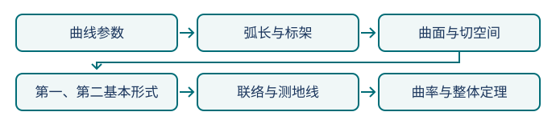

# 微分几何：曲线、曲面与流形

课件整理版｜2026-11-26｜依据 B105《微分几何期末复习》35 页课件。适合学过多元微积分、线性代数的读者。课件是一份速成课手写笔记，不是经核实的南航课程大纲。

## 导读：先看哪一部分

一条曲线关注“怎么弯、怎么扭”；一张曲面先用坐标描述，再研究长度、角度、面积和弯曲；流形把局部坐标的办法推广到更一般的空间。先学参数与切向量，再学度量、联络、曲率，最后理解局部曲率与整体形状的关系。



图 0-1 全书知识地图（自绘）。

| 想解决的问题 | 先看哪一章 | 对应练习 |
| --- | --- | --- |
| 曲线走了多远、弯得多厉害 | 参数、弧长与 Frenet 标架 | 题 1、2、4 |
| 曲面上的方向、长度、角度和面积 | 正则曲面与第一基本形式 | 题 3、5、8 |
| 曲面如何弯曲、测地线怎样求 | 第二基本形式、联络与曲率 | 题 6、9 |
| 曲率与曲面的整体形状有什么关系 | Gauss–Bonnet 定理 | 题 7 |

## 一、参数曲线与弧长


图 1-1 一、参数曲线与弧长知识地图（自绘）。

同一条路可以走得快慢不同，怎样只用走过的距离给位置编号？本章用导数和积分建立弧长参数，为下一章比较曲线弯曲程度做准备。

<a id="c-7001"></a>
### C-7001｜参数是路标，弧长是路程

正则光滑曲线是映射 $\sigma:(a,b)\to\mathbb R^3$，且每点 $\sigma'(t)\ne0$。参数 $t$ 可以是时间，$|\sigma'(t)|$ 是对应的速率。如果将参数改成 $t=t(s)$，得到 $\tilde\sigma(s)=\sigma(t(s))$；要保持正则，参数变换应光滑且导数不为零。

**边界例子：** $\sigma(t)=(t^2,t^3,0)$ 在 $t=0$ 处满足 $\sigma'(0)=(0,0,0)$，因此在包含该点的区间上不是正则曲线。此时弧长函数的导数 $ds/dt=|\sigma'(t)|$ 在 $t=0$ 为零，不能直接用下面的逆函数方法在该点建立光滑的弧长参数。

```{=latex}
\Needspace{3cm}
```

曲线从 $t_0$ 到 $t$ 的带方向弧长坐标可取
```{=latex}
\begin{formulabox}
```

$$s(t)=\int_{t_0}^{t}|\sigma'(u)|\,du.$$

```{=latex}
\end{formulabox}
```
它满足 $ds/dt=|\sigma'|>0$，因此局部可反解 $t=t(s)$；新曲线满足 $|d\tilde\sigma/ds|=1$。区间长度为 $\int_a^b|\sigma'(t)|dt$；参数反向时，变换积分的上下限也要相应调整。

**例子：螺旋线。** $\sigma(t)=(r\cos t,r\sin t,ht)$，设 $r^2+h^2>0$，则 $|\sigma'|=\sqrt{r^2+h^2}=:v$。取 $s(0)=0$，得到 $s=vt$、$t=s/v$，所以 $\tilde\sigma(s)=(r\cos(s/v),r\sin(s/v),hs/v)$。自检：对 $s$ 求导后，速度长度为 1。

```{=latex}
\Needspace{3cm}
```

**本章复盘**

| 是什么 | 为什么成立 | 什么时候不能用 |
| --- | --- | --- |
| 弧长参数下速度长度为 1。 | 弧长变化率等于原参数下的速度长度。 | 原速度为零处不能用此局部换参；换向时检查积分限。 |

练习：题目与解答第 1 题。

## 二、切向量、曲率与 Frenet 标架


图 2-1 二、切向量、曲率与 Frenet 标架知识地图（自绘）。

汽车转弯时，速度方向不断改变；怎样把“转得有多急”和“向空间中怎样扭”分开？本章用上一章的弧长参数建立标架，为后面研究曲面的弯曲提供参照。

<a id="k-7002"></a>
### K-7002｜用三个方向追踪曲线

单位切向量 $T=\sigma'/|\sigma'|$ 指向曲线前进方向。若已用弧长参数，$T=d\sigma/ds$，曲率 $\kappa=|dT/ds|$ 表示单位路程内切向量变化得有多快。

沿曲线的向量场就是给每个参数 $t$ 指定一个向量 $X(t)\in\mathbb R^3$。它可以是切向量，也可以指向别的方向；曲线自交时，即使两个参数对应同一空间点，也要先按各自参数判断。单位切向量场是沿曲线向量场的一个例子，而不是每个沿曲线向量场都必须与曲线相切。

在 $\kappa>0$ 的区间定义主法向量 $N=T'/\kappa$、副法向量 $B=T\times N$；这里撇号表示对弧长求导。按照 $\tau=-\langle B',N\rangle$ 的符号约定：
```{=latex}
\Needspace{3cm}
\begin{formulabox}
```

$$T'=\kappa N,\qquad N'=-\kappa T+\tau B,\qquad B'=-\tau N.$$

```{=latex}
\end{formulabox}
```
这三条 Frenet 公式描述标架如何旋转。为什么 $B'$ 只有 $N$ 方向？因为 $B$ 是单位向量，$\langle B',B\rangle=0$；对 $B\cdot T=0$ 求导，再用 $T'=\kappa N$，得到 $\langle B',T\rangle=0$。因此 $B'$ 只能沿 $N$，系数由扭率定义给出，即 $B'=-\tau N$，并有 $|\tau|=|B'|$。又因 $N=B\times T$，对它求导可得 $N'=-\kappa T+\tau B$。这也解释了原课件第 12 页计算中的 $N=B\times T$。$\kappa=0$ 时上述 $N$、$B$ 的定义失效，不能直接套用。足够光滑且 $\kappa>0$ 的连通曲线段上，$\tau\equiv0$ 时 $B$ 不变，曲线位于垂直于 $B$ 的平面；反过来，正则平面曲线在标架有定义处扭率为零。

图 2-2 用一小段弯曲路径表示三个方向：$T$ 沿切线，$N$ 指向切向量变化的方向，$B$ 垂直于前两者张成的平面。三个箭头都是同一点处的单位向量，图形仅表达方向关系。

```{=latex}
\Needspace{5cm}
\begin{center}
\begin{tikzpicture}[scale=1.1,line width=.7pt,every node/.style={font=\small}]
\fill[tealaccent!7] (-2.4,-.75)--(1.6,-.75)--(2.5,.65)--(-1.5,.65)--cycle;
\draw[gray] (-2.4,-.75)--(1.6,-.75)--(2.5,.65)--(-1.5,.65)--cycle;
\draw[navy,thick] (-1.8,-.55) .. controls (-1.1,-.35) and (-.55,-.06) .. (0,0) .. controls (.55,.06) and (1.1,.35) .. (1.6,.55);
\fill (0,0) circle (1.5pt) node[below left] {$p$};
\draw[->,tealaccent,very thick] (0,0)--(1.45,.15) node[right] {$T$};
\draw[->,tealaccent,very thick] (0,0)--(-.55,.65) node[above left] {$N$};
\draw[->,navy,very thick] (0,0)--(0,1.35) node[above] {$B=T\times N$};
\end{tikzpicture}
\end{center}
```

图 2-2 Frenet 标架方向示意（根据 B105 第 9 页重绘，投影仅为示意）。

一般参数下，若 $\sigma'\times\sigma''\ne0$，可直接计算
$$\kappa=\frac{|\sigma'\times\sigma''|}{|\sigma'|^3},\qquad B=\frac{\sigma'\times\sigma''}{|\sigma'\times\sigma''|},\qquad \tau=\frac{(\sigma'\times\sigma'')\cdot\sigma'''}{|\sigma'\times\sigma''|^2}.$$
公式要求相应阶导数存在。原课件第 8 页末式需与第 12 页交叉检查：一般参数不能把曲率写成单纯的 $|\sigma''|/|\sigma'|$，详见核对手记。

**为什么叉积能求曲率？** 令 $v=|\sigma'|$，则 $\sigma'=vT$。对参数 $t$ 求导并用 $dT/ds=\kappa N$，得到 $\sigma''=\dot vT+v^2\kappa N$。前一项沿切线，只改变速度大小；后一项改变方向。因此 $|\sigma'\times\sigma''|=v^3\kappa$，消去 $v$ 就得到上式。圆 $\sigma(t)=(r\cos t,r\sin t,0)$（$r>0$）的曲率为 $1/r$，半径越小，转弯越急。

<a id="k-7010"></a>
### K-7010｜给定曲率和扭率，能否找回曲线？

原课件第 13 页只写出给定 $\kappa(s),\tau(s)$ 后存在曲线的线索，没有写条件或证明。下面是在明确条件下的整理补充：在区间 $I$ 上，若 $\kappa$ 和 $\tau$ 光滑且 $\kappa>0$，则存在以 $s$ 为弧长参数、具有这两个函数的空间曲线；它在保持空间方向的刚体运动意义下唯一。

**关键思路。** 把 $T,N,B$ 放进以它们为列的矩阵 $Q=(T\ N\ B)$。Frenet 公式写成线性微分方程
$$Q'=QA,\qquad A=\begin{pmatrix}0&-\kappa&0\\\kappa&0&-\tau\\0&\tau&0\end{pmatrix}.$$
给定一点的右手正交标架作为初值，线性微分方程给出唯一的标架。因为 $A^T=-A$，有 $(Q^TQ)'=A^TQ^TQ+Q^TQA$；单位矩阵满足同一方程和初值，故 $Q^TQ=I$。标架始终正交且保持右手方向。再取初始位置 $p_0$，积分 $\sigma(s)=p_0+\int_{s_0}^s T(u)\,du$，就得到单位速度曲线；由标架方程可读出其曲率与扭率。更换初始位置和右手正交标架，只会带来平移与旋转。

条件 $\kappa>0$ 是为了保证此处的 Frenet 主法向量和扭率有定义；曲率可为零的曲线不能直接使用这段论证。原课件没有给出这些条件，本段不作为原页原文或原证明。

```{=latex}
\Needspace{3cm}
```

**本章复盘**

| 是什么 | 为什么成立 | 什么时候不能用 |
| --- | --- | --- |
| 曲率描述切向变化，扭率描述标架扭转。 | 对单位正交标架求导得到 Frenet 公式。 | 曲率为零时，法向量和副法向量无法按此定义。 |

练习：题目与解答第 2、4、10 题。

## 三、正则曲面与切平面


图 3-1 三、正则曲面与切平面知识地图（自绘）。

地球表面没有一张无失真的平面地图能覆盖所有位置，曲面附近怎样选坐标？本章用多元微分和叉积构造局部坐标及切平面，下一章在这些切方向上测量长度。

<a id="k-7003"></a>
### K-7003｜用一张地图描述一小块曲面

光滑参数化 $\varphi:U\subset\mathbb R^2\to\mathbb R^3$ 在 $\varphi_u\times\varphi_v\ne0$ 处给出两个独立的切方向。对曲面上每个点，都要找到含该点的局部区域：$U$ 是平面开集，$\varphi(U)$ 是曲面中的开邻域，$\varphi$ 一一对应且逆映射连续。只检查叉积非零并不足以证明一个覆盖整个集合的参数化是单张全局坐标图。

如图 3-2，参数平面上的点 $(u_0,v_0)$ 经 $\varphi$ 映射到曲面点 $p$；改变 $u$ 或 $v$，分别得到经过该点的两条坐标曲线，它们的切向量是 $\varphi_u$ 和 $\varphi_v$。

```{=latex}
\Needspace{5cm}
\begin{center}
\begin{tikzpicture}[scale=1.05,line width=.7pt,every node/.style={font=\small}]
\draw[->] (-2.8,-.75)--(-.4,-.75) node[right] {$u$};
\draw[->] (-2.8,-.75)--(-2.8,1.15) node[above] {$v$};
\draw[tealaccent] (-2.45,-.45) grid[step=.35] (-1.05,.95);
\fill[navy] (-1.75,.25) circle (1.5pt) node[above] {$(u_0,v_0)$};
\draw[->,thick,tealaccent] (-.1,.15)--(.85,.15) node[midway,above] {$\varphi$};
\draw[navy,fill=tealaccent!7] (1,-.65) .. controls (1.4,.05) and (1.1,.8) .. (1.75,1) .. controls (2.4,1.1) and (3.1,.75) .. (3.45,.55) .. controls (3.15,.1) and (3.5,-.55) .. (2.9,-.7) .. controls (2.3,-.9) and (1.55,-.75) .. (1,-.65) -- cycle;
\fill[navy] (2.15,.15) circle (1.5pt) node[below] {$p$};
\draw[->,thick,tealaccent] (2.15,.15)--(3.05,.23) node[right] {$\varphi_u$};
\draw[->,thick,tealaccent] (2.15,.15)--(2.5,.8) node[above] {$\varphi_v$};
\end{tikzpicture}
\end{center}
```

图 3-2 参数区域、曲面与切向量（根据 B105 第 14 页重绘，方向为示意）。

在 $p=\varphi(u,v)$，切平面为 $T_pM=\operatorname{span}\{\varphi_u,\varphi_v\}$，可选择单位法向量 $n=(\varphi_u\times\varphi_v)/|\varphi_u\times\varphi_v|$。两张坐标图重叠时，通过 $\tilde\varphi^{-1}\circ\varphi$ 换坐标；它的定义域只取两图像的重叠部分。

曲面上的切向量场 $X$ 在每个点 $p$ 选一个 $X(p)\in T_pM$。局部可写成 $X=X^1\varphi_u+X^2\varphi_v$，其中两个系数随位置变化。它与沿曲线向量场的区别是：这里要给曲面邻域内的每个点指定切向量。

**例子：图像曲面。** $\varphi(x,y)=(x,y,f(x,y))$ 的两个切向量为 $(1,0,f_x)$、$(0,1,f_y)$，向上的单位法向量是
```{=latex}
\Needspace{3cm}
\begin{formulabox}
```

$$n=\frac{(-f_x,-f_y,1)}{\sqrt{1+f_x^2+f_y^2}}.$$

```{=latex}
\end{formulabox}
```
原件第 19 页分母的根号需校正：不加根号时向量通常不是单位长度。若曲面是 $F(x,y,z)=0$ 且 $\nabla F(p)\ne0$，隐函数定理保证该点附近可取局部图像：若 $F_z(p)\ne0$，就能在该点附近写成 $z=h(x,y)$；若另一个偏导不为零，就改用对应变量作高度。以单位球面 $F=x^2+y^2+z^2-1$ 为例，北极附近 $F_z\ne0$，可写成 $z=\sqrt{1-x^2-y^2}$；赤道处 $F_z=0$，但梯度非零，可改用其他坐标。球面不能用单张平面图覆盖。

```{=latex}
\Needspace{3cm}
```

**本章复盘**

| 是什么 | 为什么成立 | 什么时候不能用 |
| --- | --- | --- |
| 参数偏导张成切平面，叉积确定法向。 | 链式法则给出切向量，正则性保证偏导线性无关。 | 叉积为零处不能使用该坐标图；一张图未必覆盖整个曲面。 |

练习：题目与解答第 5 题。

## 四、第一基本形式：长度、角度和面积


图 4-1 四、第一基本形式：长度、角度和面积知识地图（自绘）。

地图上的一个坐标单位不一定是一米，怎样从坐标变化还原真实长度？本章用上一章的切向量建立度量，再用它计算长度与面积；下一章继续研究曲面向空间的弯曲。

<a id="k-7004"></a>
### K-7004｜先求切向量，再做点积

记 $\varphi_1=\partial\varphi/\partial u^1$、$\varphi_2=\partial\varphi/\partial u^2$。第一基本形式的系数 $g_{ij}=\langle\varphi_i,\varphi_j\rangle$ 构成矩阵 $g=\begin{pmatrix}E&F\\F&G\end{pmatrix}$。若 $X=X^i\varphi_i$、$Y=Y^j\varphi_j$，则 $\langle X,Y\rangle=g_{ij}X^iY^j$。非零向量夹角由 $\cos\theta=\langle X,Y\rangle/(|X||Y|)$ 求得。

曲面曲线 $\sigma(t)=\varphi(u^1(t),u^2(t))$ 的速度由链式法则给出 $\dot\sigma=\varphi_1\dot u^1+\varphi_2\dot u^2$。与自身做点积，得到 $|\dot\sigma|^2=g_{ij}\dot u^i\dot u^j$，因此长度是
$$L=\int\sqrt{g_{ij}\,\dot u^i\dot u^j}\,dt.$$
一张无重复覆盖的参数片的面积元和面积是
```{=latex}
\Needspace{3cm}
\begin{formulabox}
```

$$dA=|\varphi_1\times\varphi_2|\,du^1du^2=\sqrt{\det g}\,du^1du^2,\qquad A=\int_U\sqrt{\det g}\,du^1du^2.$$

```{=latex}
\end{formulabox}
```
原件第 24—25 页把面积元写成 $|\det g|$；因为 $|\varphi_1\times\varphi_2|^2=\det g$，应取平方根。更换坐标时，令 $J=\partial(u^1,u^2)/\partial(\tilde u^1,\tilde u^2)$，则 $\tilde g=J^{T}gJ$，故 $\sqrt{\det\tilde g}=|\det J|\sqrt{\det g}$，与变量替换公式一致。

**自编例子：坐标缩放。** 平面参数化 $\varphi(u,v)=(u,v,0)$ 的度量是单位矩阵。换成 $u=2\tilde u$、$v=3\tilde v$ 后，$J=\operatorname{diag}(2,3)$，新度量是 $\tilde g=\operatorname{diag}(4,9)$。一个新坐标小方格对应原平面中长、宽分别放大 2 倍和 3 倍的区域，面积放大 6 倍，正好等于 $\sqrt{\det\tilde g}=6$；如果误用 $\det\tilde g=36$，面积就不对。

**球面例子。** 半径 $r>0$，取 $\varphi(\theta,\alpha)=(r\sin\theta\cos\alpha,r\sin\theta\sin\alpha,r\cos\theta)$，则 $g=\operatorname{diag}(r^2,r^2\sin^2\theta)$，面积元 $r^2\sin\theta\,d\theta d\alpha$（$0<\theta<\pi$）。极点处该坐标退化，需要换坐标图。

```{=latex}
\Needspace{3cm}
```

**本章复盘**

| 是什么 | 为什么成立 | 什么时候不能用 |
| --- | --- | --- |
| 第一基本形式计算长度、夹角和面积。 | 度量是参数偏导的内积矩阵，其行列式等于叉积长度的平方。 | 坐标退化处需换坐标；零向量不能用来定义夹角。 |

练习：题目与解答第 3、8 题。

```{=latex}
\Needspace{5cm}
```

## 五、第二基本形式与联络


图 5-1 五、第二基本形式与联络知识地图（自绘）。

沿球面移动一个箭头时，它在空间中的变化有多少留在球面内，又有多少指向球面外？本章结合切平面和度量拆分这两部分，并连接下一章的联络与曲率。

<a id="k-7005"></a>
### K-7005｜把空间导数分成曲面内外两部分

沿曲面切向量 $X$ 求切向量场 $Y$ 的普通空间导数，再投影到切平面，得到 $\nabla_XY=(\partial_XY)^\top$；法向部分记为 $\mathrm{II}(X,Y)n$，其中采用标量约定 $\mathrm{II}(X,Y)=\langle\partial_XY,n\rangle$。换法向量 $n\mapsto-n$ 会改变第二基本形式符号。它满足 $\nabla_{fX}Y=f\nabla_XY$、$\nabla_X(fY)=X(f)Y+f\nabla_XY$。

原课件第 26 页直接用 $\mathrm{II}(X,Y)$ 表示法向向量；本讲义将它写成标量 $\mathrm{II}(X,Y)$ 乘单位法向量 $n$，所以比较两种记号时要带上 $n$。

在坐标基下，$\partial_i\partial_j\varphi=\Gamma^k_{ij}\varphi_k+b_{ij}n$，其中 $b_{ij}=\langle\partial_i\partial_j\varphi,n\rangle$；并有 $\partial_i n=-g^{jk}b_{ik}\varphi_j$。这里的负号来自 $\langle n,\varphi_k\rangle=0$：对 $u^i$ 求导得 $\langle\partial_i n,\varphi_k\rangle=-b_{ik}$，再用逆度量矩阵解出切向分量。令 $J^i_a=\partial u^i/\partial v^a$，则换坐标后的第二基本形式满足 $\tilde b_{ab}=b_{ij}J^i_aJ^j_b$。这段是坐标变换，不可省略两个雅可比因子；原件第 27 页末式的行列式写法见核对手记。

**整理补充：两种基本形式怎样得到曲率。** 在所选法向约定下，形算子 $S=-dn$ 的矩阵为 $g^{-1}b$。它的两个特征值 $k_1,k_2$ 是主曲率；高斯曲率 $K=\det S=\det b/\det g=k_1k_2$，平均曲率 $H=(k_1+k_2)/2$。把法向反转时 $k_1,k_2,H$ 变号，但 $K$ 不变。球面取向外法向时 $S=-I/r$，两个主曲率都是 $-1/r$，仍有 $K=1/r^2$；若教材取相反的形算子约定，主曲率符号随之相反。

**为什么球面出现负号？** 对半径 $r>0$ 的球面，向外单位法向为 $n(p)=p/r$。沿任意切向量 $X$ 求导得到 $dn(X)=X/r$，所以本讲义采用的 $S(X)=-dn(X)=-X/r$。若把法向改为向内，$S$ 整体变号；两个特征值同时变号，其乘积仍是 $1/r^2$。

高斯绝妙定理的结论是：虽然 $K$ 可以用嵌入空间里的第二基本形式求出，它也能仅由第一基本形式及其导数计算，因此局部保持度量的变换保持 $K$。原件第 3 页列出该定理，未提供证明；这里补充结论，不把它记为原件中的证明。

**计算路线（整理补充）。** 已知参数曲面时，先固定法向，再依次完成下表；如果题目换了法向，先重算 $b$ 的符号。

| 步骤 | 算什么 | 如何检查 |
| --- | --- | --- |
| 1 | 求 $\varphi_1,\varphi_2$ 和 $g_{ij}=\langle\varphi_i,\varphi_j\rangle$ | $\det g>0$ 才是正则参数点。 |
| 2 | 选单位法向 $n$，求 $b_{ij}=\langle\varphi_{ij},n\rangle$ | 反转 $n$ 时，$b$ 整体变号。 |
| 3 | 算 $S=g^{-1}b$、$K=\det S$ 和 $H=\operatorname{tr}S/2$ | 两个主曲率的积等于 $K$；反转法向后 $K$ 不变。 |


```{=latex}
\Needspace{4.5cm}
```

**本章复盘**

| 是什么 | 为什么成立 | 什么时候不能用 |
| --- | --- | --- |
| 空间导数可分成切向联络和法向弯曲。 | 切平面与法向互相垂直，导数因此可作正交分解。 | 法向反转或符号约定改变时，主曲率的符号要重新核对。 |

练习：题目与解答第 9 题。

```{=latex}
\Needspace{5cm}
```

## 六、流形、微分、联络与曲率


图 6-1 六、流形、微分、联络与曲率知识地图（自绘）。

没有把空间放进三维空间时，还能描述方向和弯曲吗？本章把前面曲面的局部坐标与联络推广到流形，为最后的曲率积分做准备；需要用到多元函数的链式法则和线性代数。

<a id="k-7006"></a>
### K-7006｜从曲面推广到流形

流形在每个点附近都可用欧氏空间的坐标描述；不同坐标图的过渡映射满足相应光滑性。曲线 $\gamma(0)=p$ 给出切向量 $v=\gamma'(0)$，它对光滑函数的作用为 $v(f)=\frac{d}{dt}f(\gamma(t))|_{t=0}$。局部坐标给出切空间基 $\partial/\partial x^i$。

光滑映射 $f:M\to N$ 的微分 $df_p:T_pM\to T_{f(p)}N$ 将切向量推到目标流形：$df_p(v)(h)=v(h\circ f)$。当 $f$ 为实值函数时，$df_p$ 是余切向量。度量是每个切空间上的正定内积，坐标变换遵循双线性形式的变换法则。

**坐标怎样参与计算？** 如果同一邻域内由 $y$ 换到 $x=x(y)$，链式法则给出
$$\frac{\partial}{\partial y^a}=\frac{\partial x^i}{\partial y^a}\frac{\partial}{\partial x^i}.$$
如果目标流形坐标为 $z^\alpha$，记映射的坐标表达式为 $F^\alpha=z^\alpha\circ f\circ x^{-1}$，则
$$df_p\!\left(\frac{\partial}{\partial x^i}\right)=\frac{\partial F^\alpha}{\partial x^i}(x(p))\frac{\partial}{\partial z^\alpha}\Big|_{f(p)}.$$
这就是“先在坐标里求雅可比，再把系数放到目标切基上”。例如 $f(x,y)=x^2+y^2$ 在 $(1,2)$ 处的微分为 $df=2\,dx+4\,dy$；方向 $v=(a,b)$ 上的变化率为 $df(v)=2a+4b$。例子为整理补充，对应原课件第 29—30 页的方向导数与微分。

**张量是什么？** 课件采用 $(r,s)$ 记号：在一个点，张量是对 $r$ 个余切向量和 $s$ 个切向量分别线性的实值映射。度量 $g$ 是 $(0,2)$ 张量：它接收两个切向量并给出一个数。换坐标 $x=x(y)$ 后，切基按链式法则改变，度量分量随之变为 $\tilde g_{ab}=g_{ij}(\partial x^i/\partial y^a)(\partial x^j/\partial y^b)$；输入同一个几何向量得到的长度不因坐标名称变化。

无挠且与度量相容的 Levi-Civita 联络满足 $\nabla_XY-\nabla_YX=[X,Y]$ 和 $\nabla g=0$。在坐标下
```{=latex}
\Needspace{3cm}
\begin{formulabox}
```

$$\Gamma^\ell_{ij}=\tfrac12 g^{k\ell}(\partial_i g_{jk}+\partial_j g_{ik}-\partial_k g_{ij}).$$

```{=latex}
\end{formulabox}
```
**为什么联络系数由度量求出？** 以下推导为整理补充。在坐标基 $\partial_i$ 中，无挠条件给出 $\Gamma^k_{ij}=\Gamma^k_{ji}$。度量相容给出
$$\partial_i g_{jk}=\Gamma^\ell_{ij}g_{\ell k}+\Gamma^\ell_{ik}g_{j\ell}.$$
把 $(i,j,k)$ 循环排列，将前两式相加再减第三式，利用下标对称性得到 $\partial_i g_{jk}+\partial_j g_{ik}-\partial_k g_{ij}=2\Gamma^\ell_{ij}g_{\ell k}$；再乘逆矩阵 $g^{km}$，就得到上面的公式。这一步要求度量矩阵可逆；坐标退化的位置不能直接代入。

测地线满足 $\nabla_{\dot\gamma}\dot\gamma=0$；其坐标方程为 $\ddot\gamma^k+\Gamma^k_{ij}\dot\gamma^i\dot\gamma^j=0$。它表示加速度的切向部分为零，并不要求曲线在外部欧氏空间中是直线。

原件第 33 页采用 $R(X,Y)=D_YD_X-D_XD_Y+D_{[X,Y]}$ 的符号约定；另一些教材使用它的相反号。计算分量前先统一定义，不能混用。

这个算子比较沿 $X$、$Y$ 两个方向依次做协变微分的结果；$[X,Y]$ 项补偿两个方向场一般不对易造成的差别。它也作用于 $(r,s)$ 张量场 $\theta$：$R(X,Y)\theta=D_YD_X\theta-D_XD_Y\theta+D_{[X,Y]}\theta$，结果仍是同类型的张量场。作用于向量场时，按原件约定 $R(X,Y)Z=\nabla_Y\nabla_XZ-\nabla_X\nabla_YZ+\nabla_{[X,Y]}Z$。坐标平面上的标准直角坐标满足 $\Gamma^k_{ij}=0$，其曲率算子为零；这说明平面这一联络的曲率为零，不表示任意曲面仅凭某一点的联络系数为零就没有曲率。

**算一道测地线。** 在欧氏平面的直角坐标中，度量矩阵是单位阵，所有 $g_{ij}$ 都是常数，因此所有 $\Gamma^k_{ij}=0$。方程变成 $\ddot x=\ddot y=0$，解为 $x=x_0+at$、$y=y_0+bt$：匀速直线。换成极坐标后 Christoffel 符号通常非零，但同一条几何曲线不会因为换坐标而改变。

```{=latex}
\Needspace{3cm}
```

**本章复盘**

| 是什么 | 为什么成立 | 什么时候不能用 |
| --- | --- | --- |
| 坐标、微分和联络把局部计算推广到流形。 | 坐标变换遵循链式法则，联络规定向量场如何求导。 | 曲率正负号依赖约定；一点处联络系数为零不代表曲率为零。 |

练习：题目与解答第 6、8 题。

## 七、Gauss–Bonnet 定理


图 7-1 七、Gauss–Bonnet 定理知识地图（自绘）。

只观察每个小区域的弯曲，能否知道整个曲面有几个洞？本章将前面的高斯曲率与积分联系起来，用球面算例理解局部量和整体拓扑之间的关系。

<a id="k-7007"></a>
### K-7007｜局部曲率加起来反映整体形状

对紧致、无边界、可定向的光滑曲面 $M$，高斯曲率 $K$ 与欧拉示性数 $\chi(M)$ 满足
```{=latex}
\Needspace{3cm}
\begin{formulabox}
```

$$\int_M K\,dA=2\pi\chi(M).$$

```{=latex}
\end{formulabox}
```
欧拉示性数 $\chi$ 是描述整体拓扑的数；例如球面可以用多面体的顶点数 $V$、边数 $E$ 和面数 $F$ 计算，$\chi=V-E+F=2$。这个数与选用的球面半径无关。

**自编例子：球面。** 半径 $r>0$ 的球面处处有 $K=1/r^2$，面积为 $4\pi r^2$。因为曲率是常数，可以移出积分号：$\int_M K\,dA=(1/r^2)(4\pi r^2)=4\pi=2\pi\cdot2$，与球面的 $\chi=2$ 一致。这里检验的是一个例子，不是对一般定理的证明。

```{=latex}
\Needspace{5cm}
```

| 检查顺序 | 操作 |
| --- | --- |
| 先看对象 | 确认曲面紧致、光滑、可定向，并检查是否有边界。 |
| 再算积分 | 求出 $K$ 和面积元；曲率不恒定时不能把 $K$ 提到积分号外。 |
| 最后核对 | 与 $2\pi\chi(M)$ 比较；有边界时还要使用相应的边界测地曲率和角项。 |

因此不能把无边界形式直接套用到一个球面片。原课件只列出闭曲面形式，未提供定理证明；本节条件、例子与检查步骤为整理补充。

```{=latex}
\Needspace{3cm}
```

**本章复盘**

| 是什么 | 为什么成立 | 什么时候不能用 |
| --- | --- | --- |
| Gauss–Bonnet 定理联系曲率积分和欧拉示性数。 | 对满足条件的曲面，定理将局部曲率累积为整体拓扑量。 | 有边界时，不能直接套用闭曲面公式，需考虑边界项和角项。 |

练习：题目与解答第 7 题。

## 重点与易错点

下表的级别是根据本份资料的知识依赖作出的整理判断，不代表已经核实的考试范围。

| 级别 | 重点及检查方法 | 对应条目与练习 |
| --- | --- | --- |
| 必须掌握 | 先检查正则性，再求弧长、单位切向量和曲率；非匀速参数不能直接把加速度长度当成曲率。 | C-7001、K-7002；题 1、2、4 |
| 必须掌握 | 参数偏导求切平面和单位法向，点积求度量；面积元中记得取行列式的平方根。 | K-7003、K-7004；题 3、5 |
| 重要 | 先固定法向及形算子符号约定，再算主曲率；反转法向不改变高斯曲率。 | K-7005；题 9 |
| 重要 | 先查度量与联络，再写测地线方程；换坐标不改变同一条几何曲线。 | K-7006；题 6、8 |
| 重要 | 套 Gauss–Bonnet 前检查是否有边界；有边界时核查边界项与角项。 | K-7007；题 7 |
| 补充 | 原课件列出高斯绝妙定理，但没有完整证明；先理解其保持度量的含义。 | K-7005 |

```{=latex}
\Needspace{5cm}
```

## 复习地图与课程范围

下表是 B105 速成课的复习范围，不是已经核实的教学大纲；课时、考核方式、适用专业和课程版本均未在课件中注明。

| 原课件复习主题 | 本讲义学习路线 | 课件标注 |
| --- | --- | --- |
| 参数曲线 | 第一、二章：弧长、标架、曲率和扭率 | 两星 |
| 正则曲面 | 第三章：局部参数、切平面和法向量 | 三星 |
| 第一、第二基本形式与高斯绝妙定理 | 第四、五章：度量与弯曲；定理给出结论 | 未标星 |
| 流形、联络与曲率 | 第六章：切空间、微分、联络和测地线 | 未标星 |
| Gauss–Bonnet 定理 | 第七章：闭曲面公式、条件与球面例子 | 未标星 |

星级是原课件的难度标记，不是考试分值。原课件列出的参考书为 do Carmo 的《Differential Geometry of Curves and Surfaces》以及梅加强《流形与几何初步》第 1—3 章；本次未取得这两本书。高斯绝妙定理与 Gauss–Bonnet 定理的完整证明不在本次课件中。

```{=latex}
\small
```

## 核对手记与来源

本稿依据 B105 原课件第 1—35 页整理；原件副本及逐页定位见整理记录。第 8 页一般参数曲率、第 17 页隐函数值域、第 19 页单位法向量、第 24—25 页面积元和第 27 页第二基本形式变换存在需校正或核实的写法，正文及整理记录给出依据。第 3 页列出了高斯绝妙定理，但本课件未展开证明；不把目录标题当成已完成的证明。正式课程大纲和教材未取得，课件未提供的证明及课程范围不能视为已覆盖。

| 条目 | 原课件位置 | 补充或核对状态 |
| --- | --- | --- |
| C-7001、P-7001 | 第 4—5 页 | 参数与螺旋线弧长；已对照原页及符号复算。 |
| K-7002、P-7002、P-7004 | 第 6—12 页 | 第 8 页末式与第 12 页不同；圆及反例为整理补充。 |
| K-7010、P-7010 | 第 13 页 | 原页仅有存在性线索；光滑性、正曲率条件及标架方程论证为整理补充。 |
| K-7003、P-7005 | 第 14—19 页 | 原图像曲面单位法向量的分母缺根号。 |
| K-7004、P-7003、P-7008 | 第 20—25 页 | 面积元取平方根；题 8 为自编。 |
| K-7005、P-7009 | 第 26—28 页及第 3 页目录 | 第 27 页矩阵变换需用两个雅可比因子；主曲率、高斯绝妙定理结论及题 9 为整理补充。 |
| K-7006、P-7006 | 第 29—33 页 | 曲率符号按原件；平面测地线例题为自编。 |
| K-7007、P-7007 | 第 34 页 | 定理的适用条件与边界情形为整理补充。 |
