# 机械设计基础｜题目与解答

## 试题（自编，100 分）

### 1．导杆逆设计与可制造范围（15 分）

摆动导杆的机架长 100 mm，目标速比 K=2，输入匀速。请画出两极位，求曲柄半径。若实际半径容许误差 ±1 mm，中心距准确，能否保证 K≥2？求保证这一指标的最小名义半径。

### 2．偏置滑块的可行性陷阱（20 分）

滑块两极位为 (0,0)、(80,0) mm，轴心 A=(x,30) mm，安装区要求 x<0。目标 K=1.5。求两极位视角、全部满足安装区的轴心、曲柄及连杆长度。证明所得机构能整转，并说明若只给行程与偏距，答案为何不唯一。

### 3．凸轮压力角约束的反设计（20 分）

对心滚子直动推杆，升程 40 mm，推程角 90°，匀速输入，按简谐规律 s=20(1−cos u)，其中 u=πφ/β，β 为推程角（弧度）。忽略摩擦；要求整个推程压力角不超过 30°。求理论基圆半径下限及最大压力角发生位置。能否直接以半行程位置作验算？没有曲率资料时，能否保证安装任意半径滚子？

### 4．复合轮系反推与功率核对（15 分）

20 齿外齿轮以 +600 r/min 驱动 40 齿轮，后者与行星排太阳轮固连。太阳轮 24 齿，内齿圈 72 齿，行星架要求 +60 r/min。求行星轮齿数、齿圈控制转速。理想稳态，外部对太阳轮施加 −12 N·m，求作用于齿圈和架的外力矩及功率流向。

### 5．齿轮轴：危险截面可能换位置（15 分）

简支轴跨距 200 mm，齿轮在中点。水平、竖直两个平面各有中点横载，分别为 800、600 N。另有集中弯曲力偶，使竖直面弯矩图在中点从左到右向上跳 20 N·m。两端弯矩为零，规定横载单独作用时跨中弯矩为正。仅左半轴传扭 50 N·m，折合系数 0.6；齿轮左、右紧邻截面直径分别为 24、26 mm。忽略应力集中，比较两处当量应力并判断哪一处先超过 40 MPa。

### 6．两面平衡的安装限制（15 分）

以复数表示横向质量偏心矢量，单位 g·mm。在轴向坐标 20、80 mm 两处分别有 +600 和 +800i。只能在 0、100 mm 两面、半径 20 mm 处加质量。求两面的校正质量和相位（从正实轴逆时针）。若改为只在左面加质量抵消合力，试算剩余不平衡力偶在 3000 r/min 时的大小。

## 解答与自测

### 1．先画切线（5＋5＋5 分）

两切线夹角 θ=180°(K−1)/(K+1)=60°；沿角平分线取 DA=100，两切点至 A 均为半径。r=100sin30°=50 mm。K 随 r 增大，最坏值发生在 49 mm，故不能保证。要求名义半径减 1 后仍至少为 50，最小名义值为 51 mm。

### 2．先交轨迹，再验分支（5＋5＋5＋5 分）

θ=36°。两视线的叉积大小为 2400，点积为 x²−80x+900。于是 x²−80x+900=2400cot36°，解得 x=40±$\sqrt{700+2400\cot 36^{\circ}}$。仅负根约 −23.3 mm 符合。两距离约为 38.0、107.6 mm，半差给曲柄约 34.8 mm，半和给连杆约 72.8 mm。整转中曲柄销到导路的最大垂距是 30+34.8<72.8，连杆始终够长；两极位滑块均在 A 的右侧，属于同一分支。只给行程和偏距时 A 还能在平行线上移动。

### 3．最大斜率处未必是最大压力角处（各 5 分）

β=π/2，故 ds/dφ=40sin u。令 B=r₀+20，则 tanα=40sin u/(B−20cos u)。求导得极值条件 Bcos u=20；两端为零，此点为最大值。代回得 tanα最大值=40/$\sqrt{B^{2}-400}$。与 tan30° 比较得 B≥$\sqrt{5200}$，故 r₀≥52.11 mm（精确下限为 $\sqrt{5200}$−20，约 52.111 mm，选尺寸须向上取）。临界时 u≈73.9°、φ≈37.0°，早于半行程的 45°。还须检查滚子半径与理论轮廓凸段最小曲率半径，防止实际轮廓产生尖点或失真。

### 4．方向、约束与功率（各 5 分）

行星轮齿数为 (72−24)/2=24（同模数、标准未变位）。太阳轮转速 −300，代入 n_s+3n_r=4n_H 得齿圈 +180 r/min。理想外力矩满足合力矩为零、总功率为零：T_r+T_H=12，3600+180T_r+60T_H=0，得 T_r=−36、T_H=+48 N·m。转速乘力矩的符号表明太阳轮和架均输入，齿圈输出；功率分别约 +377、+302、−679 W。

### 5．要比较应力（各 5 分）

水平面跨中弯矩 800×0.2/4=40 N·m。竖直横载贡献 30 N·m；力偶的线性反力贡献在中点左侧为 −10 N·m，跨过力偶后为 +10 N·m，故左右竖直弯矩为 20、40 N·m。当量弯矩左为 $\sqrt{40^{2}+20^{2}+30^{2}}$=53.85 N·m，右为 $\sqrt{40^{2}+40^{2}}$=56.57 N·m。按 32Mₑ/(πd³) 且将弯矩换为 N·mm，左约 39.68 MPa，右约 32.78 MPa。目前均未超限；若所有工作载荷同比增加，左侧先超限，载荷放大约 1.008 倍即达 40 MPa。

### 6．同时消除合力和合力偶（各 5 分）

设校正矢量为 U₀、U₁₀₀。对左面取矩：100U₁₀₀=−(20×600+80×800i)，得 U₁₀₀=−120−640i。再由矢量和为零得 U₀=−480−160i。分别除以 20，左面质量约 25.30 g、相位 198.43°；右面约 32.56 g、相位 259.38°。只校左面时，剩余质量偏心矩为 |12000+64000i| g·mm²；乘以 10⁻⁹ 换为 kg·m²，再乘 (100π)²，得约 6.43 N·m。合力虽已为零，两支承仍受附加载荷。


```{=latex}
\needspace{12\baselineskip}
```

## 自编题考点索引

| 题号 | 关联讲义知识点 | 考点与题型 |
| --- | --- | --- |
| 自编 1、2 | K-3410、K-3436 | 连杆极位、急回与安装约束；综合计算 |
| 自编 3 | K-3418、K-3424 | 凸轮压力角约束与曲率边界；综合计算 |
| 自编 4 | K-3412、K-3419 | 周转轮系的速度与功率关系；综合计算 |
| 自编 5 | K-3417、K-3438 | 弯扭组合和危险截面；综合计算 |
| 自编 6 | K-3421 | 两面动平衡与残余力偶；综合计算 |

## 原卷考点索引

| 题号 | 关联讲义知识点 | 考点与题型 |
| --- | --- | --- |
| 1、13、14 | C-3402、K-3451 | 构件、运动副和确定运动；选择、填空 |
| 2、3、8 | C-3401、K-3417 | 应力单位、循环特性与轴的载荷；选择 |
| 4、15 | C-3403、K-3409 | 螺纹用途与自锁；选择、填空 |
| 5、16、28 | K-3418、K-3424 | 凸轮运动规律、轮廓及压力角；选择、填空、作图 |
| 6、22、27 | K-3410、K-3436 | 四杆极位、机构特点与演化；选择、简答、作图 |
| 7、25 | K-3426、K-3437 | 带传动应力、失效及设计准则；选择、简答 |
| 9、19、33 | K-3414、K-3428、K-3439 | 轴承类型、承载与寿命；选择、填空、计算 |
| 10 | C-3406、K-3427 | 联轴器分类；选择 |
| 11、12 | C-3401、K-3420 | 结构工艺与承载能力；填空 |
| 17、23、29 | K-3425、K-3440 | 齿轮加工、啮合与传动方向；填空、简答、作图 |
| 18、26、32 | K-3413、K-3427 | 键、螺栓强度和预紧；填空、简答、计算 |
| 20 | K-3554 | 飞轮与调速器；填空 |
| 21、30 | K-3451 | 虚约束与自由度；简答、计算 |
| 24、31 | K-3412、K-3419 | 轮系用途及转速方程；简答、计算 |
| 34 | C-3450、K-3428 | 轴系定位、密封与装配改错；图示分析 |

## 综合试卷及参考答案

<a id="c-3429"></a>

### C-3429｜2019—2020 学年第 1 学期 A 卷：试题及参考答案（资料 2）

本卷共 9 页，附 5 页参考答案。以下 1—26 题的题干与答案经试卷第 1—4 页、答案第 1 页人工对照。参考答案为原件附带答案，不代表当前考试范围。题目中“圆柱滚子轴承”应结合具体结构判断能否承受轴向力。第 3 题 A 选项原卷不等号有印刷缺失，依原卷保留并提示。

<a id="k-3430"></a>

### K-3430｜一、选择题（每题 1 分，共 10 分）

1. 运动的最小单元是（ ）。A 零件；B 构件；C 机构；D 机械。【参考答案】B。
2. 下列哪一项不是应力的单位（ ）。A Pa；B N·m⁻²；C kg·m⁻¹·s⁻²；D N·m。【参考答案】D。
3. 机械承受非对称循环变应力时，应力循环特性 r 的取值为（ ）。A −1<r<0 或 0<r 1（原卷此处符号缺失）；B r=−1；C r=1；D r=0。【参考答案】A。整理说明：通常讨论范围中应为 0<r<1；原题印刷待核。
4. 下列哪一类螺纹不适合用于传动（ ）。A 梯形；B 矩形；C 三角；D 锯齿形。【参考答案】C。
5. 凸轮机构中，从动件处于高速轻载场合时需要选取（ ）运动规律。A 等速；B 余弦加速度；C 正弦加速度；D 等加速度。【参考答案】C。
6. 行程速比系数 K=1.4 时，极位夹角 θ=（ ）。A π/6；B π/4；C π/3；D π/2。【参考答案】A。由 θ=180°(K−1)/(K+1)=30°。
7. 带传动中最大应力出现于（ ）。A 松边与小轮接触处；B 松边与大轮接触处；C 紧边与小轮接触处；D 紧边与大轮接触处。【参考答案】C。【理解】紧边拉应力较大，小轮弯曲更剧烈；这一判断对应题目所用常规带传动模型。
8. 心轴所受的载荷情况为（ ）。A 只承受扭矩，不承受弯矩；B 只承受弯矩，不承受扭矩；C 既承受弯矩，又承受扭矩；D 主要承受弯矩，承受很小扭矩。【参考答案】B。
9. 代号为 31310 的滚动轴承属于（ ）。A 深沟球；B 调心滚子；C 推力球；D 圆锥滚子轴承。【参考答案】D。
10. 下列哪种联轴器属于刚性联轴器（ ）。A 齿式；B 十字滑块；C 套筒；D 弹性柱销联轴器。【参考答案】C。

<a id="k-3431"></a>

### K-3431｜二、填空题（每空 1 分，共 15 分）

11. 机械零件的结构工艺性包括______、______、______。【参考答案】便于毛坯制造、机械加工、装卸和可靠定位。
12. 机械零件的承载能力主要包括______和______。【参考答案】强度、刚度。
13. 运动副是机构中两构件直接接触的______。【参考答案】可动连接。
14. 机构具有确定运动的条件是______。【参考答案】原动件数目等于机构自由度且大于零。【整理说明】还应要求原动件提供独立且相容的运动，并避开导致约束关系变化的特殊位置；只数原动件个数不足以证明任意驱动布置都能正常运动。
15. 非矩形螺纹的自锁条件是______。【参考答案】螺纹升角小于当量摩擦角。
16. 对于外凸轮廓，要保证凸轮正常工作，应使______。【参考答案】最小理论廓线曲率半径大于滚子半径；适用于相应凸轮廓线的避免失真条件。
17. 渐开线齿轮加工的方法主要有______和______。【参考答案】仿形法、范成法。
18. 键连接中键的长度一般由______的长度确定。【参考答案】轮毂。
19. 只能承受径向载荷、不能承受轴向载荷的轴承是______。【参考答案】圆柱滚子轴承。整理说明：应指不承担轴向载荷的特定结构，不能概括所有圆柱滚子轴承。
20. 周期性速度波动调节使用______，非周期性速度波动调节使用______。【参考答案】飞轮、调速器。

<a id="k-3432"></a>

### K-3432｜三、简答题（共 20 分）

21. 简述虚约束的作用。（3 分）【参考答案】改善构件受力、增加机构刚度、保证机械运转性能；虚约束不改变机构的独立运动约束数。
22. 简述平面连杆机构的优缺点。（4 分）【参考答案】优点：可实现多种轨迹及运动规律，运动副易加工、不易磨损；缺点：一般只能近似实现给定规律，设计复杂，变速构件的惯性力和惯性力矩难以平衡。
23. 斜齿轮啮合与直齿轮相比有何优点？斜齿轮正确啮合的条件是什么？（3 分）【参考答案】传动平稳、冲击及噪声小，适合高速；两轮模数、压力角相等，螺旋角大小相等且旋向相反。整理说明：此处为平行轴外啮合斜齿圆柱齿轮，模数和压力角应在对应的同一截面内比较。
24. 简述轮系的功用。（4 分）【参考答案】获得大的传动比；变速、变向；实现运动的合成与分解；实现结构紧凑的大功率传动。
25. 带传动的主要失效形式有哪些？带传动的设计准则是什么？（4 分）【参考答案】打滑和疲劳破坏；保证不打滑并使带具有一定疲劳强度和寿命。
26. 提高螺栓连接强度的方法有什么？（2 分）【参考答案】避免附加弯曲应力、减少应力集中。

<a id="k-3433"></a>

### K-3433｜四、作图与计算题

27. 试画出由曲柄摇杆机构到偏置曲柄滑块机构的演变过程并简要说明。（4 分）

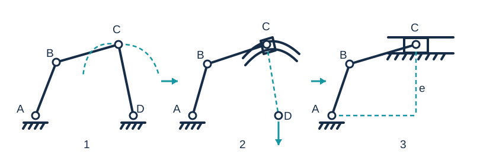

【参考答案图意】① 曲柄 AB 与连杆 BC 带动绕固定点 D 摆动的摇杆 CD；② 让 D 沿垂直于 C 附近运动方向的方向逐渐远离，C 的圆弧轨迹局部越来越平；③ D 趋向无穷远时，该局部轨迹趋于直线，C 处可用滑块与直线导路表示，摇杆的转动约束演化为滑块的移动约束。当导路不经过曲柄轴心 A 时，轴心到导路的垂直距离 e 为偏距。图为基于原答案的几何演化示意，② 的弧形轨道用于表示轨迹，不另计机构构件。

```{=latex}
\needspace{28\baselineskip}
```

28. 绘制图示凸轮机构的基圆、偏置圆、工作行程和推程过程的最大压力角。（4 分）【题图文字】偏置直动滚子从动件，滚子与偏心圆形凸轮接触，图示给定转向。下方题图依据原卷重绘；参考答案图中的色线和角度标注属于原参考答案，具体几何作图仍需自行核对。

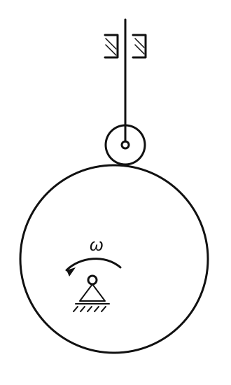

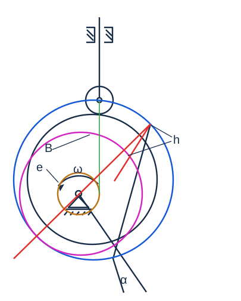

图中 B 指原答所标的基圆（紫色），e 指偏置圆（橙色），h 指原答标示的工作行程，α 指原答标示的最大压力角；蓝线、红线和绿色辅助线照原答的图示关系重绘，作图及角度位置尚待独立核对。

【整理补充｜怎样独立检查】令凸轮转轴为 O，实际圆形轮廓圆心为 C，偏心距为 $a=OC$，凸轮半径为 $R_c$，滚子半径为 $r$。以 O 为原点，把从动件竖直导路写成 $x=e$；取滚子位于圆心上方且始终接触的装配支路，并令 $R=R_c+r$。以下按理论轮廓定义基圆；若课程要求按实际轮廓定义，半径要另作区分。

1. 滚子中心相对凸轮的理论轮廓是以 C 为圆心、半径 R 的圆。若 $R>a$，以 O 为圆心、$R-a$ 为半径画理论基圆；以 O 为圆心、$|e|$ 为半径画偏置圆，导路与偏置圆相切。实际轮廓的基圆半径则为 $R_c-a$（要求 $R_c>a$）。
2. 凸轮转动时，沿导路比较滚子中心的最高位置与最低位置；两位置的竖直距离是工作行程 h。偏置时不要直接把 h 写成 2a，需按导路与圆的交点求出。
3. 公法线沿 C 与滚子中心的连线；它与导路方向的锐夹角为压力角，可为零。按题给转向在推程内找最大压力角，不能把回程最大值直接当作推程最大值。

【可计算的复核】设 $C=(a\cos\theta,a\sin\theta)$，滚子中心为 $(e,y)$，则所选上支路满足 $y=a\sin\theta+\sqrt{R^2-(e-a\cos\theta)^2}$，且 $\sin\alpha=|e-a\cos\theta|/R$。题图需满足根号有意义；以题给转向筛选 $y$ 增大的推程，再在该区间比较 α。原题没有标出 a、e、$R_c$ 和 r 的数值，本解法用于检查作图关系，不能由此给出唯一数值或宣称原答的最大角位置已经核实。

【整理补充｜用极限圆求行程】若 $R>a$ 且 $|e|<R-a$，整周均取导路上方接触支路。滚子中心距 O 的最大、最小值分别为 $R+a$、$R-a$；分别以它们为半径画圆，与导路的上方交点就是滚子中心的最高、最低位置。因此

$$y_{\max}=\sqrt{(R+a)^2-e^2},\quad y_{\min}=\sqrt{(R-a)^2-e^2},\quad h=y_{\max}-y_{\min}.$$

这给出可复查的作图步骤：先找 O 和 C，量出 $a$、$R_c$ 与 r，再画两个极限圆，沿同一导路量两交点间的距离。对心时 $e=0$ 才简化为 $h=2a$。例如自编 $a=2$ mm、$R=6$ mm、$e=1$ mm，得到 $h=\sqrt{63}-\sqrt{15}\approx4.06$ mm；此数值仅用于验证方法，不是原题尺寸。

【压力角候选位置】在上述非退化模型下，先由实际转向确定 $y$ 增大的推程区间；比较区间两端及区间内 $\theta=0,\pi$（若存在）的 $|e-a\cos\theta|$，即可找到压力角大小的最大候选值。$e-a\cos\theta=0$ 时压力角为零，不会形成正的最大值。极位的从动件速度为零，端点角度按推程内速度方向的极限定义；若题目对极位压力角有其他约定，应遵循题目约定。原答所画线条仍需结合原图比例及位置作独立核对。


29. 图示传动系统中 1、5 为蜗杆，2、6 为蜗轮，3、4 为斜圆柱齿轮，7、8 为直齿锥齿轮。已知蜗杆 1 为主动件，要求输出齿轮 8 的回转方向如图。求各轴转向，并考虑轴 I、II、III 的轴向力部分抵消，确定各轮螺旋线及轴向力方向。（10 分）【图示关系】1—2、3—4、5—6、7—8 依次啮合，2 和 3 同轴，4 和 5 同轴，6 和 7 同轴。下方题图依据原卷重绘，另附参考答案示意；原答案的旋向与全部力箭头尚未独立复核，不能将原答图视为已验证结论。

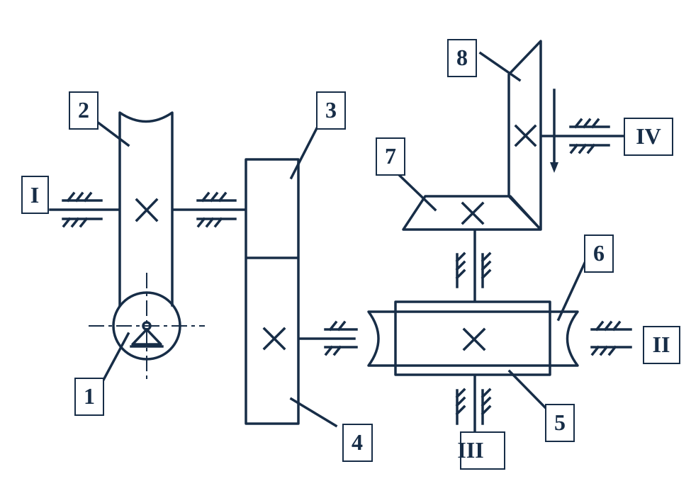

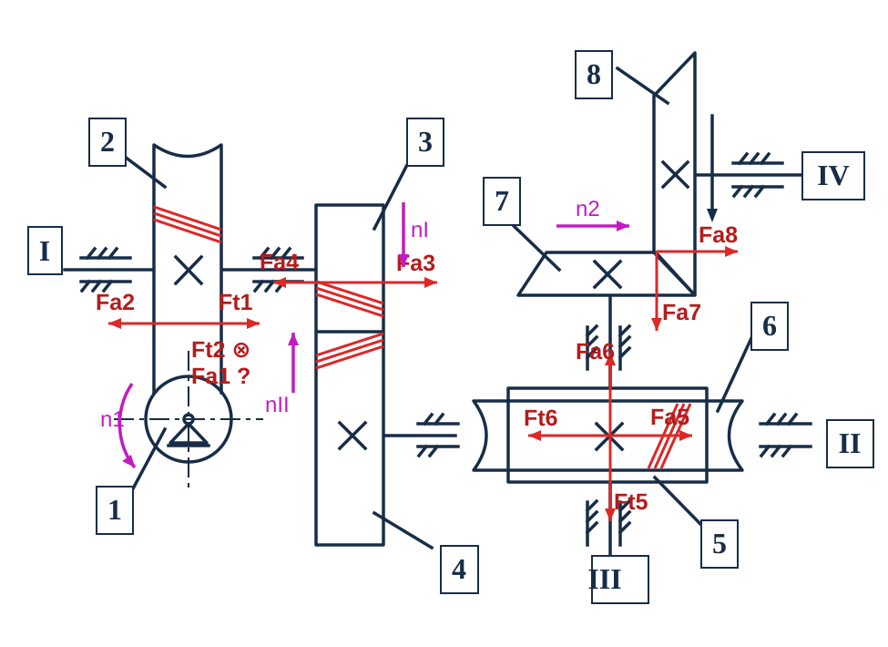

【原答标注转写】按原答案的画面方向，Fa2、Fa4、Ft6 向左，Ft1、Fa3、Fa5、Fa8 向右，Fa6 向上，Ft5、Fa7 向下；Ft2 处为叉号。原图 Fa1 符号与其他标记重叠，图中用问号表示，方向待核对。紫色箭头和红色斜线依原答示意，红线方向与答案正确性均未独立认证。

【原答转向标记】原答在蜗杆 1 左侧画向下的弧形箭头并标 $n_1$，从纸面正视为逆时针；齿轮 3 旁的箭头标 $n_{\mathrm I}$ 且向下，齿轮 4 旁的箭头标 $n_{\mathrm{II}}$ 且向上；齿轮 7 上方另有向右的箭头，原图写作 $n_2$。原图未说明最后一个下标的含义，且箭头位于齿轮 7、轴 III 附近，暂按原样保留，不擅自改成其他下标。图中的直箭头按原图位置读作转向示意，不直接理解为该轴沿箭头方向平移；这些转向及其空间视角仍需逐级核实。

【整理补充｜逐对检查】在原图画面坐标中，轴 I 上 $F_{a2}$ 向左、$F_{a3}$ 向右；轴 II 上 $F_{a4}$ 向左、$F_{a5}$ 向右；轴 III 上 $F_{a6}$ 向上、$F_{a7}$ 向下。这三组方向符合题目“部分抵消”的要求，但能抵消多少还需各自的力大小。

对直交蜗杆副 1—2，原答中 $F_{t1}$ 向右、$F_{a2}$ 向左，构成一对反向分力；$F_{t2}$ 标为叉号（指向纸内），按接触力作用与反作用，蜗杆 1 对应的轴向分力 $F_{a1}$ 应指向纸外。原图该处标记重叠，纸外方向是根据这对力推得，并非宣称已看清原标记。对 5—6，原答中 $F_{a5}$ 向右对应 $F_{t6}$ 向左，$F_{t5}$ 向下对应 $F_{a6}$ 向上；对斜齿轮 3—4，$F_{a3}$ 和 $F_{a4}$ 方向相反。以上检验了力对和同轴抵消关系，还不能单独证明全部转向、旋向与题给输出方向一致，应继续逐级按题图验证。

30. 图示机构 DE=FG=HI，且互相平行；DF=EG，且互相平行；DH=EI，且互相平行。计算自由度，并标出局部自由度、复合铰链、虚约束。（5 分）【图示关系】1 为绕 A 转动的凸轮，滚子 B 同时与构件 2、3 相接；2 在 C 与机架连接，3 经 D、构件 4 至 E；构件 5、7 分别绕 H、I 与机架连接，FG 为构件 6，E 经构件 8、滑块 9 至水平移动副 K。【参考答案】B 处滚子自转为局部自由度；D、E 为复合铰链；FG 处存在虚约束。去除局部自由度和虚约束后 n=8、低副 11、高副 1，F=3×8−2×11−1=1。判定前须保留原图给出的平行及等长条件。

【第30题机构运动简图：依据 S2 第6页重绘；参考答案文字转写自第12页】

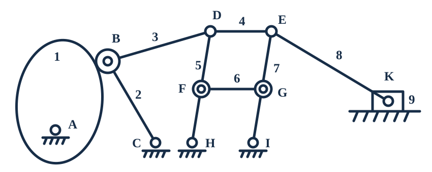

【整理补充｜逐项计数】按题图所示连接、给定平行等长条件，以及凸轮与从动件保持理想接触来计算：

1. B 处滚子自转不改变其中心或其余构件的运动，作为局部自由度处理；去掉滚子自转后，将凸轮与从动件在 B 处的接触记为一个高副。
2. DE、HI 等长且平行，DH、EI 等长且平行；F、G 分别位于图示两侧构件上，FG 与 DE 等长且平行。按这组理想几何条件，FG 对相应平行四边形的运动约束重复，计自由度时可把构件 6 及其 F、G 两个铰接一并移除；实际制造误差或改变几何条件后，不能不加检查地仍将它视为虚约束。
3. 剩余活动构件为 1、2、3、4、5、7、8、9，共 $n=8$。低副按位置逐个数：A、B、C 各 1 个，D 处构件 3、4、5 共 2 个，E 处构件 4、7、8 共 2 个，H、I 各 1 个，K 处铰链 1 个、滑块与机架移动副 1 个，合计 $P_L=11$；B 处凸轮接触另计 $P_H=1$。
4. 代入平面机构公式 $F=3n-2P_L-P_H=24-22-1=1$，与原参考答案相同。这里的结果依赖图示铰接及上述理想条件，不保证实际机构始终不失去接触，也不替代输入运动与干涉检查。


```{=latex}
\par
```

```{=latex}
\needspace{30\baselineskip}
```

31. 图示轮系中 z₁=30、z₂=30、z₃=90、z₄=30、z₁′=20、z₃′=40、z₄′=30、z₅=15，求轴 I 与轴 II 的传动比。（7 分）【参考答案】转化轮系 (n₁−nᴴ)/(n₃−nᴴ)=−z₃/z₁=−3；定轴部分 n₄/n₁′=z₁′/z₄=2/3，n₄/n₃′=−z₃′/z₄′=−4/3。同轴连接 n₁′=n₁、n₃′=n₃，所以 n₁=3n₄/2、n₃=−3n₄/4。代入转化公式解得 n₄/nᴴ=−16/3≈−5.33。

【整理说明】轮 5 是定轴部分的中间轮；两次外啮合的齿数比相乘时 z₅ 消去，因而得到 n₄/n₁′=z₁′/z₄。轮 4 与 4′ 同轴，故 n₄=n₄′；轮 1 与 1′、轮 3 与 3′ 的同轴转速也分别相等。把 n₁=3n₄/2 和 n₃=−3n₄/4 代入相对转速式，得 (3n₄/2−nᴴ)/(−3n₄/4−nᴴ)=−3，整理为 −3n₄/4=4nᴴ，因此 n₄/nᴴ=−16/3。齿数、原答公式与该代数步骤已对照 S2 第 6、12 页；此题号的 4 分式下标在印刷图中较小，连接关系仍可回查原卷。

【第31题轮系题图：依据 S2 第6页重绘；连接关系结合原卷及答案页核对】

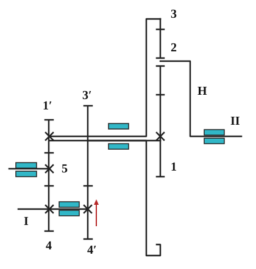


32. 凸缘联轴器用 8 个螺栓连接，螺栓中心圆直径 D=195 mm，传递转矩 T=1.1 kN·m，接合面摩擦系数 f=0.15，可靠性系数 S=1.2，求螺栓直径。（6 分）【参考答案】每个螺栓切向载荷 F=2T/(8D)≈1.41 kN；单接合面预紧力 F₀=SF/f≈11.28 kN。选性能等级 5.6，参考解答取 [σ]=99 MPa，以 1.3F₀ 的简化等效拉应力算得螺纹小径 d₁≥13.74 mm。原答初选直径 16 mm，并未展示螺纹小径表校核；最终公称规格须查标准表确认。

【第 32 题计算过程】按原答案模型：8 个螺栓均匀分布并等分转矩，只有 1 个有效摩擦接合面，且预紧后通过接合面摩擦防滑。

1. 统一单位：$T=1.1\times10^6$ N·mm，中心圆半径 $D/2=97.5$ mm。由 $8F(D/2)=T$，得每个螺栓分担的切向载荷 $F=2T/(8D)\approx1410.3$ N。
2. 按防滑要求 $fF_0\geq SF$，得单个螺栓预紧力 $F_0\geq1.2\times1410.3/0.15\approx11282$ N。若有多个有效接合面或载荷分配不均，须改用对应模型。
3. 按原答案采用的拉扭简化校核，$1.3F_0/(\pi d_1^2/4)\leq99$ MPa。用 $1$ MPa $=1$ N/mm²，得 $d_1\geq\sqrt{4\times1.3\times11282/(\pi\times99)}\approx13.73$ mm。原答案取 13.74 mm，差异来自中间数值与圆周率取近似；其代入式将 11.28 以 kN 写出而未写出换算因子，复算时必须乘 1000 转成 N。
4. 该值是按此简化模型要求的螺纹危险截面小径下限，不是公称直径。原答案初选 16 mm 后没有展示小径及材料许用值的标准表核查，因此不能仅凭“大于 13.73 mm”断言该公称规格满足要求。

```{=latex}
\par
```

33. 某工程机械轴使用一对角接触球轴承。题干写暂定型号 70208AC，后又给出 7208AC 的额定动载荷 Cᵣ=35200 N；Fᵣ₁=1000 N、Fᵣ₂=2060 N、Fₐ=880 N，n=5000 r/min，中等冲击，预计寿命 2000 h，接触角 25°。问型号是否恰当。（9 分）【参考答案】内部轴向力分别 680 N、约 1400 N；由图示方向得 Fₐ₁=2280 N、Fₐ₂≈1400 N。由题附表 e=0.68，轴承 1 的 X=0.41、Y=0.87，轴承 2 的 X=1、Y=0；P₁≈2394 N，P₂=2060 N。取冲击系数 1.5、温度系数 1，所需基本额定动载荷约 30290 N，小于 35200 N，按题给数据满足要求。【审校】原题型号前后不一致；答案页中 1440/2060 和 P₂=Fᵣ₁ 是笔误，其前后计算应分别对应约 1400/2060 和 P₂=Fᵣ₂。型号需核实，不能据此确定实际采购型号。

【按参考答案的受力假设展开】以下只核算原答案所采用的方向、内部轴向力关系及系数；由于题图 $F_A$ 箭头与中心线重叠，尚不能把该假设当成已经独立确认的安装方向。

1. 原答案取内部轴向力 $S_1=0.68F_{r1}=680$ N、$S_2=0.68F_{r2}=1400.8$ N。按其分支，$S_2+F_A>S_1$，得 $F_{a1}=S_2+F_A=2280.8$ N，$F_{a2}=S_2=1400.8$ N；原答将后者中间结果约写为 1400 N。
2. 查题附 25° 行，$e=0.68$。轴承 1 的 $F_{a1}/F_{r1}=2.2808>e$，用 $X=0.41$、$Y=0.87$，得 $P_1=0.41\times1000+0.87\times2280.8\approx2394.3$ N。轴承 2 的 $F_{a2}/F_{r2}=0.68=e$，按表中“小于或等于”列取 $X=1$、$Y=0$，得 $P_2=2060$ N。此处保留 1400.8 N 至比较完成，避免因过早取整改变分支。
3. 球轴承寿命指数取 3，按参考答案的载荷系数 $f_p=1.5$、温度系数 $f_t=1$，两轴承所需动载荷分别为 $C_{req,i}=f_pP_i(60nL_h/10^6)^{1/3}/f_t$。题给 $n=5000$ r/min、$L_h=2000$ h，立方根因子约 8.434，故 $C_{req,1}\approx30.29$ kN、$C_{req,2}\approx26.06$ kN。两者都小于题给 35.2 kN，因此在上述假设及题给额定值下满足寿命要求。

原答案把轴承 2 的比值分子写成 1440 N，且后续把 $P_2$ 写成 $F_{r1}$，与其实际代数和计算值不一致；本解按 1400.8 N 及 $F_{r2}$ 核算。0.68 的内部力系数、冲击系数和给定额定值均采用该题参考答案及附表，实际型号与系数须查相应资料。

【第33题轴承原图轮廓】依据 S2 第 7 页题图轮廓描摹，保留轴承剖面及原有标记；细线与轴向力方向仍须回查原卷。

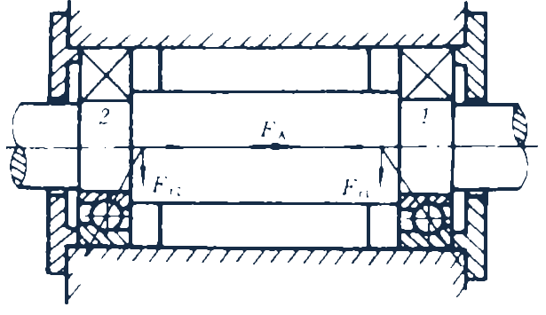

【第33题载荷示意：依据 S2 第7页重绘，仅保留轴承编号和力线；原轴承剖面及型号差异见原卷和题解】

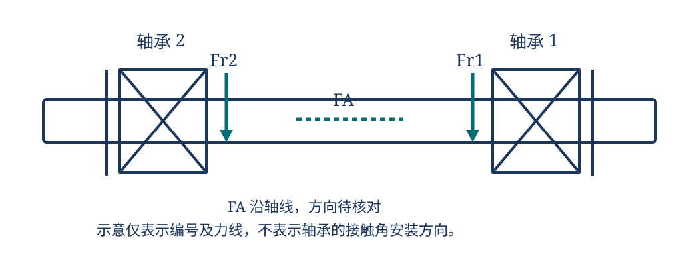

图中轴向力 FA 与原图中心线重叠，方向尚不能从本次材料中可靠辨认；本示意不画方向箭头。原始剖面及方向请回查 [S2 原卷第 7 页](原始资料/1794932044764-4.pdf)。


```{=latex}
\needspace{24\baselineskip}
```

34. 指出图示轴结构中不合理、不完善之处或提出改进意见。（10 分）

【题图】依据 S2 第 9 页线条描摹，供定位；完整原卷可回查原始资料。

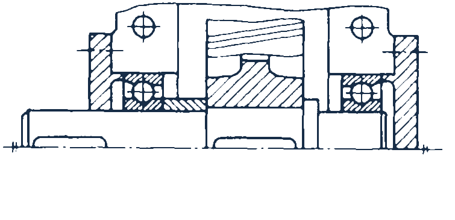

【原参考答案】以下按 S2 第 14 页的编号转写；图中编号位置为整理示意，装配适用性仍须结合具体条件判断。

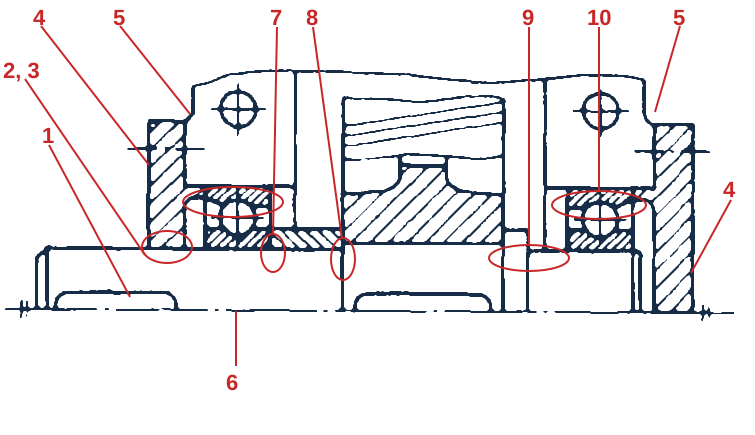

1. 键或键槽过长。
2. 轴与轴承端盖之间应留间隙。
3. 轴与轴承端盖之间应设置密封装置。
4. 轴承端盖精加工面过大。
5. 轴承端盖与支座之间应添加调整垫片。
6. 精加工轴段过长，且缺少轴肩以固定左侧待安装的联轴器或其他零件。
7. 套筒厚度应小于轴承内圈厚度。
8. 轴段长度应略小于轮毂宽度，否则无法有效固定齿轮。
9. 缺少用于固定轴承内圈的套筒。
10. 原答案写“角接触球轴承应正装”；其适用性须结合轴向载荷及整套支承布置判断。

第 7、10 项保留原答案表述，是否适用于其他轴系不由此推定。


【整理补充｜按图从左到右检查】下表解释原答案想检查什么；具体尺寸、装配顺序和接触面须按零件图及轴承型号确认。

| 原答编号 | 检查位置 | 为什么要检查、怎样处理 |
| --- | --- | --- |
| 1、6 | 左侧伸出轴段与键槽 | 键长应与待装轮毂的有效长度匹配，避免伸出后干涉静止件；按待装件定位方式设置轴肩或其他可靠定位，同时避免无必要的长精加工面。题图未给待装件尺寸，不能直接给键长。 |
| 2、3 | 左侧透盖与转轴之间 | 静止端盖与转轴需要运行间隙；根据油脂或润滑油、速度和环境选密封。密封结构不能按一种形式套用。 |
| 4、5 | 两端端盖与箱体接合处 | 非必要的大面积精加工会增加加工量，但必须保留定位、密封和紧固所需的接触面；如果该支承方案用垫片调游隙，则为垫片及调节量留位置。 |
| 7 | 左侧套筒与轴承内圈相接处 | 套筒端面应可靠支承内圈，并避免碰到滚动体、保持架或外圈，同时留拆卸空间。原答“套筒厚度小于轴承内圈厚度”未标出测量方向与尺寸，不据此拟定通用不等式，具体按轴承倒角、挡肩和接触尺寸查图纸。 |
| 8 | 齿轮轮毂与轴肩、套筒的接触处 | 沿轴向比较轮毂宽度和安装轴段：留出合适的突出量，夹紧件才能压到轮毂端面；同时检查右侧定位及转矩传递。 |
| 9 | 右侧轴承内圈与相邻零件之间 | 确定内圈所需的轴向定位后，可用尺寸合适的套筒等结构补足支承；避免与外圈、保持架干涉，并考虑拆卸。 |
| 10 | 两侧角接触球轴承 | 根据轴向力方向、受力中心、刚度、游隙和热伸长选择成对布置；原答仅写“正装”，缺少完整载荷和安装条件，不能据此认定所有支承都应采用同一方向。 |


### 第 33 题附表（S2 第 8 页）

题附完整表的可辨认数值如下：R 表示 12.3Fa/C₀r；“大比值”指 Fa/Fr>e，“小比值”指 Fa/Fr≤e。表中的数值照原图记录；省略号表示原表省略，不能当作完整设计数据。

| 类型 | R | e | 大比值 X | 大比值 Y | 小比值 X、Y |
| --- | --- | --- | --- | --- | --- |
| 深沟球 | 0.172 | 0.19 | 0.56 | 2.30 | 1，0 |
| 深沟球 | 0.345 | 0.22 | 0.56 | 1.99 | 1，0 |
| 深沟球 | 0.689 | 0.26 | 0.56 | 1.71 | 1，0 |
| 深沟球 | 1.03 | 0.28 | 0.56 | 1.55 | 1，0 |
| 深沟球 | 1.38 | 0.30 | 0.56 | 1.45 | 1，0 |
| 角接触15° | 0.178 | 0.38 | 0.44 | 1.47 | 1，0 |
| 角接触15° | 0.357 | 0.40 | 0.44 | 1.40 | 1，0 |
| 角接触15° | 0.714 | 0.23（存疑） | 0.44 | 1.30 | 1，0 |
| 角接触15° | 1.07 | 0.46 | 0.44 | 1.23 | 1，0 |
| 角接触15° | 1.43 | 0.47 | 0.44 | 1.19 | 1，0 |
| 角接触25° | — | 0.68 | 0.41 | 0.87 | 1，0 |
| 角接触40° | — | 1.14 | 0.35 | 0.57 | 1，0 |
| 圆锥滚子 | — | 1.5 tan α | 0.40 | 0.4 cot α | 1，0 |
| 双列调心球 | — | 1.5 tan α | 0.65 | 0.65 cot α | 1，0 |

【注意】资料 2 第 8 页的 α=15° 行中，12.3Fa/C₀r=0.714 对应 e 印为 0.23，与前后数据的变化趋势不一致；本次试题使用 25° 行，不依靠该存疑值。不能据此自行修改原表或用于设计，应查课程给定手册。

### 原卷核对说明

S2 为《机械设计基础》2019—2020 学年第 1 学期 A 卷与所附参考答案；题卷在原件第 1—9 页，参考答案在第 10—14 页。题 28、29 作图及力箭头未独立验证；题 31 可回查原卷中较小的轮号及连接；题 33 型号不一致且轴向力方向未能可靠辨认；题 34 的轮廓和标注仅作定位示意。原件保存在本课程“原始资料”目录，完整核对状态见整理记录。


## 机构基础辨析题（来源 B091-01）

### 例题 1｜机器与机构（第 5 页；对应 C-3401）

机器与机构的本质区别是什么？

A. 各构件间能否产生相对运动；B. 是否由许多构件组合而成；C. 是否能完成有用的机械功或转换机械能；D. 两者没有区别。

【参考答案】C。两者都可由构件组成，也可有构件间相对运动；机器还以完成有用机械功或能量转换为功能。原资料同时说明，研究运动与动力关系时，两者可用相同的机构分析方法，统称为机械；这不改变题目所问的功能区别。

### 例题 2｜机械的范围（第 5 页；对应 C-3401）

判断：机械是机器和机构的总称。

【参考答案】正确。

### 例题 3｜制造单元与运动单元（第 6 页；对应 C-3401）

填空：机器最小的制造单元是______，最小的运动单元是______。

【参考答案】零件；构件。一个构件可以由一个零件构成，也可以由多个没有相对运动的零件组成。

## 速度瞬心练习（来源 B091-01）

### 1．识别瞬心（原资料例题 4，第 7 页；对应 K-3555）

填空：两构件组成移动副时，其速度瞬心在______；两构件组成旋转副时，其瞬心在______；两构件形成高副且做纯滚动时，其瞬心在______；作相对运动的三个构件的三个瞬心______。

【原资料答案】垂直于移动副导轨的无穷远处；旋转副的圆心处；高副的接触点处；在同一条直线上。

【解】移动副的瞬心位于垂直相对移动方向的无穷远处，转动副的瞬心为共同铰心；纯滚动时接触点的相对速度为零。若接触点存在滑动，不能直接把接触点当作瞬心。

### 2．曲柄滑块的六个瞬心（对应 K-3555；原资料第 8 页）

图中 1 为曲柄，2 为连杆，3 为沿水平导路运动的滑块，4 为机架。求两两构件间的全部速度瞬心。

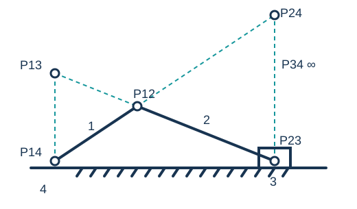

【解】四个构件共有 4×3/2=6 个瞬心。P12、P23、P14 是图中直接相连的转动副中心；P34 在垂直导路方向的无穷远处。P13 为经过 P14 且垂直导路的直线与 P12P23 的交点；P24 为 P14P12 的延长线与经过 P23 且垂直导路的直线的交点。特殊构形下应考虑交点在无穷远或重合。


```{=latex}
\needspace{30\baselineskip}
```

## 自由度综合题（来源 B091-01）

### 例题 6｜滚子、重复导轨和复合铰链（第 11 页；对应 C-3402、K-3451、K-3514）

计算下图平面机构的有效自由度。图中 F 为滚子，E 和 E′ 为同一滑杆的两处导向，C 为三杆共同铰接处。机构图按原资料重绘，几何尺寸仅作示意。

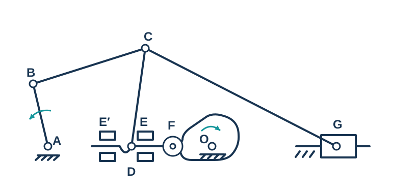

【参考答案与整理说明】

1. F 处滚子的自转不影响杆的整体运动，作为局部自由度处理：将滚子与相连滑杆在计数模型中合并，并去掉它们之间的转动副；凸轮与滚子的接触仍计作高副。
2. E 与 E′ 对同一根滑杆提供同方向导向。在原图所示理想共线导向条件下，其中一处是重复约束，只按一个独立移动副计数。
3. C 处连杆、竖杆和右侧杆三构件共同铰接，按两个转动副计数。
4. 处理后的活动构件数 n=7。低副共 9 个：A、B 各 1 个转动副；C 处 2 个转动副；D、O、G 各 1 个转动副；导向 E/E′ 算 1 个移动副，G 处滑块与机架算 1 个移动副。凸轮与滚子形成 1 个高副，即 PL=9、PH=1。
5. 代入 F=3n−2PL−PH=3×7−2×9−1=2。结果与原参考答案一致；若要进一步判断运动是否确定，还须核查独立输入运动的数量及其相容性。

【来源与边界】题干和原答依据 B091-01 第 11 页；两处导轨能否视为重复约束依赖原题的理想几何条件，不能只因为图中出现两个导向符号就一概删去。


```{=latex}
\needspace{28\baselineskip}
```

### 例题 7｜两滚子和平行杆的约束（第 12—13 页；对应 C-3402、K-3514）

判断图示平面机构的运动是否确定。原资料可辨认的条件为杆 CD、EF、GK 平行，后续文字被图框遮挡；原答按存在重复约束处理。下图依据可辨连接关系重绘为拓扑示意，轮廓和接触位置不按尺寸绘制；原图未清晰展示的末端关系须回查 B091-01 第 12—13 页。

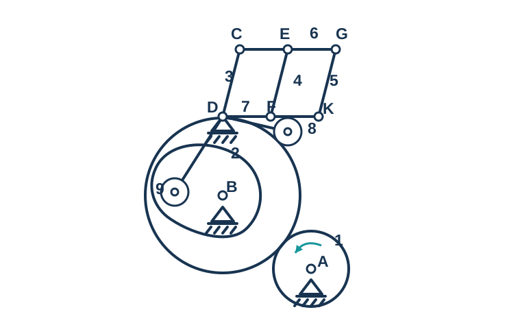

【原参考答案与整理说明】

1. 滚子 8、9 各有一个不影响机构其他部分运动的自转自由度。计有效自由度时，分别把滚子与相连杆件在计数模型中合并，同时保留相应的高副接触。
2. 原参考答案将杆 4 或杆 5 中的一根视作重复约束，去掉其中一根。这个处理依赖原题的几何关系；仅知三杆平行不足以证明该约束必然重复，被遮挡条件需回查原页。
3. D 处为复合铰链，按两个转动副计数。按原答处理后 n=6、PL=7、PH=3，因此 F=3×6−2×7−3=1。
4. 原答按一个原动件判断机构运动确定。该结论还依赖驱动与约束独立、输入相容及图示构形成立。

【核对提示】原资料第 12、13 页的局部被右上方图框遮挡；本题保留原答数值和图示能辨认的信息，尚不能独立确认全部连接、被遮挡条件及高副计数。

```{=latex}
\needspace{22\baselineskip}
```

## 平面连杆机构练习（来源 B091-02）

### 例题 1—2｜四杆机构分类（B091-02 第 13 页；对应 K-3410、K-3516）

**原题 1（填空）** 在曲柄摇杆机构中，如果将最短杆作为机架，则与机架相连的两杆都可以作整周回转运动，即得到（　　　　）。

**原题 2（判断）** 铰链四杆机构根据各杆的长度，即可判断其类型。

【原答】1. 双曲柄机构；2. 错。

【整理说明】在满足杆长条件且采用相应固定杆的理想铰链四杆模型中，固定最短杆得到双曲柄；仅有杆长还不够，必须看哪一杆固定。杆长等号及共线位置可能带来退化与分支问题，实际运动要另行检查。

### 例题 3—4｜急回和极位夹角（B091-02 第 14 页；对应 K-3436、K-3516）

**原题 3（填空）** 对心曲柄滑块机构：其极位夹角（　　　　），则 $K=1$，滑块在正反行程中平均速度相等，机构（　　　　）急回运动特性。偏置曲柄滑块机构：其极位夹角（　　　　），故 $K>1$，故其回程速度（　　　　）工作行程速度，机构（　　　　）急回运动特性。

**原题 4（判断）** 极位夹角就是从动件在两个极限位置的夹角。

【原答】3. $\theta=0$；没有；$\theta>0$；大于；具有。4. 错。

【整理说明】极位夹角是对应从动件两个极位时主动曲柄位置之间的相应夹角，不是摇杆摆角。匀速曲柄下 $K=(180^\circ+\theta)/(180^\circ-\theta)$ 表示较慢行程时间与较快行程时间之比；题 3 原答的“回程速度大于工作行程速度”是该题采用的工作与回程命名，实际哪一行程是工作或回程需按具体工艺指定。偏置例以能正常整转并形成不同极位角的机构为前提。

### 例题 5—7｜压力角、传动角与死点（B091-02 第 15—16 页；对应 K-3516、K-3556）

**原题 5（填空）** 机构的压力角是指不考虑摩擦的情况下，$\underline{\qquad\qquad}$；压力角的余角为 $\underline{\qquad}$，传动角越大，机构传力性能越好。在曲柄摇杆机构中，$\underline{\qquad}$ 与 $\underline{\qquad}$ 两次共线位置时可能出现最小传动角。

**原题 6（填空）** 曲柄摇杆机构有死点位置时，（　　　　）是主动件，此时（　　　　）与（　　　　）共线。

**原题 7（填空）** 机构处于死点位置时，传动角等于____，压力角等于____。

【原答】5. 输出构件受力方向与速度方向所夹的锐角；传动角；曲柄；机架。6. 摇杆；连杆；从动曲柄。7. $0^\circ$；$90^\circ$。

【整理说明】这些角度按课件所用的无摩擦理想模型定义；曲柄与机架两个共线位置需分别比较。图示理想曲柄滑块可比较曲柄垂直导路的两个位置；理想无摩擦导杆机构的压力角为 0°、传动角为 90°。死点判断取决于谁主动：课件例中摇杆主动、曲柄从动时，连杆与从动曲柄共线形成死点，不能把任意共线位置都当作相同输入条件下的死点。

### 例题 8｜急回特性的工程意义（B091-02 第 17 页；对应 K-3516、K-3556）

举例说明急回特性在生产中的意义。

【参考答案与说明】原资料以牛头刨床为例：较慢的工作行程用于切削，较快的非工作行程可缩短空程。原资料又以颚式破碎机为例，称较快的工作行程有助于击碎矿石，较慢的回程有助于碎料落下。应先区分具体工况和工作方向，不能只记“快行程一定是回程”。

```{=latex}
\needspace{8\baselineskip}
```

### 例题 9｜克服和利用死点（B091-02 第 18 页；对应 K-3516、K-3556）

举例说明，工程中如何克服机构死点、如何利用死点。

【参考答案与说明】可以利用飞轮储存的动能帮助机构通过死点，或将多组机构的死点错开；原资料举缝纫机、内燃机等例子。夹具或起落架撑杆可利用接近共线或越过中心的布置配合止挡与锁定。锁定可靠性仍由具体结构、载荷和锁止装置决定。

### 例题 10｜按杆长分类（第 19—23 页；对应 C-3404、K-3410）

铰链四杆机构中，杆 2、杆 3、杆 4 的长度依次为 50 mm、35 mm、30 mm，杆 4 为机架。若要求机构分别为曲柄摇杆机构（杆 1 为曲柄）和双曲柄机构（杆 1、3 为曲柄），求杆 1 的长度范围。图只表示杆件连接和编号，不按尺寸绘制。

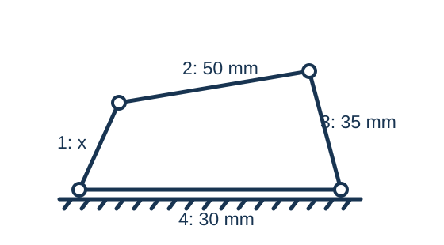

【原参考答案】设杆 1 长度为 x mm。曲柄摇杆情形原答为 x≤15；双曲柄情形原答为 45≤x≤55。

【整理说明】杆长为正，且要组成非退化的闭链。按原资料采用“最短杆＋最长杆≤其余两杆之和”的分类规则：

1. **杆 1 为曲柄。** 取杆 1 为最短杆，且它与机架相邻。此时杆 2 最长，由 x+50≤35+30 得 x≤15；结合正长度得到 0<x≤15。
2. **双曲柄。** 机架 4 为最短杆。若 30≤x≤35，则 30+50≤35+x 要求 x≥45，与该区间矛盾；若 35≤x≤50，则同一不等式给出 45≤x≤50；若 x≥50，则 30+x≤35+50 给出 50≤x≤55。合并得到 45≤x≤55。
3. **端点检查。** x=15、45 或 55 时，最短杆与最长杆之和等于其余两杆之和，存在所有杆共线的变位位置。若题目要求全过程避开该退化位置，须另加严格不等式并结合装配支路与运动要求判断；不能仅凭原答中的等号保证实际机构可无障碍越过该位置。

原资料的长度范围与本次不等式推导一致；端点的运动边界为整理补充。B091-02 的源文件在部分页面解析时提示引用对象缺失，当前已对照第 19—23 页可见内容，但不据此断言所有图层完整。

### 例题 11｜由摆角和行程速比设计（B091-02 第 24 页；对应 K-3516）

已知摇杆 CD 的长度、摆角 ψ 和曲柄匀速转动时的行程速比系数 K，试设计一个曲柄摇杆机构。

【原答思路与整理说明】先根据 CD 和 ψ 画出 C 的两个极位 C1、C2。由 θ=180°(K−1)/(K+1) 求极位夹角，再以 C1C2 为弦构造满足 ∠C1AC2=θ 的辅助圆弧。选取合适 A 后，将 AC1、AC2 中较大、较小的长度分别记为 Lmax 和 Lmin：曲柄长为 (Lmax−Lmin)/2，连杆长为 (Lmax＋Lmin)/2。最后回验曲柄整转、极位、运动方向及装配支路。

原页使用 90°−θ 构造辅助圆的底角，该图法直接适用于 0<θ<90°；其他角度及 K=1 的共线情形见讲义。若所选 A 到两极位等距，则算得曲柄长为零，应换点。

【自编坐标自检】取 K=1.4，则 θ=30°。令 C1=(−1,0)、C2=(1,0)、D=(0,−1)，可得 CD=$\sqrt{2}$、摇杆两极位夹角 90°。选择 A=(1,2$\sqrt{3}$)，测得 AC1=4、AC2=2$\sqrt{3}$，且 ∠C1AC2=30°；于是 AB=2−$\sqrt{3}$、BC=2＋$\sqrt{3}$。这里 A 是辅助圆上的一个非退化候选点，实际应用仍须回验运动分支和结构。

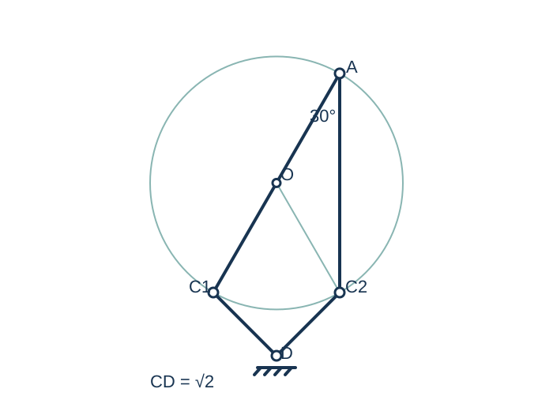


### 例题 12｜三个连杆位置反求轴心（B091-02 第 25 页；对应 K-3556）

铰链四杆机构中，已知连杆上 B、C 两点各自的三个对应位置，求固定铰链 A、D。说明何时不能得到有限唯一的轴心。

【解】分别作 B1B2、B2B3 的中垂线，交点为 A；再作 C1C2、C2C3 的中垂线，交点为 D。两组点各自必须确定唯一圆心；若三个不同点共线，就没有有限圆心。还须检验三组 B、C 的距离是否相同以及机构能否在同一装配支路到达这些位置。

【自编坐标自检】B1=(0,1)、B2=(0.6,0.8)、B3=(−0.6,0.8)；C1=(2,1)、C2=(2.6,0.8)、C3=(1.4,0.8)，长度单位一致。三组 BC 长度均为 2；分别作中垂线可得 A=(0,0)、D=(2,0)，且 AB 与 DC 均为 1。下图展示所得三个对应位置，并非唯一设计方案。

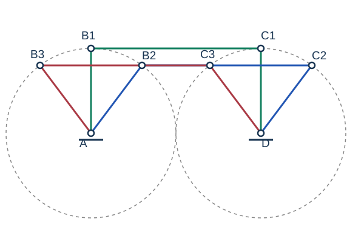


```{=latex}
\needspace{22\baselineskip}
```

## 凸轮机构练习（来源 B091-03）

### 例题 1—2｜轮廓与运动规律（B091-03 第 14 页；对应 K-3418、K-3424）

**原题 1（填空）** 凸轮的形状是由____和____决定的。

**原题 2（填空）** 在凸轮机构推杆的四种常用运动规律中，（　　）有刚性冲击；（　　）、（　　）有柔性冲击；（　　）无冲击。

【原答】1. 从动件运动规律和基圆半径。2. 等速运动规律；等加速等减速运动规律、余弦加速度运动规律；正弦加速度运动规律。

【整理说明】1：还须明确从动件形式、导路、偏距及滚子半径等几何条件，不能只凭两个量确定任意机构轮廓。2：按与休止段的常见连接条件，等速规律有刚性冲击，等加速等减速和余弦加速度规律有柔性冲击，正弦加速度规律无上述两类冲击；实际还要检查接头和工况。原课件第 14 页表格局部文字重叠，以上依据题目及可辨解析整理。

### 例题 3—4｜凸轮机构的特点（B091-03 第 15 页；对应 K-3424）

**原题 3（选择）** 与平面连杆机构相比，凸轮机构的突出优点是：  
A. 能严格实现给定的从动件运动规律　B. 能实现间歇运动　C. 能实现多种运动形式的变换　D. 传力性能好。

**原题 4（选择）** 与连杆机构相比，凸轮机构的最大缺点是：  
A. 惯性力难以平衡　B. 点、线接触，易磨损　C. 设计较为复杂　D. 不能实现间歇运动。

【原答】3. A；4. B。

【整理说明】3：按理想几何模型可通过设计轮廓实现给定的可行运动规律；B、C 也可由其他机构实现。4：点、线接触使局部接触应力较高，实际寿命还取决于材料、润滑和载荷。

```{=latex}
\needspace{15\baselineskip}
```

### 例题 5—7｜基圆与压力角（B091-03 第 16—17 页；对应 K-3418、K-3424）

**原题 5（填空）** 凸轮机构的基圆半径是指____做的圆。

**原题 6（填空）** 增加基圆半径可____凸轮机构的压力角。

**原题 7（简答）** 在设计对心凸轮机构时，当出现 $\alpha\ge[\alpha]$，在不改变运动规律的前提下，可以采取哪些措施改进？

【原答】5. 以理论轮廓线的最小向径为半径；6. 减小；7. 加大基圆半径、将对心改为偏置、采用平底从动件。

【整理说明】5：原题把“基圆半径”与“所作的圆”混在一句中；以凸轮转动中心为圆心、理论轮廓最小向径为半径所作的是基圆，该最小向径才是半径。6：在讲义所列直动模型及其他条件不变时，增大基圆通常减小压力角，但尺寸增大。7：改为偏置或平底从动件会改变几何或接触形式，应分别检查推程、回程、曲率、接触和装配，不能保证任意改动都满足要求。

```{=latex}
\needspace{22\baselineskip}
```

### 例题 8｜偏心圆凸轮的理论轮廓与行程（第 18 页；对应 K-3418、K-3424）

对心直动滚子从动件盘形凸轮机构中，凸轮的实际轮廓为圆心 A、半径 R=40 mm 的圆，转动中心 O 到 A 的距离 OA=15 mm，滚子半径为 10 mm，凸轮逆时针转动。画理论轮廓，求理论基圆半径和从动件行程，并画出该位置的压力角。下图按题意重绘并选取一个示意角度；已知数值本身不能唯一确定图示位置的压力角数值。

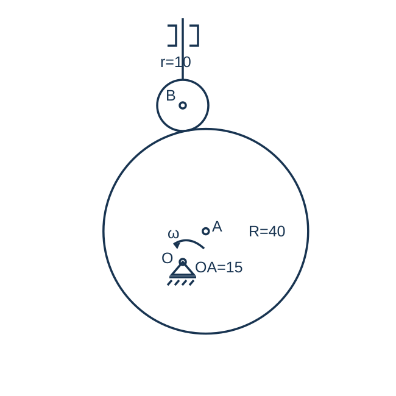

【参考答案与整理说明】

1. 理论轮廓是滚子中心相对凸轮描出的轨迹；对于该外接滚子与圆形实际轮廓，理论轮廓也是以 A 为圆心的圆，半径为 40+10=50 mm。
2. 理论基圆以 O 为圆心，半径为理论轮廓的最小向径。此题 OA=15 mm 小于理论圆半径，所以 $r_b$=50−15=35 mm。
3. 从动件对心直动，滚子中心到 O 的最小和最大距离分别为 35 mm、65 mm；行程 h=65−35=30 mm。
4. 在所画位置，连接 A 与滚子中心 B，这是圆形轮廓的接触公法线；它与从动件导路方向所夹的锐角就是压力角 α。要计算 α 的具体数值，还需知道当时的角位置。

```{=latex}
\needspace{25\baselineskip}
```

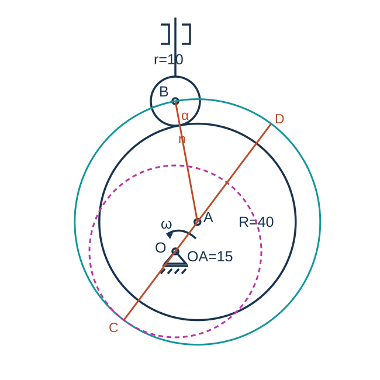

解图中青色为理论轮廓，紫色为理论基圆，C、D 标出相对 O 的最小、最大向径位置。图中接触法线和位置只为说明画法，不代表原卷另行给出角度。

```{=latex}
\needspace{22\baselineskip}
```

### 例题 9｜偏置滚子凸轮作图（B091-03 第 19 页；对应 K-3418）

图示为偏置直动滚子从动件的圆形凸轮，凸轮逆时针转动。画出偏距圆、理论轮廓、理论基圆、当前位置从动件位移 s，以及凸轮从当前位置转过 90° 后的位移 s′ 和该位置压力角；再确定行程 h。下图依据原题的连接关系作示意，尺寸与角位置不是原卷给定的数值。

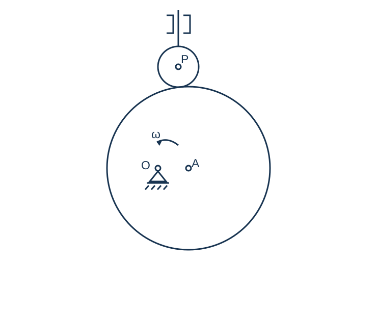

【原答案方法与整理说明】以 O 为圆心、偏距为半径画偏距圆；以 A 为圆心、经过滚子中心画圆形理论轮廓；以 O 为圆心画与理论轮廓内切的理论基圆。当前导路与基圆、理论轮廓的对应交点之间量得 s。凸轮实际逆时针转过 90° 时，用反转法令导路围绕 O 顺时针转过 90°；在该位置的导路上再量基圆至理论轮廓的位移 s′。滚子中心与 A 的连线给出该处公法线，它与从动件运动方向的锐夹角为压力角。行程要比较整周的最大与最小从动件位置，不能把某一时刻的 s 或 s′ 直接当成 h。

**原图中的行程画法。** 将 O 与理论圆圆心 A 连线，向 A 所在一侧延长至理论轮廓，得到最大向径点 D（原课件标 B′）。过 D 作与偏距圆相切的导路线，选择与机构反转支路一致的一条；该线与基圆的对应交点记为 H，则 DH 为行程。该作法适用于此题的外接滚子、圆形理论轮廓及偏距小于理论基圆半径的情况；不能把它当作任意轮廓凸轮的通用最大行程画法。

【自编数值验证】取实际圆半径 40 mm、滚子半径 10 mm，因此理论圆半径 R=50 mm；取 OA=15 mm、偏距 e=10 mm，理论基圆半径为 35 mm。令当前导路为 x=10 mm、圆心 A=(15,0)，且从动件选上侧接触支路。理论基圆与导路交点的纵坐标为 $\sqrt{35^2-10^2}$≈33.54 mm；当前滚子中心纵坐标为 $\sqrt{50^2-(10-15)^2}$≈49.75 mm，故 s≈16.21 mm。

实际凸轮逆时针转 90°，反转后的导路为 y=−10 mm，取右侧对应支路。基圆交点横坐标仍为 $\sqrt{35^2-10^2}$≈33.54 mm，滚子中心横坐标为 15+$\sqrt{50^2-10^2}$≈63.99 mm，故 s′≈30.45 mm；该位置公法线与导路的锐夹角 α=arcsin(10/50)≈11.54°。

对本自编圆凸轮，滚子中心到 O 的最小、最大向径为 35、65 mm。导路与偏距圆相切，因此最高、最低位置沿导路的坐标分别为 $\sqrt{65^2-10^2}$ 与 $\sqrt{35^2-10^2}$，行程 h≈30.69 mm。数值只用于检验作图逻辑；原题未给出这些尺寸。

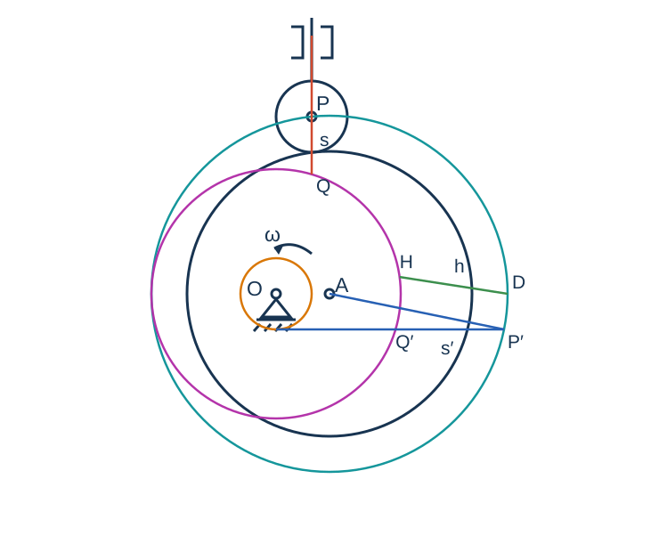

图中青色为理论轮廓、紫色为理论基圆、橙色为偏距圆；P、Q 对应初始位置，P′、Q′ 对应反转 90°，D 为最大向径位置，H 为通过 D 的相应导路与基圆的交点。


```{=latex}
\needspace{22\baselineskip}
```

### 四段运动与反转作图（角度来源 B091-03 第 9—11 页；对应 K-3418、K-3424）

某对心直动尖顶凸轮逆时针匀速转动，一周依次为推程 120°、远休止 60°、回程 90°、近休止 90°。为便于计算，本题另取理论基圆半径 50 mm、升程 30 mm，推程为等速，回程采用简谐规律。写出各阶段角度范围，在位移图和反转图上标出对应位置，并说明此设计在接头处的冲击特性。

【解】φ 从推程起点沿凸轮实际转向量取。四段依次为 0°—120°、120°—180°、180°—270°、270°—360°。反转作图时导路绕固定凸轮中心按相反方向转过相同角度，从基圆上对应点沿导路量 s；尖顶轨迹即该机构的理论与实际轮廓。

下表用 mm 记录所选规律的示例点。回程 180°—270° 取 $s=15[1+\cos(\pi(\varphi-180^\circ)/90^\circ)]$；表中角度用度数代入该无量纲比值。

| φ | 0° | 60° | 120° | 180° | 225° | 270° | 360° |
| --- | --- | --- | --- | --- | --- | --- | --- |
| 位移 s | 0 | 15 | 30 | 30 | 15 | 0 | 0 |

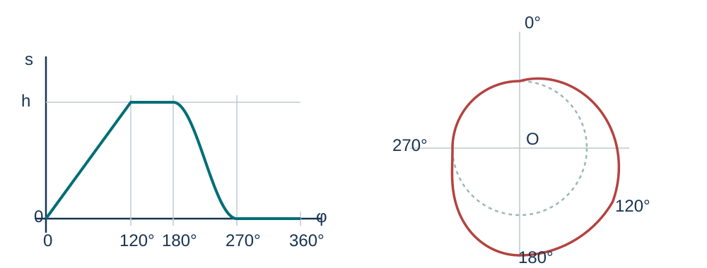

图中左侧为位移曲线，右侧为反转后的尖顶轨迹；灰色圆为基圆。图示角度次序和各段运动角取自原资料，50 mm、30 mm 及简谐回程为整理自编，不代表原页给出这些数值。等速推程与休止段连接时速度突变，有刚性冲击；简谐回程与休止段连接处加速度不连续，有柔性冲击。若改为其他运动规律，应重新计算每个分点和接头连续性。


## 直齿圆柱齿轮练习（来源 B091-04 第 16—21 页）

### 例题 1—2｜渐开线与中心距（对应 K-3411、K-3425）

**原题 1（选择）** 渐开线的形状取决于（　　）直径。  
A. 节圆　B. 基圆　C. 分度圆　D. 齿顶圆。

**原题 2（选择）** 一对渐开线齿轮啮合传动时，其中心距安装若有误差，（　　）。  
A. 不能保证瞬时传动比不变　B. 瞬时传动比虽有变化，但平均转速比仍不变　C. 仍能保证瞬时传动比不变　D. 仍能保证无齿侧隙连续传动。

【原答】1. B；2. C。

【整理说明】1：渐开线由基圆上的发生线展开确定。2：若中心距略有变化后仍保持正常连续啮合，两基圆半径不变，速比大小仍为 $r_{b2}/r_{b1}$；齿侧间隙、啮合角和接触情况可能变化，故不能据此保证 D。原题未明确限定误差范围，偏差过大可能不再满足正常啮合条件。

```{=latex}
\needspace{15\baselineskip}
```

### 例题 3—6｜标准齿轮与安装（B091-04 第 17 页；对应 K-3425）

**原题 3（判断）** 标准直齿圆柱齿轮就是分度圆上的压力角和模数均为标准值的齿轮。

**原题 4（判断）** $m$、$\alpha$、$h_a^*$、$c^*$ 都是标准的齿轮是标准齿轮。

**原题 5（判断）** 标准直齿圆柱齿轮传动的实际中心距恒等于标准中心距。

**原题 6（判断）** 标准直齿圆柱齿轮齿廓上各点的压力角均为 20°。

【原答】3—6 均为错。

【整理说明】3—4：还须满足分度圆齿厚与齿槽宽相等的标准齿厚条件；5：实际安装中心距可以改变，但应另验啮合；6：20°是课件所指标准分度圆压力角，渐开线其他点的压力角随半径改变。

### 例题 7—8｜分度圆和节圆（B091-04 第 18 页；对应 K-3411、K-3425）

**原题 7（选择）** 标准直齿圆柱齿轮 A 分别与齿轮 B、C 啮合传动，轮 A 上的分度圆有多少个，节圆有多少个？  
A. 1　B. 2　C. 1 或 2　D. 不确定。

**原题 8（判断）** 单个齿轮既有分度圆，又有节圆。

【原答】7. 分度圆选 A、节圆选 B；8. 错。

【整理说明】A 的分度圆由自身参数确定，是一个；两次配对各确定一个工作节圆。原答“两个节圆”指两组啮合各有一个；若两次配对所得 A 的节圆半径相同，这两个几何圆会重合，因此不同大小的节圆可能只有一个。脱离配对和安装条件，单个齿轮不能单独确定工作节圆。标准齿轮对按标准中心距安装时，节圆与分度圆重合。

### 例题 9—12｜啮合、重合度与根切（B091-04 第 19—20 页；对应 K-3425、K-3517）

**原题 9（填空）** 渐开线直齿圆柱齿轮的正确啮合条件是 $\underline{\qquad\qquad\qquad}$。

**原题 10（填空）** 增大模数，齿轮传动的重合度____；增多齿数，齿轮传动的重合度____；重合度大于 1 是齿轮的____条件。

**原题 11（判断）** 用范成法切制渐开线直齿圆柱齿轮发生根切的原因是齿轮太小了，大的齿轮就不会根切。

**原题 12（填空）** 渐开线标准直齿圆柱齿轮不发生根切的最少齿数为____。

【原答】9. 两齿轮模数相等、压力角相等。10. 不变；增加；连续传动。11. 错。12. 17。

【整理说明】9—10：正确啮合另需检查端面重合度 $\varepsilon_\alpha$；理想几何临界为 1，工程连续运转通常要求大于 1 并留有裕量。齿数、压力角、齿顶高系数及相对安装条件相同时，模数改变使啮合线长度和基节等比例变化，二者之比不变；标准外啮合、其他参数相同的常见比较中增加齿数可提高重合度。

11—12：范成法根切取决于刀具齿顶线与啮合极限点的关系，绝对尺寸大不等于一定不根切。标准齿条刀具 $h_a^*=1$、$\alpha=20^\circ$ 且无变位时，理论界限约 17.10，整数不根切严格取至少 18 齿；工程上常取 17 齿并允许轻微根切。刀具参数和变位改变时应重新判断。

```{=latex}
\needspace{15\baselineskip}
```

### 例题 13｜齿轮尺寸与啮合角（B091-04 第 21 页；对应 K-3425）

已知一对标准齿轮传动，齿轮 1 的参数为 $m=2.5\,\mathrm{mm}$，$\alpha=20^\circ$，$h_a^*=1$，$c^*=0.25$，$z_1=22$，中心距 $a=68.75\,\mathrm{mm}$。求 $z_2$ 和第二轮分度圆、齿顶圆、齿根圆、基圆直径。若中心距改为 $a'=69.75\,\mathrm{mm}$，求此时的啮合角。

【解】原题没有单独写明安装形式；原答使用 $a=m(z_1+z_2)/2$，即按标准外啮合直齿轮以标准中心距安装理解。由此得 $z_2=2a/m-z_1=33$。故 $d_2=mz_2=82.5\,\mathrm{mm}$，$d_{a2}=m(z_2+2h_a^*)=87.5\,\mathrm{mm}$，$d_{f2}=m[z_2-2(h_a^*+c^*)]=76.25\,\mathrm{mm}$，$d_{b2}=d_2\cos20^\circ\approx77.52\,\mathrm{mm}$。若不采用此安装假设，仅凭给定中心距不能按该式唯一确定齿数。

中心距改变后基圆不变，由 $a'\cos\alpha'=a\cos\alpha$ 得 $\alpha'=\arccos(68.75\cos20^\circ/69.75)\approx22.15^\circ$，与原资料的约 22.1° 一致。此时标准分度圆尺寸未变，节圆和齿侧间隙则随安装状态变化。


```{=latex}
\needspace{15\baselineskip}
```

## 斜齿轮与蜗杆练习（来源 B091-05 第 10—12 页）

### 例题 1—2｜法面、端面与配对（B091-05 第 10 页；对应 K-3517）

**原题 1（填空）** 渐开线斜齿圆柱齿轮的标准参数在____面上；在尺寸计算时应将____面参数代入直齿轮的计算公式。

**原题 2（填空）** 平行轴外啮合斜齿圆柱齿轮机构的正确啮合条件是 $\underline{\qquad\qquad}$、$\underline{\qquad\qquad}$、$\underline{\qquad\qquad}$。

【原答】1. 法面；端面。2. 法向模数相等、法向压力角相等、螺旋角大小相等且方向相反。

【整理说明】常用法面标准制下先由 $m_t=m_n/\cos\beta$ 求端面模数，再由 $d=m_tz$ 求分度圆直径；齿顶高等仍按相应标准参数计算。原页解析中压力角等式右侧下标重复，按题干和啮合条件理解为两轮相等。平行轴内啮合时旋向相同。

```{=latex}
\needspace{14\baselineskip}
```

### 例题 3—4｜当量齿数与根切（B091-05 第 11 页；对应 K-3425、K-3517）

**原题 3（填空）** 渐开线标准直齿圆柱齿轮不发生根切的最少齿数为____。

**原题 4（填空）** 斜齿圆柱齿轮的当量齿数 $z_v$ 与其实际齿数 $z$ 的关系为____，只要标准斜齿圆柱齿轮的____大于或等于 17，则它就一定不根切。

【原答】3. 17。4. $z_v=z/\cos^3\beta$；当量齿数 $z_v$。

【整理说明】标准刀具条件下，17 齿是允许轻微根切的常用工程近似；理论界限约 17.10，严格按整数取为 18。$z_v$ 是用假想直齿轮近似分析法面齿形的量。原题“一定不根切”不能无条件推广到所有刀具、变位和加工方式；实际整数齿数应向上取整并核对加工条件。

### 例题 5—7｜蜗杆传动与中间平面（B091-05 第 12 页；对应 K-3517）

**原题 5（判断）** 蜗杆传动一般用于传递大功率、大传动比。

**原题 6（判断）** 国家标准将蜗杆的分度圆直径标准化，是为了限制蜗轮滚刀的数目。

**原题 7（填空）** 蜗杆蜗轮的中间平面是指____的平面，在中间平面内相当于____啮合传动。

【原答】5. 错；6. 对；7. 垂直于蜗轮轴线且包含蜗杆轴线；齿轮齿条。

【整理说明】5：单级大传动比是其突出特点，但相对滑动和发热使效率、散热及磨损成为限制；具体功率能力取决于设计。6：相同模数下统一蜗杆分度直径系列有利于减少匹配滚刀规格，实际选用依相应标准及刀具参数。7：常见阿基米德圆柱蜗杆副可在该平面类比齿轮齿条啮合；两轴正交时，蜗杆轴向模数、压力角与蜗轮端面对应值分别相等，导程角与蜗轮螺旋角大小相等且旋向相同。


```{=latex}
\needspace{19\baselineskip}
```

## 轮系练习（来源 B091-06 第 8—16 页）

### 例题 1—5｜识别轮系（B091-06 第 8—9 页；对应 K-3412）

**原题 1（填空）** 根据轮系中齿轮的轴线是否固定，可将轮系分为____轮系、____轮系和____轮系三种。

**原题 2（判断）** 定轴轮系首末两轮转速之比，等于组成该轮系的所有主动齿轮齿数连乘积与所有从动齿轮齿数连乘积之比。

**原题 3（选择）** 当定轴轮系中首末轮轴线____时，可以用正、负号表示输入输出转向关系。  
A. 平行　B. 不平行　C. 交错　D. 异交。

**原题 4（填空）** 在周转轮系中，轴线固定的齿轮称____，兼有自转和公转的齿轮称____，而这种齿轮的动轴线所在的构件称____。

**原题 5（填空）** 自由度为 2 的周转轮系称为____，自由度为 1 的周转轮系称为____。

【原答】1. 定轴、周转、复合。2. 错。3. A。4. 太阳轮（中心轮）、行星轮、行星架（转臂或系杆）。5. 差动轮系、行星轮系。

【整理说明】2：首轮转速与末轮转速之比的大小按各级从动轮齿数乘积除以主动轮齿数乘积求得，方向另判。3：平行或共线轴应统一正方向；空间不平行轴需要按各轴观察方向画转向。4：中心轮的轴线相对机架固定不等于该轮不能转动；原页“中心轮至少两个”描述的是所讲基本轮系，实际机构分类须结合结构。5：自由度需结合具体构件约束与固定条件判断。

```{=latex}
\needspace{19\baselineskip}
```

### 例题 6｜定轴轮系（B091-06 第 10 页；对应 K-3412）

齿轮 1 与 2 外啮合，2 与 3 同轴刚接，3 与内齿轮 4 内啮合，4 与 5 同轴刚接，5 与 6、6 与 7 分别外啮合。齿数依次为 $30,30,20,80,25,40,35$；若 $n_1=100\,\mathrm{r/min}$，求 $n_7$ 的大小与方向。

```{=latex}
\begin{center}
\begin{tikzpicture}[x=1cm,y=1cm,>=stealth,every node/.style={font=\small},line width=.7pt]
\foreach \x/\n in {0/1,2/2,4/3,6/4,8/5,10/6,12/7} {\node[draw,circle,minimum size=6mm,inner sep=0pt] (g\n) at (\x,0) {\n};}
\draw[->] (g1)--node[above]{外}(g2); \draw[double] (g2)--node[above]{同轴}(g3); \draw[->] (g3)--node[above]{内}(g4);
\draw[double] (g4)--node[above]{同轴}(g5); \draw[->] (g5)--node[above]{外}(g6); \draw[->] (g6)--node[above]{外}(g7);
\end{tikzpicture}
\end{center}
```

图 轮系例题 6-1：根据 B091-06 第 10 页整理的啮合关系图；箭头表示计算路径，非实际转向或安装尺寸。

【原答】课件写传动比大小为 3.73，输出转速为 26.8 r/min，与轮 1 反向；其数值与所列齿数不符。

【复算】按题给齿数，传动比的大小为

$$\left|\frac{n_1}{n_7}\right|=\frac{z_2z_4z_6z_7}{z_1z_3z_5z_6}=\frac{30\times80\times35}{30\times20\times25}=5.6.$$

以轮 1 转向为正，逐级得到 $n_2=n_3=-100$、$n_4=n_5=-25$、$n_6=15.625$、$n_7=-125/7\approx-17.86\,\mathrm{r/min}$。因此输出约为 17.86 r/min，与轮 1 反向。齿轮 6 是惰轮，其齿数在速比大小中约去，但它改变最终转向；课件的 3.73 与 26.8 以及题册旧稿中的 56/15 都是算术错误。

```{=latex}
\needspace{19\baselineskip}
```

### 例题 7｜复合行星轮的转速（B091-06 第 14 页；对应 K-3412）

齿轮 1 与行星轮 2 外啮合，2 与 2′ 固连并由架 H 支撑，2′ 与中心内齿轮 3 啮合。$z_1=30$、$z_2=25$、$z_{2'}=20$、$z_3=75$；取轮 1 的方向为正，$n_1=210$、$n_3=-54\,\mathrm{r/min}$。求架 H 转速。

```{=latex}
\begin{center}
\begin{tikzpicture}[x=1cm,y=1cm,>=stealth,every node/.style={font=\small},line width=.7pt]
\foreach \x/\n/\t in {0/g1/1,2.6/g2/2,5.2/gp/$2'$,7.8/g3/3} {\node[draw,circle,minimum size=7mm,inner sep=0pt] (\n) at (\x,0) {\t};}
\draw[->] (g1)--node[above]{外啮合}(g2); \draw[double] (g2)--node[above]{固连}(gp); \draw[->] (gp)--node[above]{内啮合}(g3);
\draw[teal!70!black] (2.6,-.5)--(2.6,-1)--(5.2,-1)--(5.2,-.5); \node[below,teal!70!black] at (3.9,-1) {行星架 $H$ 支撑 2 和 $2'$};
\end{tikzpicture}
\end{center}
```

图 轮系例题 7-1：根据 B091-06 第 14 页整理的相对啮合和固连关系，非空间布置尺寸图。

【解】在随架转动的参考系中，两次啮合分别为外、内啮合，故 $(n_1-n_H)/(n_3-n_H)=-z_2z_3/(z_1z_{2'})=-25/8$。代入 $(210-n_H)/(-54-n_H)=-25/8$，得 $n_H=10\,\mathrm{r/min}$，与轮 1 同向。验算相对转速为 200 和 −64，之比确为 −25/8。

```{=latex}
\needspace{19\baselineskip}
```

### 例题 8｜定轴与周转组合（B091-06 第 16 页；对应 K-3412）

定轴齿轮 1 与 2 外啮合，2 与 2′ 固连；2′ 与行星轮 3 外啮合，3 与固定内齿轮 4 内啮合，3 由架 H 支撑。已知 $z_1=20$、$z_2=40$、$z_{2'}=20$、$z_3=30$、$z_4=80$。求 $i_{1H}=n_1/n_H$。

```{=latex}
\begin{center}
\begin{tikzpicture}[x=1cm,y=1cm,>=stealth,every node/.style={font=\small},line width=.7pt]
\foreach \x/\n/\t in {0/g1/1,2.5/g2/2,5/gp/$2'$,7.5/g3/3,10/g4/4} {\node[draw,circle,minimum size=7mm,inner sep=0pt] (\n) at (\x,0) {\t};}
\draw[->] (g1)--node[above]{外}(g2); \draw[double] (g2)--node[above]{固连}(gp); \draw[->] (gp)--node[above]{外}(g3); \draw[->] (g3)--node[above]{内}(g4);
\draw[teal!70!black] (7.5,-.4)--(7.5,-1.0)--(5,-1.0); \node[below,teal!70!black] at (6.25,-1.0) {架 $H$ 支撑行星轮 3}; \node[below] at (10,-.4) {固定};
\end{tikzpicture}
\end{center}
```

图 轮系例题 8-1：根据 B091-06 第 16 页整理的定轴和周转部分连接关系，非空间布置尺寸图。

【解】定轴部分 $n_1/n_2=-40/20=-2$。周转部分在架固定的转化轮系中，$(n_{2'}-n_H)/(n_4-n_H)=-z_4/z_{2'}=-4$。由 $n_2=n_{2'}$、$n_4=0$ 得 $n_{2'}=5n_H$，进而 $n_1=-10n_H$，故 $i_{1H}=-10$。负号表示输入轮与架在统一轴向约定下反向；例如取 $n_H=1$ 时，$n_1=-10$、$n_2=n_{2'}=5$，可代回两式验证。


```{=latex}
\needspace{18\baselineskip}
```

## 齿轮失效与强度练习（来源 B091-07 第 15—20 页）

### 例题 1—5｜失效与材料（B091-07 第 15—16 页；对应 K-3425、K-3517）

**原题 1（选择）** 一般参数的闭式硬齿面齿轮传动的主要失效形式是：  
A. 齿面点蚀　B. 轮齿折断　C. 齿面塑性变形　D. 齿面胶合。

**原题 2（选择）** 一般参数的闭式软齿面齿轮传动的主要失效形式是：  
A. 齿面点蚀　B. 轮齿折断　C. 齿面磨粒磨损　D. 齿面胶合。

**原题 3（选择）** 一般参数的开式齿轮传动，其主要失效形式是：  
A. 齿面点蚀　B. 齿面磨粒磨损　C. 齿面胶合　D. 齿面塑性变形。

**原题 4（选择）** 对齿轮轮齿材料性能的基本要求是：  
A. 齿面要硬、齿芯要韧　B. 齿面要硬、齿芯要脆　C. 齿面要软、齿芯要脆　D. 齿面要软、齿芯要韧。

**原题 5（选择）** 设计一对材料相同的软齿面齿轮传动时，一般使小齿轮齿面硬度 $\mathrm{HBS}_1$ 与大齿轮 $\mathrm{HBS}_2$ 的关系为：  
A. $\mathrm{HBS}_1<\mathrm{HBS}_2$　B. $\mathrm{HBS}_1=\mathrm{HBS}_2$　C. $\mathrm{HBS}_1>\mathrm{HBS}_2$。

【原答】1. B；2. A；3. B；4. A；5. C。

【整理说明】1—3：这是课件在一般条件下给出的典型失效，具体工况仍须检查其他失效。4—5：齿面耐磨、芯部有足够韧性是常见要求；原资料建议钢制软齿面小轮比大轮硬约 30—50 HBS，用于改善小轮耐磨性和匹配寿命，材料与热处理需按具体设计确定。

### 例题 6—9｜强度和齿宽（B091-07 第 17—19 页；对应 K-3425、K-3517）

**原题 6（选择）** 为了提高齿面接触强度，可：  
A. 保持分度圆直径不变而增大模数　B. 增大分度圆直径　C. 保持分度圆直径不变而增加齿数。

**原题 7（选择）** 为了提高齿根抗弯强度，可：  
A. 增大模数　B. 保持分度圆直径不变而增加齿数　C. 采用负变位齿轮。

**原题 8（选择）** 一对直齿圆柱齿轮，小齿轮齿宽 $b_1$ 与大齿轮齿宽 $b_2$ 的关系是：  
A. $b_2-b_1=(5\sim10)\,\mathrm{mm}$　B. $b_1-b_2=(5\sim10)\,\mathrm{mm}$　C. $b_2=b_1$　D. 任意关系。

**原题 9（选择，部分内容难辨）** 一对啮合直齿圆柱齿轮，原页题干部分许用接触应力符号和数值重叠；比较两轮接触应力。  
A. 齿轮 1 大于齿轮 2　B. 齿轮 1 小于齿轮 2　C. 齿轮 1 等于齿轮 2　D. 不能确定。

【原答】6. B；7. A；8. B；9. C。

【整理说明】6—7：接触疲劳常先考虑增大分度圆直径或中心距，弯曲疲劳常先考虑增大模数；改变尺寸后还须复核载荷分布、几何和另一项强度。8：小轮加宽为装配误差留余量，使预定啮合宽度不易缩短；5—10 mm 是原资料示例，多出的宽度不自动增加有效接触宽度。9：同一理想接触处的两齿面共同承受接触压力，但许用接触应力可以不同，应分别比较；原页重叠的具体数值不据图猜测。

```{=latex}
\needspace{13\baselineskip}
```

### 例题 10｜减速器各级的布置（B091-07 第 20 页；对应 K-3517）

二级减速器若分别采用直齿与斜齿圆柱齿轮，斜齿轮通常放在哪一级？若采用锥齿轮与圆柱齿轮，锥齿轮通常放在哪一级？说明原因。

【参考答案与边界】原资料均建议放在高速级：斜齿轮啮合较平稳，有利于减小高速运行时的振动和噪声；高速级转矩通常较小，可减轻所需承受的力。锥齿轮放高速级也有利于控制轮齿尺寸、轴承载荷及悬臂布置的负担。实际轴向力还取决于分度圆直径、螺旋角和载荷，级次选择需结合效率、支承和制造条件，不能仅由转矩比较直接确定。


```{=latex}
\needspace{18\baselineskip}
```

## 齿轮和蜗杆受力练习（来源 B091-08 第 10—16 页）

### 例题 1｜中间轴轴向力（对应 K-3440）

两级平行轴斜齿圆柱齿轮减速器中，1 与 2 啮合、3 与 4 啮合，2 和 3 固连在中间轴上。比较中间轴所受两齿轮轴向力同向和反向两种布置。

【解】以中间轴一个方向为正。两力同向时齿轮作用在中间轴上的轴向合力大小为 $|F_{a2}|+|F_{a3}|$；两力反向时为 $||F_{a2}|-|F_{a3}||$。原资料建议调整第二级旋向，使两力反向从而抵消一部分；只有大小恰好相等时合力才为零，轴承载荷仍须按各力的作用位置和支承方案计算。每对外啮合斜齿轮仍须保证旋向相反、螺旋角大小相等。

```{=latex}
\needspace{20\baselineskip}
```

### 例题 2｜锥齿轮与斜齿轮（B091-08 第 12—14 页；对应 K-3440）

原题中 1、2 为一对直交轴直齿锥齿轮；2、3 同在中间轴 II 上，3、4 为一对平行轴外啮合斜齿轮。1 为主动轮，输入转向如图。要求：①标出各轴转向；②选择齿轮 3、4 的旋向，使轴 II 的轴向力较小；③标出轮 2、3 在啮合点处的圆周力、径向力和轴向力方向。

```{=latex}
\begin{center}
\begin{tikzpicture}[x=1cm,y=1cm,>=stealth,line width=.8pt,every node/.style={font=\small}]
\draw[gray!75,line width=1.1pt] (-.6,0)--(2,0); \draw[gray!75,line width=1.1pt] (4,-1.55)--(4,2.5); \draw[gray!75,line width=1.1pt] (7.5,-1.55)--(7.5,2.5);
\draw[fill=blue!8] (1.45,1.4)--(2.2,.85)--(2.2,-.75)--(1.45,-1.3)--cycle;
\draw[fill=blue!8] (1.45,-1.3)--(2.2,-.75)--(5.5,-.75)--(6.25,-1.3)--cycle;
\draw[fill=cyan!10] (3.1,.25) rectangle (4.9,1.05); \draw[fill=cyan!10] (4.9,.25) rectangle (8.4,1.05);
\node at (1.8,-.15) {1}; \node at (3.2,-1.05) {2}; \node at (4,.65) {3}; \node at (6.7,.65) {4};
\draw[->,blue!70!black] (-.35,-.1)--(-.35,.85) node[above] {$n_{\mathrm I}$};
\node[below] at (.2,-.12) {轴 I}; \node[below] at (4,-1.55) {轴 II}; \node[below] at (7.5,-1.55) {轴 III};
\fill (2.2,-.75) circle (1.5pt); \fill (4.9,.65) circle (1.5pt);
\node[below left] at (2.2,-.75) {锥齿啮合}; \node[above] at (4.9,1.05) {斜齿啮合};
\end{tikzpicture}
\end{center}
```

图 齿轮受力例题 2-1：依据 B091-08 第 12 页重绘的轴与啮合位置示意；1 为主动轮，轴 I 的箭头沿原图观察方向标示转向。该图不表示精确齿形、尺寸或轴承布置。

【原答转写】按原图箭头标记，轴 II 转向向右、轴 III 转向向左；原资料给出的方案为 3 右旋、4 左旋。在原页视图，轮 2 的径向力向右、轴向力向下、圆周力指向纸外；轮 3 的径向力向左、轴向力向上、圆周力指向纸外。2 与 3 的轴向力相反，因此可抵消一部分。原图的输入转向及观察方向是这些箭头的前提；换视角或反转输入后，应重新画接触点速度与作用反作用，不能直接照搬左右或纸内外方向。

```{=latex}
\needspace{22\baselineskip}
```

### 例题 3｜锥齿轮、斜齿轮和蜗杆组合（B091-08 第 15—16 页；对应 K-3440）

原题中 1、2 为锥齿轮，3、4 为斜齿轮，5、6 为蜗杆和蜗轮；2 与 3 同轴，4 与 5 同轴。输入转向及重物上升方向如图，要求轴 III 上齿轮 4 和蜗杆 5 的轴向力部分抵消。求：①轴 II、III 的转向；②轮 3、4、5、6 的旋向；③各轮啮合点所受圆周力、轴向力和径向力方向。

```{=latex}
\begin{center}
\begin{tikzpicture}[x=1cm,y=1cm,>=stealth,line width=.8pt,every node/.style={font=\small}]
\draw[gray,line width=1.1pt] (.7,-1.3)--(.7,.05); \draw[gray,line width=1.1pt] (1.6,1.0)--(5.1,1.0); \draw[gray,line width=1.1pt] (2.3,3.0)--(9.1,3.0);
\draw[fill=blue!8] (.05,0)--(.4,.45)--(1.15,.45)--(1.55,0)--cycle;
\draw[fill=blue!8] (1.15,.45)--(1.55,0)--(1.55,2)--(1.15,1.55)--cycle;
\draw[fill=cyan!10] (3,0.2) rectangle (3.85,1.8); \draw[fill=cyan!10] (3,1.8) rectangle (3.85,3.8);
\draw[fill=gray!15] (6.05,2.65) rectangle (8.3,3.35); \draw[fill=gray!5] (7.18,1.3) circle (1.35); \draw (7.18,1.3) circle (.63);
\draw (7.81,1.3)--(7.81,-1.4); \draw[fill=gray!10] (7.48,-1.4) rectangle (8.14,-1.9); \node at (7.81,-1.65) {$W$};
\draw[->,blue!70!black] (.18,-1.05)--(1.18,-1.05) node[right] {$n_1$}; \draw[->,teal!70!black] (8.25,-1.15)--(8.25,-.4) node[right] {$v$};
\node at (.65,.2) {1}; \node[left] at (1.15,1.2) {2}; \node at (3.42,.65) {3}; \node at (3.42,3.45) {4}; \node at (7.15,3) {5}; \node at (6.3,1.3) {6};
\node[below] at (.7,-1.3) {轴 I}; \node[above] at (4.65,1) {轴 II}; \node[right] at (9.1,3) {轴 III};
\end{tikzpicture}
\end{center}
```

图 齿轮受力例题 3-1：依据 B091-08 第 15 页重绘的轴系及输入、重物运动方向示意。齿形、配合和尺寸作简化；各力方向需按对应啮合点和观察方向判断。

【原答与核对边界】原解图将轴 II 的转向箭头标为向下、轴 III 标为向上；原资料给出 3 右旋、4 左旋，蜗杆 5 与蜗轮 6 均左旋，轴 III 上 $F_{a4}$ 向左、$F_{a5}$ 向右；先由输入轴确定各级转向，再由重物上升确定蜗轮运动和蜗杆轴向力，最后让 4、5 的轴向力相反以选择 3、4 的旋向。原页示意中的部分分力符号和箭头较小、相互重叠，本整理仅转写可辨识的旋向与判定链，完整三维分力方向仍须结合原题图独立复核；不以未辨清的箭头作为已验证答案。


```{=latex}
\needspace{18\baselineskip}
```

## 带与链传动练习（来源 B091-09 第 13—26 页）

### 例题 1—6｜传力、弹性滑动与打滑（B091-09 第 13—17 页；对应 K-3426、K-3519）

**原题 1（选择）** V 带传动主要依靠什么传递运动和动力？  
A. 带的紧边拉力　B. 带和带轮接触面间的摩擦力　C. 带的预紧力。

**原题 2（选择）** 在一般传递动力的机械中，主要采用哪种传动？  
A. 平带　B. 同步带　C. V 带　D. 多楔带。

**原题 3（选择）** 带传动中，$v_1$ 为主动轮圆周速度，$v_2$ 为从动轮圆周速度，$v$ 为带速，它们之间的关系是：  
A. $v_1=v_2=v$　B. $v_1>v>v_2$　C. $v_1<v<v_2$　D. $v_1=v>v_2$。

**原题 4（选择）** 带传动工作时产生弹性滑动是因为：  
A. 带的预紧力不够　B. 紧边和松边拉力不等　C. 带绕过带轮时有离心力　D. 带和带轮间摩擦力不够。

**原题 5（选择）** 带传动正常工作时不能保证准确的传动比是因为：  
A. 带的材料不符合胡克定律　B. 带容易变形和磨损　C. 带在带轮上打滑　D. 带的弹性滑动。

**原题 6（选择）** 带传动打滑总是：  
A. 在小轮上先开始　B. 在大轮上先开始　C. 在两轮上同时开始。

【原答】1. B；2. C；3. B；4. B；5. D；6. A。

【整理说明】1—2：普通 V 带靠摩擦传力，同步带靠啮合；适合哪一种仍取决于工况。3—5：按原课件正常传力、存在弹性滑动的简化模型，主动轮、带和从动轮速度依次减小；具体速度须说明测量位置，弹性滑动与过载打滑不同。6：普通开式传动且两轮摩擦条件相近时，小轮包角常较小、易先达到摩擦极限；“总是”过于绝对，实际须比较两轮摩擦和包角条件。

### 例题 7—11｜应力、张紧与链节（B091-09 第 18—21 页；对应 K-3426、K-3519）

**原题 7（选择）** 带传动中，带每转一周，拉应力是：  
A. 有规律变化的　B. 不变的　C. 无规律变化的。

**原题 8（选择）** 若小带轮为主动轮，带的最大应力发生在带的哪一处？  
A. 进入主动轮　B. 进入从动轮　C. 退出主动轮　D. 退出从动轮。

**原题 9（选择）** 带传动采用张紧装置的目的是：  
A. 减轻带的弹性滑动　B. 提高带的寿命　C. 改变带的运动方向　D. 调节带的预紧力。

**原题 10（图示选择）** 下列 V 带传动中，哪一图的张紧轮位置最合理？

```{=latex}
\begin{center}
\begin{tikzpicture}[x=1cm,y=1cm,line width=0.7pt,>=stealth,every node/.style={font=\small}]
\foreach \shift/\label in {0/A,4.2/B,8.4/C,12.6/D} {
 \begin{scope}[xshift=\shift cm]
 \draw (0,0) circle (.35); \draw (2.35,0) circle (.55);
 \draw[densely dashdotted,gray] (-.6,0)--(3,0);
 \draw[->,blue!70!black] (-.16,.08) arc (140:15:.22);
 \node at (1.15,-1.05) {\label};
 \end{scope}}
\begin{scope}
 \draw (-.03,.35)--(2.30,.55); \draw (-.03,-.35)--(.55,-.58)--(2.30,-.55); \draw[teal!70!black] (.55,-.40) circle (.18);
\end{scope}
\begin{scope}[xshift=4.2cm]
 \draw (-.03,.35)--(2.30,.55); \draw (-.03,-.35)--(.62,-.34)--(2.30,-.55); \draw[teal!70!black] (.62,-.52) circle (.18);
\end{scope}
\begin{scope}[xshift=8.4cm]
 \draw (-.03,.35)--(1.65,.61)--(2.30,.55); \draw (-.03,-.35)--(2.30,-.55); \draw[teal!70!black] (1.65,.43) circle (.18);
\end{scope}
\begin{scope}[xshift=12.6cm]
 \draw (-.03,.35)--(.65,.30)--(2.30,.55); \draw (-.03,-.35)--(2.30,-.55); \draw[teal!70!black] (.65,.48) circle (.18);
\end{scope}
\end{tikzpicture}
\end{center}
```

图 带传动例题 10-1：依据 B091-09 第 20 页重绘，左侧小轮为主动轮，箭头表示转向；小圆为张紧轮，A—D 分别保留原题的带边、内外侧和相对位置。图为示意，非尺寸图。


**原题 11（选择）** 链传动中，链节数常采用偶数，这是为了使链传动：  
A. 工作平稳　B. 链条与链轮轮齿磨损均匀　C. 避免采用过渡链节　D. 提高传动效率。

【原答】7. A；8. A；9. D；10. C；11. C。

【整理说明】7—8：在稳定周期工况的常用模型中，带应力随紧松边及绕轮位置变化，最大应力常在紧边进入小轮处。9—10：张紧用于调整预紧力；普通 V 带常在松边内侧配置张紧轮，并检查包角和弯曲。原图“只能单向弯曲”等说法不能推广到所有带型与制造商。11：偶数链节有利于避免采用易受附加弯矩的过渡链节。

```{=latex}
\needspace{18\baselineskip}
```

### 例题 12—17｜选型、失效与工作能力（B091-09 第 22—24 页；对应 K-3426、K-3519）

**原题 12（填空）** 在设计 V 带传动中，V 带的型号是根据 $\underline{\qquad\qquad}$ 和 $\underline{\qquad\qquad}$ 选取的。

**原题 13（填空）** 链传动的 $\underline{\qquad\qquad}$ 是造成瞬时传动比不恒定的原因。

**原题 14（填空）** 带传动的设计准则是在 $\underline{\qquad\qquad}$ 的条件下，具有一定的疲劳强度和寿命。

**原题 15（填空）** 带传动的失效形式是 $\underline{\qquad\qquad\qquad}$。

**原题 16（简答）** 带传动工作时带中有哪些应力？最大应力发生在何处，大小如何表示？

**原题 17（简答）** 试论述如何提升摩擦型带传动的工作能力。

【原答】12. 计算功率和小带轮转速。13. 多边形效应。14. 不打滑。15. 打滑和疲劳破坏。16. 拉应力、弯曲应力和离心应力；最大应力在紧边绕入小带轮处，约为 $\sigma_{\max}=\sigma_1+\sigma_{b1}+\sigma_c$。17. 改善摩擦条件、适当增大初拉力、增大包角。

【整理说明】12：按所用 V 带型号选型图及适用标准确定；13：链节逐个啮入和退出使瞬时速度波动；14—16：设计须同时满足防滑和疲劳寿命，最大应力位置以原题模型为前提。17：预紧力过大会增加带和轴承负荷并影响寿命；包角、材料、槽型和工作环境均应综合考虑，原页 $f_v\approx3f$ 是特定槽型下的近似，不能直接用于所有 V 带。

### 例题 18｜由功率求拉力（B091-09 第 25 页；对应 K-3426）

普通 V 带传递功率 $P=7.5\,\mathrm{kW}$，带速 $v=10\,\mathrm{m/s}$，紧边拉力为松边的两倍。求有效拉力和两边拉力。

【解】$F_e=1000P/v=750\,\mathrm{N}$；由 $F_e=F_1-F_2$ 及 $F_1=2F_2$ 得 $F_2=750\,\mathrm{N}$、$F_1=1500\,\mathrm{N}$。此题的拉力比由题设给出，无需假设临界打滑。

### 例题 19｜临界摩擦与预紧力（B091-09 第 26 页；对应 K-3426）

已知单根普通 V 带能传递的最大功率 $P=6\,\mathrm{kW}$，主动轮基准直径 $d_1=100\,\mathrm{mm}$、转速 $n_1=1460\,\mathrm{r/min}$、包角 $150^\circ$，带与轮的当量摩擦系数 $f_v=0.51$。不考虑离心力，求带的紧边拉力、松边拉力、初拉力及最大有效拉力。

【解】按原答取给定主动轮处于临界摩擦状态、其接触能力控制整套传动，并采用 $2F_0=F_1+F_2$ 的简化关系。$v=\pi d_1n_1/(60\times1000)\approx7.645\,\mathrm{m/s}$，$F_{e,\max}=1000P/v\approx784.9\,\mathrm{N}$。包角化为弧度 $\alpha=5\pi/6$，临界比值 $q=e^{f_v\alpha}\approx3.801$。由 $F_1/F_2=q$ 与 $F_1-F_2=F_e$，得 $F_2\approx280.2\,\mathrm{N}$、$F_1\approx1065.1\,\mathrm{N}$，$F_0\approx(F_1+F_2)/2=672.7\,\mathrm{N}$。原答中途把带速取为 7.64 m/s，故数值有轻微舍入差异。原页最后一组式子写作 $2F_0=F_1+F'_2$，但题目及代入值均使用松边拉力 $F_2$，此处按同一松边力理解。若未满足上述临界或控制轮条件，仅凭功率和摩擦系数不能唯一求出预紧力。


```{=latex}
\needspace{18\baselineskip}
```

## 螺纹连接练习（来源 B091-10 第 23—29 页）

### 例题 1—6｜牙型和连接类型（B091-10 第 23—26 页；对应 K-3427、K-3520）

**原题 1（选择）** 在常用的螺纹传动中，传动效率最高的螺纹是：  
A. 三角形　B. 梯形　C. 锯齿形　D. 矩形。

**原题 2（选择）** 在常用的螺纹连接中，自锁性最好的螺纹是：  
A. 三角形　B. 梯形　C. 锯齿形　D. 矩形。

**原题 3（选择）** 当两个被连接件不太厚时，宜采用：  
A. 双头螺柱连接　B. 螺栓连接　C. 螺钉连接　D. 紧定螺钉连接。

**原题 4（选择）** 当两个被连接件之一太厚、不宜制成通孔，且需要经常拆装时，往往采用：  
A. 螺栓连接　B. 螺钉连接　C. 双头螺柱连接　D. 紧定螺钉连接。

**原题 5（选择）** 当两个被连接件之一太厚、不宜制成通孔，且连接不需要经常拆装时，往往采用：  
A. 螺栓连接　B. 螺钉连接　C. 双头螺柱连接　D. 紧定螺钉连接。

**原题 6（填空）** 螺纹连接的基本类型有哪些？

【原答】1. D；2. A；3. B；4. C；5. B；6. 螺栓连接、双头螺柱连接、螺钉连接和紧定螺钉连接。

【整理说明】1—2：矩形常用于传动，三角形常用于连接。效率与自锁还受升角、当量摩擦角、载荷方向等影响，原页的牙型排序不能不加条件推广。3—5：原答是典型选型，还要考虑可达空间与受力。6：连接方式与三角形、矩形等牙型是两种不同分类。

### 例题 7—10｜防松和横向传力（B091-10 第 27—28 页；对应 K-3520）

**原题 7（简答）** 螺纹连接为什么要防松？防松的实质是什么？

**原题 8（填空）** 常用的防松方法有哪些分类？

**原题 9（选择）** 若采用普通螺栓连接承受横向载荷，则载荷靠什么来传递？  
A. 结合面之间的摩擦力　B. 螺栓的剪切和挤压　C. 螺栓的剪切和被连接件的挤压。

**原题 10（选择）** 若采用铰制孔用螺栓连接承受横向载荷时，螺栓杆受到什么作用？  
A. 弯曲和挤压　B. 拉伸和剪切　C. 剪切和挤压　D. 扭转和弯曲。

【原答】7. 振动、冲击、变载和温度变化等可能使连接松动；防松的实质是限制螺旋副相对转动。8. 摩擦防松、机械防松、破坏螺纹副关系。9. A。10. C。

【整理说明】7：静载自锁不等于振动下不会松；原页称连接用三角螺纹都自锁，实际还需检查升角、摩擦和工况。8：如对顶螺母、开口销与开槽螺母、冲点等；粘接能否拆卸取决于胶种与工艺。9—10：普通预紧螺栓的原答使用接合面未滑移的摩擦传力模型；铰制孔连接主要验杆剪切和孔壁挤压。发生滑移后应重新分析。

### 例题 11｜轴向载荷与剩余预紧力（B091-10 第 29 页；对应 K-3413、K-3520）

**原题 11（选择）** 承受预紧力 $F_0$ 的紧螺栓连接在受工作拉力 $F$ 时，剩余预紧力为 $F_1$，其螺栓所受的总拉力 $F_2$ 为：

A. $F_2=F+F_0$；B. $F_2=F+F_1$；C. $F_2=F_0+F_1$；D. $F_2=F+\dfrac{C_b}{C_b+C_m}F$。

【原答】B。

【整理说明】在接合面保持压紧、静力平衡模型中，$F_2=F+F_1$。设初始预紧力 $F_0$，螺栓刚度 $C_b$、被连接件刚度 $C_m$，$\chi=C_b/(C_b+C_m)$，则在线弹性且接合面未分离时 $F_2=F_0+\chi F$，$F_1=F_0-(1-\chi)F$。原选项 D 原样保留，不能把它当作一般的正确刚度分配式。接合面分离后需另建模型。

【自编验算】取 $F_0=10\,\mathrm{kN}$、$F=4\,\mathrm{kN}$、$\chi=0.25$，则 $F_2=11\,\mathrm{kN}$、$F_1=7\,\mathrm{kN}$，满足 $F_2=F+F_1$ 且 $F_1>0$。这些数值仅用于说明，不是原资料给定。


```{=latex}
\needspace{17\baselineskip}
```

## 键连接练习（来源 B091-11 第 9—11 页）

### 例题 1—4｜平键用途和尺寸（B091-11 第 9—11 页；对应 K-3427、K-3520）

**原题 1（选择）** 普通平键连接的主要用途是使轴与轮毂之间：

A. 安装与拆卸方便　B. 沿轴向可作相对滑动并具有导向作用　C. 沿周向固定并传递转矩　D. 沿轴向固定并传递轴向力。

**原题 2（选择）** 普通平键连接的工作面是键的：

A. 两个端面　B. 两个侧面　C. 上下两面　D. 侧面和上下面。

**原题 3（选择）** 设计键连接时，键的截面尺寸 $b\times h$ 通常根据什么按标准选择？

A. 所传递功率的大小　B. 所传递转矩的大小　C. 轮毂的长度　D. 轴的直径。

**原题 4（选择）** 当键连接强度不足时可采用双键，使用两个平键时要求两键怎样布置？

A. 相隔 90°—120°　B. 相隔 120°—130°　C. 相隔 180°　D. 在同一直线上。

【原答】1. C；2. B；3. D；4. C。

【整理说明】1—2：普通平键侧面承压传递转矩，通常另用轴肩、挡圈等实现轴向固定。3：按轴径查标准选截面，按轮毂长度和标准系列选键长，再校核强度。4：两个普通平键通常相隔 180°；原资料考虑分载不均，按约 1.5 个键的等效承载能力估算，还要复核键槽对轴的削弱。其他键型不能直接套用这一估算。

### 自编例｜普通平键挤压校核（对应 K-3520）

一根圆头普通平键传递转矩 $T=120\,\mathrm{N\cdot m}$，轴径 $d=30\,\mathrm{mm}$，键宽 $b=8\,\mathrm{mm}$、键高 $h=7\,\mathrm{mm}$、总长 $L=40\,\mathrm{mm}$。按简化模型取接触高度 $k=h/2$ 和有效长度 $l=L-b$，求工作面平均挤压应力；是否满足强度由给定许用值决定。

【解】统一单位 $T=120000\,\mathrm{N\cdot mm}$，$k=3.5\,\mathrm{mm}$、$l=32\,\mathrm{mm}$。圆周力 $F_t=2T/d=8000\,\mathrm{N}$，故 $\sigma_p=F_t/(kl)\approx71.4\,\mathrm{MPa}$。若某题给出适用的 $[\sigma_p]=100\,\mathrm{MPa}$，则此简化挤压校核满足；此许用值仅为自编演示，实际需按材料、工况和所用设计依据确定，并视要求另校剪切及轴强度。


```{=latex}
\needspace{18\baselineskip}
```

## 轴与轴系结构练习（来源 B091-12 第 16—21 页）

### 分类与材料｜原题（B091-12 第 16—17 页；对应 C-3450）

1. 按承受载荷的不同，轴可分为哪三类？（填空）
2. 转轴是指什么轴？（填空）
3. 心轴是指什么轴？（填空）
4. 传动轴是指什么轴？（填空）
5. 某 45 钢轴的刚度不足，可采取哪项措施提高其刚度？（选择）  
A. 改用 40Cr　B. 淬火处理　C. 增大轴径　D. 增大圆角半径。
6. 当用 45 钢做轴刚度不够时，可用合金钢代替。（判断）

【原答】1. 转轴、心轴、传动轴。2. 工作中既承受弯矩又承受扭矩的轴。3. 只受弯矩不受扭矩的轴。4. 只受扭矩不受弯矩的轴。5. C。6. 错。

【整理说明】这三类按主要载荷作理想化分类；实际轴还会受到自重和其他载荷。钢材种类和热处理对弹性模量的影响通常较小；在相同材料类型、载荷和支承下增大轴径通常有助于提高刚度，还要满足尺寸与强度要求。

### 轴的定位｜原题（B091-12 第 18—19 页；对应 C-3450、K-3428）

1. 轴上零件都必须进行哪两种定位？（填空）
2. 轴上常用的周向定位零件有哪些？列举三种。（填空）
3. 轴上零件的轴向定位常用哪些结构？列举四种。（填空）
4. 下列用于轴向定位的是哪项？（选择）  
A. 套筒　B. 花键　C. 销　D. 过盈配合。

【原答】1. 轴向、周向定位。2. 键、花键、紧定螺钉。3. 轴肩、套筒、轴端挡圈、圆螺母。4. A。

【整理说明】第 1 题中的“都必须”过于绝对：滑移齿轮或浮动支承可能需要保留规定方向的运动，定位应按功能判断。第 4 题按课件的常见用途选择套筒；销、花键或过盈配合能否限制某方向的运动取决于具体结构和受力，不能仅凭名称一概排除。

```{=latex}
\needspace{18\baselineskip}
```

### 结构改错 1｜轴承、套筒与端盖（B091-12 第 20 页；对应 C-3450）

原图为轴、两侧轴承、齿轮、套筒和端盖组成的轴系，图中以 ①—⑧ 标出检查位置。请结合原图指出这些位置的结构问题及修改思路。题图的细部轮廓仍需回看原件，以下表格保留原页编号与文字检查点。

```{=latex}
\begin{center}
\begin{tikzpicture}[x=1cm,y=1cm,scale=0.9,every node/.style={font=\small},line width=0.7pt]
\draw[fill=gray!12] (0,0) rectangle (12,0.55); \draw[dash pattern=on 5pt off 2pt] (-0.2,0.275)--(12.2,0.275);
\draw[fill=cyan!10] (1.2,0.55) rectangle (2.3,1.25); \draw (1.3,0.65) rectangle (2.2,1.15); \draw (1.75,0.9) circle (0.18);
\draw[fill=cyan!10] (8.8,0.55) rectangle (9.9,1.25); \draw (8.9,0.65) rectangle (9.8,1.15); \draw (9.35,0.9) circle (0.18);
\draw[fill=blue!10] (4.8,0.55) rectangle (7.3,1.65); \draw (5.7,1.65)--(5.7,1.85)--(6.3,1.85)--(6.3,1.65);
\draw[fill=gray!25] (7.3,0.55) rectangle (8.8,0.98); \draw[fill=gray!25] (0.75,0.55) rectangle (1.2,1.5); \draw[fill=gray!25] (9.9,0.55) rectangle (10.35,1.5);
\node at (1.75,1.53) {轴承}; \node at (6.05,1.35) {齿轮轮毂}; \node at (8.05,0.78) {套筒}; \node at (9.35,1.53) {轴承};
\foreach \x/\y/\label in {0.95/1.95/1,2.35/1.65/2,7.15/1.85/3,6.7/0.25/4,8.6/1.35/5,10.1/1.95/6,10.7/0.8/7,11.4/1.35/8} {\draw[blue!70!black,fill=white] (\x,\y) circle (0.19);\node[blue!70!black] at (\x,\y) {\label};}
\end{tikzpicture}
\end{center}
```

图 结构改错 1-1：依据 B091-12 第 20 页整理的主要零件和编号位置示意；非原图精确轮廓，特别是键、端盖和局部接触需回看原件。

| 原编号 | 原资料指出的问题与修改方向 | 整理说明 |
| --- | --- | --- |
| ①、⑥ | 端盖与箱体之间考虑调整垫片；接触处设置凸台以减少精加工面。 | 是否需要垫片及凸台取决于该支承的游隙调整方案和加工结构。 |
| ② | 轴肩过高使轴承拆卸不便，原页建议降低轴肩。 | 原页约取轴承内圈厚度的 2/3；支承尺寸与拆卸空间应按所用轴承核验。 |
| ③ | 与齿轮配合的轴段过长，套筒不能压住齿轮；原页建议轴段比轮毂窄 1—2 mm。 | 关键是使套筒压住轮毂端面并保留装配余量，具体尺寸依公差链确定。 |
| ④ | 键太长会妨碍右侧套筒装入，原页建议键略短于轮毂宽度。 | 同时检查有效接触长度及装配路径。 |
| ⑤ | 套筒过高使轴承拆卸不便，原页建议降低套筒高度。 | 原页同样给出内圈厚度约 2/3 的建议；实际需检查允许支承范围及拆卸空间。 |
| ⑦ | 右轴承右侧精加工面及装拆路径过长，原页建议设置工艺轴肩。 | 台阶位置还须满足各零件的装入方向和定位要求。 |
| ⑧ | 透盖与转轴之间应有间隙；原页建议毛毡圈密封。 | 运行间隙和密封形式须与转速、润滑及环境匹配。 |

```{=latex}
\needspace{18\baselineskip}
```

### 结构改错 2｜成对轴承与带轮定位（B091-12 第 21 页；对应 C-3450）

原图为两个单列角接触球轴承支承的轴系，轴端另有带轮；按题设应承受双向轴向载荷。结合原图 ①—（10） 检查并提出修改。下表按原页编号保留检查点；尚未独立完成原图各细部的尺寸验算。

```{=latex}
\begin{center}
\begin{tikzpicture}[x=1cm,y=1cm,scale=0.9,every node/.style={font=\small},line width=0.7pt]
\draw[fill=gray!12] (0,0) rectangle (12.5,0.55); \draw[dash pattern=on 5pt off 2pt] (-0.2,0.275)--(12.7,0.275);
\draw[fill=cyan!10] (1.1,0.55) rectangle (2.2,1.25); \draw (1.2,0.65) rectangle (2.1,1.15); \draw (1.65,0.9) circle (0.18);
\draw[fill=cyan!10] (7.8,0.55) rectangle (8.9,1.25); \draw (7.9,0.65) rectangle (8.8,1.15); \draw (8.35,0.9) circle (0.18);
\draw[fill=blue!10] (3.1,0.55) rectangle (5.2,1.6); \draw[fill=gray!25] (5.2,0.55) rectangle (7.8,0.98); \draw[fill=gray!25] (0.65,0.55) rectangle (1.1,1.5); \draw[fill=gray!25] (8.9,0.55) rectangle (9.35,1.5); \draw[fill=blue!10] (10.5,0.55) rectangle (12,1.6);
\node at (1.65,1.53) {轴承}; \node at (4.15,1.3) {齿轮}; \node at (6.5,0.78) {套筒}; \node at (8.35,1.53) {轴承}; \node at (11.25,1.3) {带轮};
\foreach \x/\y/\label in {0.7/1.95/1,1.55/1.95/2,2.5/1.45/3,4.5/1.85/4,6.9/1.35/5,8.1/1.95/6,8.9/0.25/7,9.35/1.95/8,10/1.35/9,11.4/1.95/10} {\draw[blue!70!black,fill=white] (\x,\y) circle (0.19);\node[blue!70!black] at (\x,\y) {\label};}
\end{tikzpicture}
\end{center}
```

图 结构改错 2-1：依据 B091-12 第 21 页整理的主要零件和编号位置示意；不表示轴承接触角、精确配合或尺寸，判断时需与原图对照。

| 原编号 | 原资料指出的问题与修改方向 | 整理说明 |
| --- | --- | --- |
| ①、⑧ | 端盖与箱体间考虑调整垫片；接触处设凸台。 | 依实际游隙调整方案、结构及加工要求确定。 |
| ②、⑥ | 两轴承同向安装，不能满足题设的双向轴向载荷；原页建议面对面。 | 可按载荷和刚度需求选面对面或背靠背等合适方案，不把同向安装当作所有工况都错误。 |
| ③ | 轴肩过高，拆卸不便。 | 原页建议约为内圈厚度的 2/3；实际按轴承支承尺寸和工具空间核验。 |
| ④ | 轴段过长，套筒不能压紧齿轮；原页建议比轮毂宽度短 1—2 mm。 | 目标是保证轮毂端面压紧，具体尺寸应结合公差链。 |
| ⑤ | 套筒过高，轴承拆卸不便。 | 原页的 2/3 建议须结合实际支承和拆卸条件。 |
| ⑦ | 多余轴肩阻碍右轴承和套筒装入；原页建议去除并适当降低右侧轴径。 | 沿装配方向逐件检查，修改后还需保证定位、配合及强度。 |
| ⑨ | 透盖与转轴需有运行间隙，原页建议毛毡圈密封。 | 密封形式及间隙由工况和结构决定。 |
| （10） | 带轮两侧缺少轴向定位；原页示例为左轴肩、右轴端挡圈。 | 必要时检查接触、装拆、载荷和防松。 |


```{=latex}
\needspace{18\baselineskip}
```

## 滚动与滑动轴承练习（来源 B091-13 第 23—34 页）

### 例题 1—3｜类型和代号（B091-13 第 23—25 页；对应 K-3428、K-3521）

**原题 1（选择）** 在下列四种型号的滚动轴承中，只能承受径向载荷的是：  
A. 6208　B. N208　C. 3208　D. 5208。

**原题 2（选择）** 某角接触球轴承内径 45 mm，精度等级 P0，宽度系列为窄系列，直径系列为中系列，接触角 25°，其代号为：  
A. 7145　B. 6209　C. 7209C　D. 7309AC。

**原题 3（简答）** 说明滚动轴承 7309C 代号的含义。

【原答】1. B。2. D。3. 7 表示角接触球轴承；宽度系列代码 0 省略；3 表示直径系列；09 表示内径 45 mm；C 表示公称接触角 15°。

【整理说明】N 型圆柱滚子轴承主要承受径向载荷。题 1 原页的轴承类型示例与选项代号不是一一对应的说明；其他型号的结构及承载能力应按具体型号目录核验。题 2、3 按原课件所用代号体系解读：09 对应 45 mm，AC 对应 25°，C 对应 15°；完整型号和后缀以所用标准或厂家目录为准。

### 例题 4—6｜额定寿命与接触角（B091-13 第 26—27 页；对应 K-3414、K-3521）

**原题 4（选择）** 滚动轴承的额定寿命是指同一批轴承中多少比例的轴承能达到的寿命？  
A. 90%　B. 10%　C. 50%　D. 60%。

**原题 5（选择）** 某轴承在基本额定动载荷 $C$ 下工作 $10^6$ 转时，其失效概率为多少？  
A. 90%　B. 10%　C. 50%　D. 60%。

**原题 6（选择）** 角接触轴承承受轴向载荷的能力，随接触角 $\alpha$ 的增大而：  
A. 增大　B. 减小　C. 不变　D. 不定。

【原答】4. A。5. B。6. A。

【整理说明】题 4、5 按基本额定疲劳寿命的规定条件与同批统计模型理解：约 90% 达到或超过该寿命，额定动载荷对应的基本额定寿命为一百万转；不能把它理解为任意工况下所有失效原因的实际概率。题 6 是同类条件下的接触角趋势，具体承载能力还取决于型号、结构和载荷。

### 例题 7—11｜配合、失效和支承（B091-13 第 28—30 页；对应 K-3428、K-3521）

**原题 7（填空）** 滚动轴承是标准件，其内圈与轴颈配合为____；外圈与轴承座孔的配合为____。

**原题 8（填空）** 滚动轴承的失效形式主要有____、____和____三种。

**原题 9（填空）** 滑动轴承轴瓦上的油孔、油槽应布置在____处。

**原题 10（填空）** 滚动轴承轴向固定的结构型式主要包括____、____、____等。

**原题 11（填空）** 轴系支点轴向固定结构型式中，两端单向固定结构主要用于____的情况。

【原答】7. 基孔制；基轴制。8. 疲劳点蚀、塑性变形、磨损。9. 非承载处。10. 两端单向固定、一端固定一端游动、两端游动。11. 温度不高且变化不大、短轴。

【整理说明】题 7 表示以标准轴承圈为配合基准的课程习惯，轴承专用公差带不等同于普通基准孔、轴公差带，实际查轴承配合表。题 9 通常尽量避开主要承载区，还要结合供油和油膜设计。题 10、11：两端单向固定常用于温升及轴向伸长较小的情形；固定端与游动端组合可容纳热伸长；两端游动必须有其他可靠结构提供所需轴向定位。原课件提到人字齿轮，但其能否定位须看具体约束。

```{=latex}
\needspace{16\baselineskip}
```

### 例题 12｜两角接触球轴承寿命（B091-13 第 31—33 页；对应 K-3414、K-3439）

一对相同 7307AC 角接触球轴承按原题所示相对安装，轴向外力沿轴向指向 2 端。题给 $F_{r1}=2060\,\mathrm{N}$、$F_{r2}=1000\,\mathrm{N}$、$F_{ae}=880\,\mathrm{N}$，内部派生轴向力 $F_d=0.7F_r$，载荷系数 $f_p=1.5$；$e=0.70$，当 $F_a/F_r\le e$ 时 $X=1,Y=0$，大于 $e$ 时 $X=0.41,Y=0.85$。两轴承均为 $C=33400\,\mathrm{N}$、$n=5000\,\mathrm{r/min}$，球轴承寿命指数 3，要求寿命 2000 h；按原题取温度系数 1。判断寿命是否满足。

```{=latex}
\begin{center}
\begin{tikzpicture}[x=1cm,y=1cm,>=stealth,line width=0.8pt,every node/.style={font=\small}]
\draw[gray,line width=1.4pt] (0,0)--(10.2,0);
\draw[fill=cyan!10] (0.7,-0.32) rectangle (1.35,0.32); \draw[fill=cyan!10] (8.85,-0.32) rectangle (9.5,0.32);
\node[above] at (1.025,0.32) {轴承 1}; \node[above] at (9.175,0.32) {轴承 2};
\draw[->,blue!70!black] (1.025,-1.1)--(1.025,-0.38) node[midway,left] {$F_{r1}$};
\draw[->,blue!70!black] (9.175,-1.1)--(9.175,-0.38) node[midway,right] {$F_{r2}$};
\draw[->,teal!70!black] (1.4,0.7)--(3,0.7) node[midway,above] {$F_{d1}$};
\draw[->,teal!70!black] (8.8,0.7)--(7.2,0.7) node[midway,above] {$F_{d2}$};
\draw[->,red!70!black] (4.2,0.28)--(6,0.28) node[midway,above] {$F_{ae}$};
\end{tikzpicture}
\end{center}
```

图 轴承寿命例题 12-1：按 B091-13 第 31—32 页重绘的载荷方向示意；两端派生力方向用于此题的判断，不表示轴承的精确接触结构。

【解】由题给安装方向，$F_{d1}=1442\,\mathrm{N}$ 指向 2 端，$F_{d2}=700\,\mathrm{N}$ 指向 1 端。由于 $1442+880>700$，按原图的受力模型，1 端为放松端、2 端为压紧端：$F_{a1}=1442\,\mathrm{N}$，$F_{a2}=1442+880=2322\,\mathrm{N}$。若安装方向或外力反向，需重新画受力并平衡，不能直接沿用。

$F_{a1}/F_{r1}=0.70=e$，选 $X_1=1,Y_1=0$；$F_{a2}/F_{r2}=2.322>e$，选 $X_2=0.41,Y_2=0.85$。因此 $P_1=1.5\times2060=3090\,\mathrm{N}$，$P_2=1.5(0.41\times1000+0.85\times2322)=3575.55\,\mathrm{N}$。同型号、同转速下 2 端控制，$L_{10h}=10^6/(60\times5000)\times(33400/3575.55)^3\approx2717\,\mathrm{h}>2000\,\mathrm{h}$，按题给模型满足寿命要求。这里 $f_p$ 已乘入 $P$，不能在寿命公式中重复计入。
