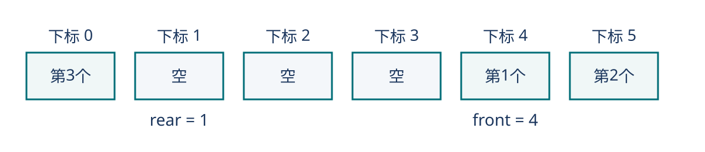
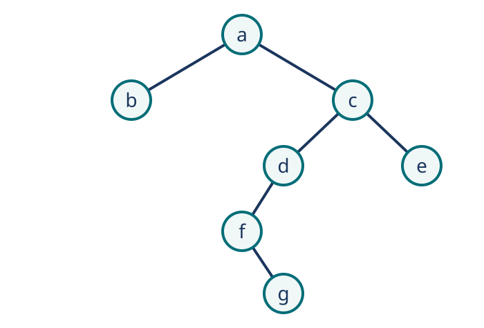
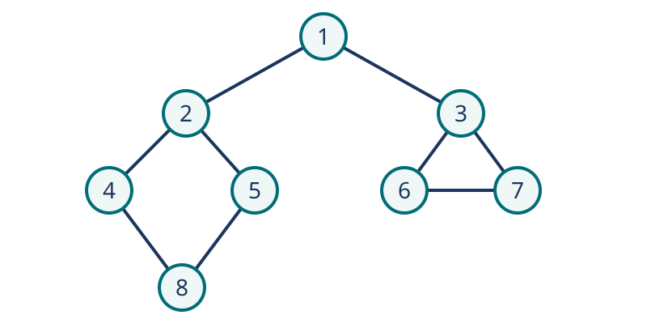

# 数据结构讲义

资料整理版｜2026-11-25。以六份速成课课件为范围整理；原资料未提供完整课程大纲、教材版本和考核要求。

## 一页速览

```text
绪论：逻辑关系 → 存储实现 → 算法及复杂度
线性表 → 栈与队列 → 串、数组、广义表
                              ↓
                    树、二叉树 → 图
```

先从第一章弄清“关系”和“存储”的区别；第二至四章练习线性结构及其操作；第五、六章处理树和图。每章结合示意图理解方法，再到配套题册按题号检验。

## 第一章｜绪论：把数据关系与处理方法分开


图 1-1　本章知识地图。

知识地图：数据 → 元素与关系 → 逻辑结构 → 存储实现 → 算法 → 时间与空间分析。

<a id="k-9101"></a>
### K-9101｜数据、元素、数据项和数据对象

**先看例子。** 一张人员表中，每一行是一条人员记录；姓名、性别、身高、课程代号是记录里的各个字段。把数据想成一箱积木：数据是可由计算机处理的信息表示，数据元素是通常作为一个整体处理的单位，数据项是元素中有独立含义的组成部分。数据对象是性质相同的数据元素的集合。

课件图片给出人员表与课程表：

| 姓名 | 性别 | 身高 | 课程代号 |
| --- | --- | ---: | --- |
| 小明 | 男 | 180 | A |
| 小红 | 女 | 180 | A |
| 小绿 | 男 | 180 | B |

| 课程代号 | 课程名 |
| --- | --- |
| A | 语文 |
| B | 数学 |

人员表和课程表可以分别视为两个数据对象；人员表中的一行是一个人员数据元素，“姓名”等是数据项。数据项是否需要再拆分，取决于任务要求，例如姓名在另一个应用中也可能拆成姓与名。

**边学边练：** [P-9101—9103](题目与解答.md#p-9101)。

<a id="k-9102"></a>
### K-9102｜逻辑关系和存储方式

**关系与摆放是两件事。** 逻辑结构说“元素之间是什么关系”；存储结构说“如何放进计算机并表达关系”。同一逻辑结构可以采用不同的存储实现。

| 逻辑结构 | 关系特点 | 直观例子 |
| --- | --- | --- |
| 集合 | 除同属于集合外，不强调其他结构关系 | 一组互不排列的标签 |
| 线性 | 前后相邻，通常一个元素至多有一个直接前驱和一个直接后继 | 排队的人 |
| 树形 | 父子关系呈层次 | 一个部门下属多个小组 |
| 图形 | 元素之间可以有多对多关系 | 多地之间的交通网络 |

课件树形图示例以 `a` 为父结点、`b、c、d、e、f` 为子结点；图形示例的有向边为 `a→b、a→c、d→a、e→c`。这两组关系分别体现一对多和多对多的组织方式。

顺序存储把元素放在连续空间，通过位置计算访问。链式存储用结点和链接表示关系，结点可以连续，也可以分散。例如课件中的顺序表按地址 `100、104、108、…、176` 存放 20 个占 4 字节的元素，`a[0]=45、a[1]=65、a[2]=7、a[19]=21`；示例地址只是说明，不能推广为所有类型都占 4 字节。

链表示意：`头指针 → a1 → a2 → … → an → 空`。连续存储不等于所有逻辑关系天然等于地址顺序：怎样解释地址仍由数据结构的实现规则决定。

**抽象数据类型（ADT）**描述数据对象、元素之间的关系和允许的基本操作，强调“能做什么”，把具体存储实现隔开。例如栈规定压入和弹出遵循后进先出，可以由数组或链表实现。课件一处把 ADT 简化为“基本类型以外的数据类型”，同一课件的习题解释给出了对象、关系和操作三部分；本讲义采用后三部分的定义。

**边学边练：** [P-9101—9103](题目与解答.md#p-9101)。

<a id="k-9103"></a>
### K-9103｜算法及其质量

算法是为解决特定问题写出的有限步骤。课件列出五项性质：有穷性、确定性、可行性、零个或多个输入、一个或多个输出。确定性强调每一步含义明确；相同输入能否得到相同结果还取决于算法是否包含随机等额外输入，不能把课件的确定性措辞随意套到所有随机过程。

设计时除了正确，还应考虑可读、对异常输入的处理能力、执行时间及额外空间。数据结构组织对象，算法决定如何处理对象，两者结合形成可执行程序。

**边学边练：** [P-9104](题目与解答.md#p-9104)。

<a id="k-9104"></a>
### K-9104｜时间复杂度与额外空间

**要比较方法，先数工作量。** 设输入规模为 `n`，先选基本操作，再数执行次数随 `n` 如何变化；只保留渐近增长阶，就能比较规模很大时的趋势。例如连续做 `n` 次是 `O(n)`，两个各执行 `n` 次的嵌套循环共有 `n²` 次基本操作，是 `O(n²)`。

| 循环方式 | 基本操作次数 | 渐近阶 |
| --- | --- | --- |
| 一条固定语句 | 常数次 | `O(1)` |
| 从 1 遍历到 n | n 次 | `O(n)` |
| 两层各遍历 n 次 | n² 次 | `O(n²)` |
| 从 1 开始每轮乘 3，直到超过 n | `floor(log₃ n)+1` 次（`n≥1`） | `O(log n)` |
| 第 i 行执行 n−i 次，i=1…n−1 | n(n−1)/2 次 | `O(n²)` |
| 从 0 开始递增 y，直到 `(y+1)²>n` | `floor(sqrt(n))` 次（`n≥1`） | `O(sqrt(n))` |

课件双层循环示例在仅计两层条件判断和内层 `x=x+1` 的口径下，分别执行 `n+1`、`n(n+1)` 和 `n²` 次，总数为 `2n²+2n+1`。若还统计初始化和自增语句，精确表达式会改变，但增长阶仍为 `O(n²)`。

大 O 是渐近上界，不等于“运行时间严格正比于某项”；具体机器和实现会改变实际时间。最好、最坏、平均复杂度应先指定输入规模及输入分布；平均情况不是自动假定所有输入等概率。

其中 `sqrt(n)` 表示 n 的平方根。空间分析要明确统计口径：总空间可包含输入和输出，**辅助空间**只统计算法额外使用的空间。固定数量的整数变量为 `O(1)`；额外申请长度为 `n` 的数组为 `O(n)`；递归调用栈也可能随 `n` 增长。

**边学边练：** [P-9104—9108](题目与解答.md#p-9104)。

**本章复盘**

| 提问 | 回答 |
| --- | --- |
| 先确定什么 | 数据元素及其逻辑关系 |
| 再决定什么 | 选择存储实现和操作算法 |
| 怎样比较方法 | 在明确输入及统计范围后分析时间和额外空间 |

**三句话带走：** 数据结构把元素和关系组织起来；逻辑关系可以有不同存储实现；分析复杂度先数操作并明确空间口径。

## 第一章核对手记

| 来源 | 差异与处理 |
| --- | --- |
| B007-01 第 13、21 张 | 第 13 张把 ADT 简化为非基本类型；第 21 张按数据对象、关系和操作解释。本稿采用后者。 |
| B007-01 第 16 张 | 课件将大 O 解释为“成正比”，本稿区分渐近上界和严格比例；执行次数取决于对比较、赋值等操作的计数约定。 |
| B007-01 第 18 张 | 课件只讨论额外辅助空间；本稿区分总空间与辅助空间。 |
| B007-01 第 8 张 | 标为线性结构的配图呈现课程记录和多个索引表，图文对应关系不够明确，暂不把该图当作线性表的唯一示例。 |

## 第一章来源对照

K-9101：B007-01 第 3—5、21 张；K-9102：第 6—13、21—22 张；K-9103：第 14—15 张；K-9104：第 16—18、23—26 张。第 1—2 张为封面和目录，第 19—20、27 张为总结、分隔或结束页。

## 第二章｜线性表：给元素排出先后次序


图 2-1　本章知识地图。

知识地图：有限序列 → 位序与前驱后继 → 连续存储的顺序表 / 指针连接的单链表 → 按位置操作 → 时间与空间取舍。

<a id="k-9105"></a>
### K-9105｜线性表与位序

**先想象一列候车的人。** 每个人有自己的位置，除队首外每人都有直接前一个人，除队尾外每人都有直接后一个人。线性表是 `n≥0` 个相同数据特性的元素组成的有限序列：

```text
L = (a₁, a₂, …, aᵢ, …, aₙ)；n=0 时为 ( ) 空表
```

元素可以是整数、字符，也可以是一条含学号、姓名、性别、年龄和成绩的学生记录；元素之间有顺序，并不要求元素值按大小排序，也允许值重复。对非空表而言，首元素没有直接前驱，末元素没有直接后继；中间元素各有一个直接前驱和直接后继。

线性表 ADT 可以描述为数据对象 `{aᵢ | 1≤i≤n}`、相邻关系 `{(aᵢ₋₁,aᵢ) | 2≤i≤n}`，以及创建、取值、插入、删除、查找、分解和排序等操作。它描述接口和关系，不指定使用数组还是链表。

| 名称 | 含义 | 例子 |
| --- | --- | --- |
| 位序 i | 线性表中的第几个元素，从 1 开始 | 第 3 个元素 `a₃` |
| 数组下标 | C/C++ 数组中的位置，从 0 开始 | 存放第 3 个元素的 `elem[2]` |
| 表长 n | 当前有效元素个数 | 空表长度为 0 |

**边学边练：** [P-9114](题目与解答.md#p-9114)。

<a id="k-9106"></a>
### K-9106｜顺序表：连续空间与随机访问

顺序表用连续存储单元依次存放线性表元素。若第 1 个元素的起始地址是 `base`，每个元素占 `w` 个存储地址单位，那么第 `i` 个元素的地址为 `base+(i−1)×w`。例如首地址 100、每个元素占 2 个地址单位，第 5 个元素位于 `100+(5−1)×2=108`。

```text
位序       1       2       3       …       n
下标       0       1       2       …      n−1
内容      a₁      a₂      a₃       …      aₙ
地址     base   base+w  base+2w    …  base+(n−1)w
```

因为可由下标直接计算地址，已知合法位序时取值为 `O(1)`；按值查找一般要从头比较，最坏 `O(n)`。在第 `i` 个位置插入时，必须先把原来第 `i` 到第 `n` 个元素后移；需移动 `n−i+1` 个元素。删除第 `i` 个元素时后续元素前移 `n−i` 个；若位置平均分布，插入的平均移动次数为 `n/2`。这里默认数组容量足够；满表扩容还需额外分配和复制。

**有序表归并。** 两个表各自已经有序时，分别从表头比较，输出较小者并只移动该表指针；一个表用尽后，直接接上另一个表的剩余元素。例如 `(1,3)` 与 `(2,4)` 依次比较 1/2、3/2、3/4，得到 `(1,2,3,4)`，共比较 3 次。两表各有 `n≥1` 个元素时，标准逐元素归并最好比较 `n` 次、最坏 `2n−1` 次，总时间为 `O(n)`。

课件使用动态分配的顺序表。下面保留其 `ElemType*` 与长度的设计，用可编译的 C++ 补足类型、局部变量和返回值；查找返回位序，0 代表失败。

```cpp
#include <new>
using ElemType = int;
struct SqList { ElemType *elem; int length; int capacity; };

bool init(SqList &L, int capacity) {
    if (capacity <= 0) return false;
    L.elem = new (std::nothrow) ElemType[capacity];
    if (!L.elem) return false;
    L.length = 0; L.capacity = capacity;
    return true;
}
bool get(const SqList &L, int i, ElemType &e) {
    if (i < 1 || i > L.length) return false;
    e = L.elem[i - 1];
    return true;
}
int locate(const SqList &L, ElemType e) {
    for (int i = 0; i < L.length; ++i)
        if (L.elem[i] == e) return i + 1;
    return 0;
}
/* 使用结束后 delete[] L.elem，且不要把同一数组重复释放。 */
```

普通 `new` 在分配失败时通常抛出 `std::bad_alloc`；这里用 `std::nothrow` 才能通过空指针判断失败。课件把普通 `new` 与空指针检查并列，应区分这两种机制。

**边学边练：** [P-9109—9111](题目与解答.md#p-9109)、[P-9115](题目与解答.md#p-9115)。

<a id="k-9107"></a>
### K-9107｜单链表：通过指针连接结点

链表中的结点包含数据域和指针域；结点地址不要求连续，靠 `next` 找下一个结点。课件给出的存储示例为：

| 结点地址 | 数据 | 下一个结点地址 | 位序 |
| --- | --- | --- | --- |
| 1000 | a | 1100 | 1 |
| 1100 | b | 1200 | 2 |
| 1200 | c | 1300 | 3 |
| 1300 | d | 0（空） | 4 |

这些地址仅为示意；链式存储不要求相邻结点碰巧连续。课件表中另列 1400 空行，它不是当前链表中的元素。

```text
带头结点：  L → [头结点] → [a₁] → [a₂] → … → NULL
不带头结点：L → [a₁] → [a₂] → … → NULL
```

头指针保存第一个结点的地址；若设置头结点，它指向头结点，否则指向首元结点。**首元结点**存第一个数据元素，**头结点**是首元前附加的结点。带头结点的空表满足 `L->next==NULL`（前提是头结点已建立），不带头结点的空表满足 `L==NULL`。

获取第 `i` 个元素时，从首元结点开始按 `next` 往后走，数到 `i`；若 `i<1` 或提前遇到 `NULL`，说明位置无效。访问第 `i` 个结点需要随位置增长的遍历时间，最坏 `O(n)`；若已经持有某结点指针，读取该结点数据为 `O(1)`。

**边学边练：** [P-9112](题目与解答.md#p-9112)、[P-9117](题目与解答.md#p-9117)。

<a id="k-9108"></a>
### K-9108｜链表插入、删除与指针顺序

**插入时先接后半段，才能不丢链。** 已找到第 `i−1` 个结点 `p`，要插入新结点 `s`：先让 `s->next=p->next`，再让 `p->next=s`。第 1 个位置的前驱是头结点；在表尾插入时 `p->next` 原本为空。

```text
插入前：p → 原后继       第一步：s → 原后继
第二步：p → s → 原后继
```

删除时先保存要删的结点，再绕过它并释放：`q=p->next; p->next=q->next; delete q;`。若 `p->next` 已经为空，就没有第 `i` 个结点可删。

下列示例采用带头结点的 C++ 单链表。这里默认 `L` 已指向有效头结点；定义 `Node` 后可先调用 `make_list()` 建立空表。`insert` 和 `erase` 都先从头找前驱，因此总的最坏时间为 `O(n)`；已知前驱后修改指针本身只需 `O(1)`。

```cpp
#include <new>
struct Node { int data; Node *next; };
Node *make_list() { return new (std::nothrow) Node{0, nullptr}; }

bool get(Node *L, int i, int &value) {
    if (!L || i < 1) return false;
    Node *p = L->next;
    for (int j = 1; p && j < i; ++j) p = p->next;
    if (!p) return false;
    value = p->data; return true;
}
bool insert(Node *L, int i, int value) {
    if (!L || i < 1) return false;
    Node *p = L;
    for (int j = 0; p && j < i - 1; ++j) p = p->next;
    if (!p) return false;
    Node *s = new (std::nothrow) Node{value, p->next};
    if (!s) return false;
    p->next = s; return true;
}
bool erase(Node *L, int i) {
    if (!L || i < 1) return false;
    Node *p = L;
    for (int j = 0; p->next && j < i - 1; ++j) p = p->next;
    if (!p->next) return false;
    Node *q = p->next;
    p->next = q->next;
    delete q; return true;
}
void destroy(Node *L) {
    while (L) { Node *next = L->next; delete L; L = next; }
}
```

| 任务 | 顺序表 | 带头结点单链表 |
| --- | --- | --- |
| 按位序访问 | `O(1)` | 最坏 `O(n)` |
| 按值查找 | 最坏 `O(n)` | 最坏 `O(n)` |
| 已知位置插入/删除 | 最坏移动 `O(n)` | 已知前驱时改链 `O(1)`；从头找前驱最坏 `O(n)` |
| 存储 | 连续，可能需要扩容 | 结点不必连续，指针域占额外空间 |

**边学边练：** [P-9112](题目与解答.md#p-9112)、[P-9118](题目与解答.md#p-9118)。

**本章复盘**

| 问题 | 先检查什么 | 关键结论 |
| --- | --- | --- |
| 位序访问 | 第 1 个元素与数组下标 0 的对应关系 | 顺序表可直接算地址 |
| 插入删除 | 是否已知前驱、位置是否合法 | 单链表先保存后继，再修改链接 |
| 选择实现 | 是否频繁随机访问、插入删除、容量变化 | 两种实现各有代价 |

**三句话带走：** 线性表规定前后顺序；顺序表靠位置计算地址、链表靠指针连接结点；链表改链接快，但寻找位置也要计入时间。

## 第二章核对手记

| 来源 | 差异与处理 |
| --- | --- |
| B007-02 第 7—8 张 | 课件用普通 `new` 后检查空指针；示例代码改用 `std::nothrow` 并检查结果，避免把抛异常的普通 `new` 当作失败返回空指针。 |
| B007-02 第 12 张 | 表中地址 1000、1100、1200、1300 只是示例，不意味着链结点必须连续。 |
| B007-02 第 17、19 张 | 原图中的 `p、s、q、j` 为未完整展示的局部变量，讲义补足声明与初始状态；原图插入的注释把 `i≤1` 误写为非法，合法首位插入应为 `i=1`，非法条件为 `i<1`。 |
| B007-02 第 21 张第 5 题 | 原答按标准双指针归并给出最少 n 次比较；输入均为各 n 个元素时，该结论对应两个表均非空且比较模型为逐元素比较。 |
| B007-02 第 23 张第 8 题 | 原答 `O(n²)` 对逐个从表头查找有序插入位置的最坏情况成立；若输入已有序并用尾指针建表可为 `O(n)`，原题缺少条件。 |

## 第二章来源对照

K-9105：B007-02 第 3—5、22 张；K-9106：第 6—10、20—21、23 张；K-9107：第 11—15 张；K-9108：第 16—19、21、23—25 张。原件第 4 张学生记录图包含示例姓名与学号，本讲义保留记录的字段结构，不转写具体姓名与学号。

## 第三章｜栈与队列：限制操作的位置


图 3-1　本章知识地图。

知识地图：线性关系 → 两端操作规则 → 栈的后进先出 / 队列的先进先出 → 顺序存储与循环复用 → 空满判断。

<a id="k-9109"></a>
### K-9109｜栈和队列的规则

**为什么盘子和排队不一样？** 一摞盘子只能从最上面放入和取出，所以后放的先取；排队买票时从队尾加入、从队头离开，所以先来先服务。栈和队列都是受操作位置约束的线性表。

| 结构 | 插入位置 | 删除位置 | 顺序 |
| --- | --- | --- | --- |
| 栈 | 栈顶 | 栈顶 | 后进先出 LIFO |
| 队列 | 队尾 | 队头 | 先进先出 FIFO |

若 `1、2、3` 依次入栈后才出栈，输出为 `3、2、1`；但入栈和出栈可以交替，因此并非所有出栈序列都只能是完全逆序。例如 `入1、入2、出2、出1、入3、出3` 得到 `2、1、3`。

顺序栈、链栈分别以连续空间和链式结点实现栈；循环队列、链队分别以循环数组和链式结点实现队列。逻辑上的操作规则不因存储方式改变。

**边学边练：** [P-9119—9122](题目与解答.md#p-9119)、[P-9128](题目与解答.md#p-9128)。

<a id="k-9110"></a>
### K-9110｜顺序栈的栈顶与操作

课件的顺序栈使用 `base` 指向栈底、`top` 指向当前栈顶元素之后的位置。空栈满足 `top==base`；已用空间为 `top−base`，若等于 `stacksize` 则现有空间已满。也可以用从 0 开始的整数 `top` 表示元素个数；**不能把指针值 `top` 直接与整数 0 或容量比较**，必须先确认本题采用的定义。

```text
入栈 5 → 入栈 3 → 入栈 6：底 [5,3,6] 顶
连续出栈：6 → 3 → 5；再次出栈失败
```

用整数 `top` 且预分配数组时，入栈先检查 `top<capacity`，再写 `a[top]` 并增加 `top`；出栈先检查 `top>0`，再减小 `top` 并取 `a[top]`。取栈顶但不删除时读取 `a[top−1]`。一类实现固定容量并拒绝满栈入栈；课件图片还展示了满栈后扩容，扩容成功后必须根据原来已用长度重新确定 `top`。

```cpp
#include <vector>
struct Stack { std::vector<int> a; };
void push(Stack &s, int value) { s.a.push_back(value); }
bool pop(Stack &s, int &value) {
    if (s.a.empty()) return false;
    value = s.a.back(); s.a.pop_back(); return true;
}
bool peek(const Stack &s, int &value) {
    if (s.a.empty()) return false;
    value = s.a.back(); return true;
}
```

此示例用动态数组管理扩容；`push_back` 可能因内存分配失败抛异常，扩容时单次插入可能搬移元素，摊还成本通常为 `O(1)`。课件的 `malloc/realloc` 写法针对可直接按字节移动的元素，扩容失败时应先把结果存入临时指针，避免丢失原分配地址。

**边学边练：** [P-9123](题目与解答.md#p-9123)、[P-9124](题目与解答.md#p-9124)。

<a id="k-9111"></a>
### K-9111｜循环队列的空、满与长度

普通顺序队列不断出队后，前面出现空位置；如果尾指针只向右走，末尾到界时可能发生“前面有空位、尾部却无法继续”的假溢出。循环队列把数组看作首尾相接的环，下标到末尾后用取模回到 0。

课件约定：`front` 指向队头元素，`rear` 指向队尾元素的下一位置；空队列二者相等。如果不另外保存状态，空与“每格都填满后绕回”的情况都会出现 `front==rear`。常用办法是**留一个空位**：数组大小为 `m`，最多存 `m−1` 个元素。

| 条件或操作 | 表达式 | 含义 |
| --- | --- | --- |
| 空 | `front == rear` | 没有可取元素 |
| 满 | `(rear+1)%m == front` | 再插入会追上队头 |
| 长度 | `(rear-front+m)%m` | 当前有效元素个数 |
| 入队后 | `rear=(rear+1)%m` | 尾位置沿环前进 |
| 出队后 | `front=(front+1)%m` | 头位置沿环前进 |

例如 `m=6、front=4、rear=1`，元素处于下标 `4、5、0`，长度 `(1−4+6)%6=3`。



图 3-2　六个单元、队头在 4、队尾后一位置在 1。另加元素计数或空满标志，也能区分空和满，但那时判断规则和可用容量要按该实现重新定义，不能混用公式。

有的题把 `f` 定义为队头元素的**前一个位置**，把 `r` 定义为队尾元素位置；在元素数小于数组长度时，长度也可写 `(n+r−f)%n`。它的指针含义与课件 `front/rear` 不同，公式看起来相似，不代表指针指向的位置相同。

**边学边练：** [P-9121](题目与解答.md#p-9121)、[P-9126—9127](题目与解答.md#p-9126)。

<a id="k-9112"></a>
### K-9112｜循环队列的入队与出队

先判断能否操作，再写值或读值，最后推进指针；这样空队不读数据、满队不覆盖队头。下例数组有 6 个单元，留 1 个空位，因此最多保存 5 个整数。

```cpp
struct Queue { int a[6]{}; int front = 0, rear = 0; };
int length(const Queue &q) { return (q.rear - q.front + 6) % 6; }
bool enqueue(Queue &q, int value) {
    if ((q.rear + 1) % 6 == q.front) return false;
    q.a[q.rear] = value;
    q.rear = (q.rear + 1) % 6;
    return true;
}
bool dequeue(Queue &q, int &value) {
    if (q.front == q.rear) return false;
    value = q.a[q.front];
    q.front = (q.front + 1) % 6;
    return true;
}
```

链队列删除最后一个元素后，队头和队尾状态都需要与空队表示一致；是否把尾指针置空、还是指回保留的头结点，取决于链队列是否设置头结点及其约定。

**边学边练：** [P-9125—9128](题目与解答.md#p-9125)。

**本章复盘**

| 问题 | 检查 | 结论 |
| --- | --- | --- |
| 元素出入顺序 | 是否允许交替进出 | 栈只能从顶端操作；队列从头出、尾入 |
| 指针代表什么 | 栈顶本身还是其后一个位置；队头前还是队头 | 下标和空满公式随约定改变 |
| 循环数组能装多少 | 是否保留一个空位 | `m` 格留一格时最多装 `m−1` 个 |

**三句话带走：** 栈后进先出，队列先进先出；循环数组通过取模复用空间；使用空满公式前先确认指针定义和容量约定。

## 第三章核对手记

| 来源 | 差异与处理 |
| --- | --- |
| B007-03 第 5—9 张 | 文字把 `top` 写成类似整数的位置，而代码定义为指针；正文区分指针和下标，并分别给出空满条件。 |
| B007-03 第 7 张 | 图片展示满栈扩容，旁图展示满栈报错；两者是不同设计，正文分别说明。 |
| B007-03 第 21 张第 3 题 | 题中 `f` 是队头前一位置、`r` 是队尾位置，与正文队头/队尾下一位置的约定不同；分别解释。 |
| B007-03 第 25 张第 9 题 | 原题将“最大容量为 n”与留空一格的公式并列；若 n 是数组单元数，可存 n−1 个；若 n 是实际可容纳元素数，还需说明额外空间或标志位。 |

## 第三章来源对照

K-9109：B007-03 第 3—4、19—22、25 张；K-9110：第 5—9、23 张；K-9111：第 10—13、21、24—25 张；K-9112：第 14—18、24 张。第 1—2、26 张为封面、目录和结束页。

## 第四章｜串、数组与广义表


图 4-1　本章知识地图。

知识地图：字符序列 → 串的存储与操作 → 数组的多维下标和线性地址 → 广义表的原子、子表、表头与表尾。

<a id="k-9113"></a>
### K-9113｜串：元素限定为字符的线性表

串是零个或多个字符组成的有限序列；串长是字符数量，空串长度为 0，而由一个或多个空格构成的空白串长度大于 0。子串是主串中一段连续字符；长度相同且对应位置字符全部相同，两个串才相等。

串的常见操作包括赋值、比较、求长度、连接、取子串、定位子串和替换。操作中使用的位置是否从 0 还是从 1 开始，应先按接口约定确定；串比较的字符顺序也受编码和比较规则影响。

| 存储方式 | 结构 | 特点 |
| --- | --- | --- |
| 定长顺序串 | 固定字符数组，可用单独字段或指定位置存长度 | 容量预定；超容量时需定义截断或失败行为 |
| 堆分配串 | 动态分配连续空间，记录地址和长度 | 空间可随需求变化，需处理分配和释放 |
| 块链串 | 结点内存多个字符，再以指针连接 | 结点大小影响指针开销；最后一块可能未填满 |

定长串还可以用结束标记表示长度，如 C 字符串以 `\0` 结尾，结束符不计入长度，但需要空间存放它。图片中块大小为 4 的示意是 `ABCD → EFGH → … → MN##`，`#` 表示最后一块未使用位置；若数据中本身可能出现 `#`，应另存实际长度，不能仅靠这个符号判定结束。

**边学边练：** [P-9129—9130](题目与解答.md#p-9129)。

<a id="k-9114"></a>
### K-9114｜多维数组的行优先与列优先地址

一维数组中的元素类型相同且连续存储；从 0 起计，下标 `i` 元素的地址为 `base+i×w`，其中 `w` 是每个元素占用的地址单位。二维数组既可看作行向量的序列，也可看作列向量的序列；确定实际地址前先确认按行还是按列存储。

设行范围为 `r₀…r₀+R−1`，列范围为 `c₀…c₀+C−1`，每个元素占 `w` 个地址单位：

| 存储顺序 | `A[i,j]` 从首地址起的元素个数 | 地址 |
| --- | --- | --- |
| 行优先 | `(i−r₀)×C+(j−c₀)` | `base+元素偏移×w` |
| 列优先 | `(j−c₀)×R+(i−r₀)` | `base+元素偏移×w` |

**例：** `A[1…100,1…100]` 行优先，每个元素占 2 个地址单位，首地址 10。`A[5,5]` 前有 `4×100+4=404` 个元素，地址 `10+404×2=818`。先算元素偏移，再乘元素大小，能避免把元素个数直接当成字节数。

**边学边练：** [P-9131—9133](题目与解答.md#p-9131)。

<a id="k-9115"></a>
### K-9115｜对称矩阵的压缩存储

对称矩阵满足 `aᵢⱼ=aⱼᵢ`；只保存下三角（含对角线）即可恢复另一半。若下标从 1 开始、按行依次保存，下三角第 `i` 行有 `i` 个元素，前 `i−1` 行共有 `i(i−1)/2` 个。对 `i≥j`，元素在一维数组中的位序为 `k=i(i−1)/2+j`；对 `i<j`，先交换行列，用 `k=j(j−1)/2+i`。

例如第 8 行第 5 列前有 `7×8/2=28` 个元素，位序为 `28+5=33`。若首元素地址是 1、每个元素占 1 个地址单位，则地址也为 33；其他首地址或元素大小需再换算。公式依赖**只存下三角、含对角线、行优先且位序从 1 开始**，条件改变时不能直接套用。

**边学边练：** [P-9135—9136](题目与解答.md#p-9135)。

<a id="k-9116"></a>
### K-9116｜广义表、表头和表尾

广义表也是有限序列，但元素既可以是单个原子，也可以是一个子表。例如 `(a,(b,c,d))` 的顶层有两个元素：原子 `a` 和子表 `(b,c,d)`，所以长度为 2；`((a,b,c))` 只有一个顶层子表，长度为 1。

广义表的深度由最深的嵌套层数决定；本资料中 `((1,2),(3,(4,5)))` 最深有 3 层括号，深度为 3。顶层元素数量与括号深度是两种指标，不可混算。空表 `()` 长度为 0；`(())` 有一个元素——空表——所以长度为 1。空表与含空表的表不相同。

对**非空表**，`Head(L)` 取第一个元素，可以是原子或子表；`Tail(L)` 由剩余元素组成，结果仍是广义表。例如 `L=((a,b,c))`：`Head(L)=(a,b,c)`，`Tail(L)=()`。空表没有可取的表头或表尾。

课件还给出 `A=()`、`B=(e)`、`C=(a,(b,c,d))`、`D=(A,B,C)`，代入后 `D=((),(e),(a,(b,c,d)))`，长度为 3。`E=(a,E)` 展示递归引用：按引用表示可有限存储定义，但不断展开会出现无限嵌套，因此不能把展开后的深度当成普通有限括号层数计算。

**边学边练：** [P-9134](题目与解答.md#p-9134)、[P-9138—9140](题目与解答.md#p-9138)。

**本章复盘**

| 任务 | 先判断什么 | 核心步骤 |
| --- | --- | --- |
| 串长度 | 是否为空串、空格是否属于字符 | 数实际字符，不把结束符算入 |
| 数组地址 | 下标起点、行列优先、元素大小 | 算元素偏移，再乘地址单位 |
| 广义表 | 顶层元素和最深层分别是什么 | 顶层计长度，嵌套计深度 |

**三句话带走：** 串限定元素为字符；数组地址由存储顺序和元素大小共同决定；广义表的一个元素可以是子表。

## 第四章核对手记

| 来源 | 差异与处理 |
| --- | --- |
| B007-04 第 14 张 | 用“外层逗号数加 1”计算长度只适用于非空表；空表长度为 0。 |
| B007-04 第 20 张第 5 题 | 每个元素为 10 个字符、每字符占 1 字节，原解把元素偏移 84 当作字节偏移，正确应为 840 字节；相同地址对应的选项仍为 B。 |
| B007-04 第 21 张第 7 题 | 原题未明确保留下三角还是上三角；按课件答案 33 推定保留含对角线的下三角并按行存储，讲解注明假设。 |
| B007-04 第 22 张第 9 题 | 中间维度写为 `−1…−3`，按升序上下界写法不成立；原答案 45 对应将其理解为 3 个下标 `−1、−2、−3`。 |

## 第四章来源对照

K-9113：B007-04 第 3—9、18 张；K-9114：第 10—11、19—20、22 张；K-9115：第 21 张；K-9116：第 12—16、20、22 张。第 1—2、17、23 张为封面、目录、总结和结束页。

## 第五章｜树、二叉树与哈夫曼编码


图 5-1　本章知识地图。

知识地图：层级关系 → 结点与子树 → 二叉树性质和存储 → 四种遍历与还原 → 权值合并和前缀编码。

<a id="k-9117"></a>
### K-9117｜树的层级与二叉树的左右

树可以为空；非空树有且只有一个根，其他结点各有一个父结点，并分属互不相交的子树。结点的**度**是它直接拥有的孩子个数；树的度是所有结点度的最大值；没有孩子的结点叫叶子。森林是互不相交的若干棵树。

课件的普通树示例：`A` 的孩子是 `B、C`；`B` 的孩子是 `D`；`C` 的孩子是 `E、F`；`D` 的孩子是 `G、H、I`；`E` 的孩子是 `J`。因此 `D` 的度为 3，整棵树的度为 3，`G、H、I、J、F` 为叶子。如果根按第 1 层计算，该树共有 4 层。一个结点不能同时属于两个不同的子树；否则这组关系不是上述意义的树。

二叉树的每个结点最多有两个孩子，并区分左孩子和右孩子。只有一个孩子时，左孩子与右孩子是不同的结构。二叉树可以为空；非空二叉树由根、左子树、右子树组成。

把**有序树**转为二叉树时，可采用“左孩子、右兄弟”表示：第一个孩子作为左孩子，下一个兄弟作为右孩子。若原树的孩子次序没有确定，转换结果的形态也不能唯一确定；对固定有序树和固定转换规则，转换结果唯一。

**边学边练：** [P-9143—9144](题目与解答.md#p-9143)。

<a id="k-9118"></a>
### K-9118｜二叉树性质与存储

以下层数从根所在的第 1 层开始；树高按层数计。

| 性质 | 结论与条件 |
| --- | --- |
| 第 `i` 层结点数 | 最多 `2^(i−1)`，`i≥1` |
| 高为 `h` 的二叉树 | 最多 `2^h−1` 个结点 |
| 非空二叉树 | 若叶子数为 `n₀`、度为 2 的结点数为 `n₂`，则 `n₀=n₂+1` |
| `n≥1` 的完全二叉树 | 高为 `floor(log₂ n)+1` |
| 完全二叉树的层序编号 | 结点 `i` 的父结点为 `floor(i/2)`（`i>1`）；左、右孩子若存在，其编号为 `2i`、`2i+1` |

**为什么叶子比双孩子结点多 1？** 设度为 1 的结点数为 `n₁`。按结点计数，`n=n₀+n₁+n₂`；按孩子边计数，`n−1=n₁+2n₂`。两式相减得到 `n₀=n₂+1`。

满二叉树每一层都占满；完全二叉树除最后一层外各层都满，最后一层从左向右连续排列。顺序存储可按完全二叉树的层序编号放入数组，以位置计算父子关系；一般稀疏二叉树也能这样表示，但需保留缺失位置，极端倾斜时空间可能浪费。课件称顺序存储“不能反映逻辑关系”，不准确：位序公式和空位标记可以反映关系。

链式表示给每个结点保存数据及左右孩子指针。例：`a` 左孩子 `b`、右孩子 `c`；`c` 左孩子 `d`、右孩子 `e`；`d` 左孩子 `f`、右孩子 `g`。层序位置分别为 `a:1、b:2、c:3、d:6、e:7、f:12、g:13`，没有结点的下标保持空位。

**边学边练：** [P-9145—9147](题目与解答.md#p-9145)。

<a id="k-9119"></a>
### K-9119｜先序、中序、后序和层序

三种深度优先遍历都先确定当前结点的左右子树，差别只在“访问根”放在什么位置；层序遍历从根开始逐层、每层从左到右访问。

| 方法 | 访问顺序 | 使用情境 |
| --- | --- | --- |
| 先序 | 根 → 左 → 右 | 先处理结点，再处理子树 |
| 中序 | 左 → 根 → 右 | 在左右子树之间处理结点 |
| 后序 | 左 → 右 → 根 | 先处理子树，再处理结点 |
| 层序 | 从上到下、每层从左到右 | 按层查看结点 |

课件遍历例中 `a` 的左右孩子为 `b、c`；`c` 的左右孩子为 `d、e`；`d` 的左孩子为 `f`；`f` 的右孩子为 `g`。注意这里 `g` 是 **f 的右孩子**，与上一节用于说明存储的树不同。

```text
        a
       / \
      b   c
         / \
        d   e
       /
      f
       \
        g
```



图 5-2　课件遍历例中 f 的右孩子是 g。

该树先序为 `abcdfge`，中序为 `bafgdce`，后序为 `bgfdeca`，层序为 `abcdefg`。中序例如先访问 `b`、`a`，再进入 `c` 的左子树；在那里先访问 `f`、`g`，再访问 `d`，最后访问 `c、e`。

**边学边练：** [P-9141](题目与解答.md#p-9141)、[P-9148](题目与解答.md#p-9148)。

<a id="k-9120"></a>
### K-9120｜由先序和中序还原二叉树

若每个结点标识互不相同，先序的第一个元素是当前子树的根；在中序中找到这个根，左边属于左子树，右边属于右子树，再按左右子树长度分割先序并递归处理。重复标识会使仅凭这两种遍历序列还原不一定唯一。

课件例：先序 `abcdefg`、中序 `cbdaefg`。根为 `a`；中序左侧 `cbd` 对应左子树、右侧 `efg` 对应右子树。左子树根 `b` 有左孩子 `c` 和右孩子 `d`；右子树是 `e→f→g` 的右孩子链。后序为 `cdbgfea`。

**边学边练：** [P-9142](题目与解答.md#p-9142)。

<a id="k-9121"></a>
### K-9121｜哈夫曼树、带权路径长度和前缀码

叶子 `i` 的权为 `wᵢ`、从根到叶子的边数为 `lᵢ`，带权路径长度是 `WPL=Σwᵢlᵢ`。对非负权值，哈夫曼构造每次取当前权值最小的两棵树合并，将两根权值之和作为新根，直到剩一棵树；得到的树使 WPL 最小。权值相等时选择顺序和左右分配可能不同，故编码不一定唯一。

课件用权值 `2、4、5、7` 对比三棵树：一种四个叶子都在第 2 层边深时 WPL 是 `(2+4+5+7)×2=36`；将权 7 放深度 1、权 5 放深度 2、权 2 与 4 放深度 3，WPL 为 `7+5×2+(2+4)×3=35`；另一棵树 WPL 为 `2+4×2+(5+7)×3=46`。第二棵较短。

课件另一例给出 `Z:2、K:7、F:24、C:32、U:37、D:42、L:42、E:120`。原文称这些数为概率，但它们的和是 306；可将其看作频数或比例权值，除以 306 才成为总和为 1 的概率。逐次合并产生权值 `9、33、65、79、107、186、306`，WPL 为这七个合并权值之和 `785`。原图在权值 24 处还出现字母 `M`；后续编码表用 `F`，这里采用题目首图与编码表的 `F`，并保留差异记录。

采用课件图示的左边标 0、右边标 1，可得到一组前缀码：

| 字符 | E | U | D | L | C | Z | K | F |
| --- | --- | --- | --- | --- | --- | --- | --- | --- |
| 编码 | 0 | 100 | 101 | 110 | 1110 | 111100 | 111101 | 11111 |

前缀码要求任何一个完整码字都不是另一个完整码字的开头。例如 `01` 是 `010` 的前缀，二者不能同时出现在前缀码中。该例两个权值为 42，交换对应左右位置会得到不同但同样有效的编码；固定给出原图左右标记时才有上表结果。

**边学边练：** [P-9149—9150](题目与解答.md#p-9149)。

**本章复盘**

| 问题 | 先确认 | 做法 |
| --- | --- | --- |
| 树的层次与结点 | 根层编号、是否区分左右 | 数孩子、分层并检查是否为树 |
| 二叉树的遍历与还原 | 结点标识是否唯一、遍历顺序 | 确定根并递归划分左右子树 |
| 哈夫曼编码 | 权值、并列时的选择、左右位值 | 每次合并最小权，读取根到叶的路径 |

**三句话带走：** 树表达层级，二叉树还区分左右；遍历的根访问时机决定顺序；哈夫曼树通过合并最小权使带权路径长度最小。

## 第五章核对手记

| 来源 | 差异与处理 |
| --- | --- |
| B007-05 第 9 张 | 顺序存储可以用编号与空位标记表达逻辑关系；本稿说明稀疏树主要问题是空间浪费。 |
| B007-05 第 20—23 张 | 课件将总和为 306 的数称作概率，且权 24 标为 F/M 不一致；本稿记为权值，按首图及编码表采用 F。 |
| B007-05 第 24 张第 1 题 | 树转二叉树的唯一性需固定孩子次序与转换约定；原题未交代。 |
| B007-05 第 26 张第 5 题 | 图中文字上下标显示，A 为 `m^k−1`、B 为 `m^(k−1)`；原答案 A 错，应选 B。总数在 `m>1` 时为 `(m^h−1)/(m−1)`，不是 `m^h−1`。 |
| B007-05 第 27 张第 6 题 | 课件解释仅列出“全无左孩子”或“全无右孩子”；链状树可在不同层混用左、右孩子，结点标识不重复时结论仍是一片叶子。 |

## 第五章来源对照

K-9117：B007-05 第 3—5、24 张；K-9118：第 6—10、25—26 张；K-9119：第 11—15、27 张；K-9120：第 16 张；K-9121：第 17—23、28—29 张。第 1—2、30 张分别为封面、目录和结束页。

## 第六章｜图：表达多对多关系


图 6-1　本章知识地图。

知识地图：顶点与边 → 有向/无向及路径 → 矩阵或邻接表 → 深度/广度遍历 → 拓扑排序。

<a id="k-9122"></a>
### K-9122｜顶点、边、度与路径

图用 `G=(V,E)` 表示：`V` 是顶点集合，`E` 是顶点间边的集合。课件采用顶点集合非空的约定；其他教材也可能允许空图，具体要看所用定义。

有向边 `<u,v>` 从弧尾 `u` 指向弧头 `v`；无向边 `(u,v)` 不区分顺序。例如课件有向图 `V={1,2,3}`、`E={<1,2>,<2,1>,<2,3>}`。

课件的无向示例为 `V={v₁,v₂,v₃,v₄,v₅}`、`E={(v₁,v₂),(v₁,v₄),(v₂,v₃),(v₂,v₅),(v₃,v₄),(v₃,v₅)}`。

在**无自环、无重边的简单图**中，无向完全图的每对不同顶点间有一条边，共 `n(n−1)/2` 条；有向完全图的每对不同顶点有两个方向的弧，共 `n(n−1)` 条。若允许自环或重边，边数上界要重新确定。子图的顶点和边分别来自原图，且所保留边的端点也必须保留。

无向图的度数之和等于边数的两倍；有向图的入度之和、出度之和都等于弧数。无向图中自环对度贡献 2；入度和出度针对有向边分别数进入和离开该点的次数。

路径把相邻顶点依次连接；无权路径长度通常是边数，带权路径的代价是边权之和。简单路径没有重复顶点；回路的起点和终点相同，简单回路除首尾重合外不重复顶点。例如原图的有向路径 `1→2→3→5→6→3` 有 5 条边；`3→5→6→3` 是简单回路。 课件无向图还给出路径 `1→2→5→7→6→5→2→3`，长度为 7；其中 `1→2→5→7→6` 是简单路径，`5→7→6→5` 是简单回路。

课件的带权有向图有顶点 `0、1、2、3`，弧及权值分别为 `0→1:1`、`0→3:4`、`1→2:9`、`1→3:2`、`2→0:3`、`2→1:5`、`2→3:8`、`3→2:6`。例如 `0→1→3` 的路径权值和为 `1+2=3`。

无向图中任意两点可互达称连通；有向图也可讨论强连通（任意两点相互可达）和弱连通（忽略方向后连通）。课件把“连通”只限定于无向图的说法过窄，应区分所采用的术语。

**边学边练：** [P-9151—9155](题目与解答.md#p-9151)。

<a id="k-9123"></a>
### K-9123｜邻接矩阵和邻接表

邻接矩阵用 `n×n` 方阵表达边。对无权图，`A[i][j]=1` 表示从 `i` 到 `j` 有**直接边**，不只是有一条可能经过其他顶点的路径；无边记 0。无向图矩阵对称；在无自环的无向简单图中，第 `i` 行元素和为顶点 `i` 的度。有向图行和对应出度、列和对应入度。若允许无向自环，只把对角线 1 加一次不能得到自环贡献 2 的度数，需要调整计数约定。

带权图应区分“无边”和边权为 0：可另用存在标记，或用约定的无穷大表示无边，不能一律把 0 当成无边。邻接矩阵判断指定两点是否直接相邻通常 `O(1)`，空间 `O(n²)`；扫描整个矩阵统计边数通常 `O(n²)`。

邻接表为每个顶点保存邻居列表。课件无向图的顶点及邻接顺序为：

| 顶点 | 依次列出的邻居 |
| --- | --- |
| v₁ | v₄、v₂ |
| v₂ | v₅、v₃、v₁ |
| v₃ | v₅、v₄、v₂ |
| v₄ | v₃、v₁ |
| v₅ | v₃、v₂ |

对不含自环的无向图，每条边通常在两个端点的表中各记一次，因此边结点数是边数两倍；对有向图的出边邻接表，每条弧通常只记一次，不能照搬“两倍”。邻接表空间通常为 `O(n+e)`，遍历一条顶点的邻居需要与其表长相当的时间；有向出边表容易数出度，统计入度一般需要遍历所有表或另建逆邻接表。

**边学边练：** [P-9153](题目与解答.md#p-9153)、[P-9157](题目与解答.md#p-9157)。

<a id="k-9124"></a>
### K-9124｜深度优先与广度优先遍历

**深度优先 DFS** 先访问起点，再选择未访问的邻居继续向深处走；走不动时回退，直至当前可达范围访问完。可用递归调用栈或显式栈。**广度优先 BFS** 先访问起点，把新发现的邻居入队，再依次处理队首；入队时即标记，避免同一顶点被重复入队。

对于不连通无向图，从一个起点只能访问所在连通分量；要遍历全部顶点，需继续选择未访问顶点作为新起点。有向图同样应区分从当前点可达的顶点与全图。邻接表实现下，完整 DFS 或 BFS 的时间通常为 `O(n+e)`；按邻接矩阵扫描邻居通常为 `O(n²)`。

课件示例的无向边为 `(1,2)、(1,3)、(2,4)、(2,5)、(4,8)、(5,8)、(3,6)、(3,7)、(6,7)`。从 1 出发，若每次按顶点编号从小到大检查邻居：



图 6-2　课件 DFS 和 BFS 共用的无向图。

- DFS：`1,2,4,8,5,3,6,7`。
- BFS：`1,2,3,4,5,6,7,8`。

若起点或邻居检查顺序改变，合法序列也会改变。课件给出的其他 DFS 序列如下（每行是一种可能，不能把它们当作同一次遍历的不同片段）：

| 起点 | 序列 |
| --- | --- |
| 1 | 1,2,5,8,4,3,6,7；1,2,5,8,4,3,7,6 |
| 1 | 1,3,6,7,2,4,8,5；1,3,7,6,2,4,8,5；1,3,7,6,2,5,8,4 |
| 2 | 2,4,8,5,1,3,6,7；2,5,8,4,1,3,6,7；2,5,8,4,1,3,7,6 |
| 2 | 2,1,3,6,7,4,8,5；2,1,3,6,7,5,8,4；2,1,3,7,6,4,8,5；2,1,3,7,6,5,8,4 |

**边学边练：** [P-9155—9157](题目与解答.md#p-9155)。

<a id="k-9125"></a>
### K-9125｜AOV 网络与拓扑排序

AOV 网络用顶点表示活动，用有向边表示直接先后约束。拓扑序列是一个包含所有顶点的线性排列，要求每条边的起点排在终点之前；这样的序列可能不止一个。只有有向无环图才能完成全部顶点的拓扑排序。

```text
计算各顶点入度 → 收集入度为 0 的顶点 → 取出并输出
                         ↑                  ↓
                   新入度为 0 ← 删除其出边并递减终点入度
```

处理结束后若输出顶点数少于总顶点数，剩余部分存在有向环。课件用栈保存入度为 0 的顶点；也可用队列，选择不同会改变合法拓扑序列，但不改变是否存在环的判断。

课件课程先修表示例：`C1` 高等数学、`C2` 程序设计基础无先修；`C3` 离散数学需 `C1、C2`；`C4` 数据结构需 `C3、C5`；`C5` 高级语言程序设计需 `C2`；`C6` 编译方法需 `C5、C4`；`C7` 操作系统需 `C4、C9`；`C8` 普通物理需 `C1`；`C9` 计算机原理需 `C8`。一个符合该表的顺序为 `C1,C2,C8,C3,C5,C9,C4,C6,C7`。另一张网络图还画出 `C2→C4` 这一条直接边，它可由 `C2→C5→C4` 间接满足；两张图的直接边集合并不完全相同。

**边学边练：** 可检查上面课程序列是否使每条先修边的起点早于终点；若同时增加 `C7→C1`，会出现环，无法完成拓扑排序。

**本章复盘**

| 任务 | 先确认 | 方法 |
| --- | --- | --- |
| 数边与度 | 有向还是无向，是否允许自环和重边 | 数端点、入度或出度 |
| 读取图 | 矩阵还是邻接表，有无边权 | 直接边与可达路径分开 |
| 遍历与排序 | 起点、邻居次序、是否全图 | DFS 用栈，BFS 用队列；拓扑排序处理零入度顶点 |

**三句话带走：** 图用顶点和边表达关系；存储方式决定查找和遍历成本；有向无环图才能排出完整拓扑序。

## 第六章核对手记

| 来源 | 差异与处理 |
| --- | --- |
| B007-06 第 3、5、27 张 | 完全图最大边数采用无自环、无重边的简单图约定；其他图定义可允许空顶点集、自环或重边。 |
| B007-06 第 11 张 | 邻接矩阵元素 1 表示直接边，原文写“有通路”容易与多边路径混淆；有向图第 i 列对应入度。 |
| B007-06 第 14 张备注 | “邻接表边结点数是边数两倍”适用于通常的无向图表示，不适用于有向出边邻接表。 |
| B007-06 第 24—25 张 | 先修表与后一网络图的直接边集合不同，后一图多画 `C2→C4`；本稿的课程顺序按先修表核对。 |
| B007-06 第 27 张第 3 题 | 原解称“连通图一定是无向图”；有向图也有强连通与弱连通概念，本题按无向连通简单图求解。 |

## 第六章来源对照

K-9122：B007-06 第 3—10、27—28 张；K-9123：第 11—14、27、29 张；K-9124：第 15—22、28—29 张；K-9125：第 23—26 张。第 1—2、30 张为封面、目录和结束页。

## 重点与易错点

下表的等级为整理判断，表示复习顺序，不代表原课件公布的考试分值。

| 级别 | 要点 | 条目与练习 |
| --- | --- | --- |
| 必须掌握 | 逻辑关系与存储方式分开；根据操作次数分析增长阶 | K-9102、K-9104、P-9105—9108 |
| 必须掌握 | 位序从 1 起、数组下标从 0 起；链表插入先保存原后继 | K-9106、K-9108、P-9115、P-9118 |
| 必须掌握 | 栈和队列的端点规则；循环队列先明确空位和指针约定 | K-9109—9112、P-9121、P-9127 |
| 必须掌握 | 数组先计算元素偏移，再乘每元素占用空间 | K-9114—9115、P-9131—9136 |
| 重要 | 广义表按顶层元素数求长度，按最深嵌套求深度 | K-9116、P-9138—9140 |
| 必须掌握 | 遍历顺序按根的位置区分；先序加中序还原需要结点标识唯一 | K-9119—9120、P-9141—9142 |
| 重要 | 哈夫曼构造每次取最小权；相同权值下编码不必唯一 | K-9121、P-9149—9150 |
| 必须掌握 | 邻接矩阵标直接边；DFS、BFS 和拓扑排序使用不同流程 | K-9123—9125、P-9153、P-9157 |

## 考试地图与课程要求

原材料只给出六个复习主题：绪论、线性表、栈与队列、串与数组及广义表、树与二叉树、图；课件没有注明本课程适用专业、完整教学大纲、学时、教材版本或考核分配。上述六项是本次资料范围，不能据此认定为完整课程范围。

## 来源与附件说明

- B007-01：《01+绪论.pptx》，27 张；B007-02：《02+线性表.pptx》，26 张；B007-03：《03+栈和队列.pptx》，26 张。
- B007-04：《04+串、数组、广义表.pptx》，23 张；B007-05：《05+树和二叉树.pptx》，30 张；B007-06：《06+图.pptx》，30 张。
- 来源页、图片对象、原题、校正与文件哈希见 [整理记录](整理记录.md)；九幅可编辑矢量图位于 `附件/图示/`。
