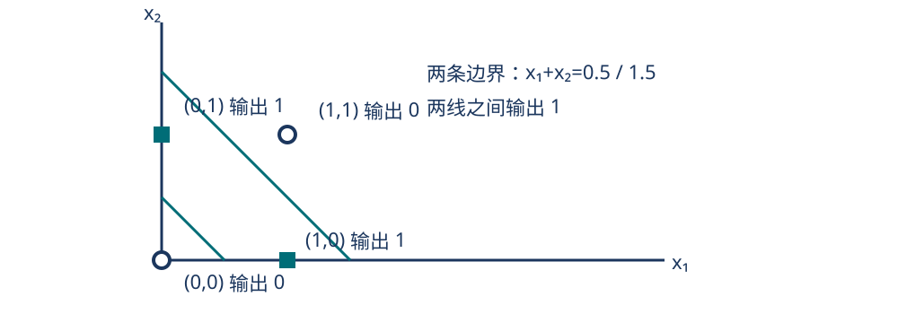
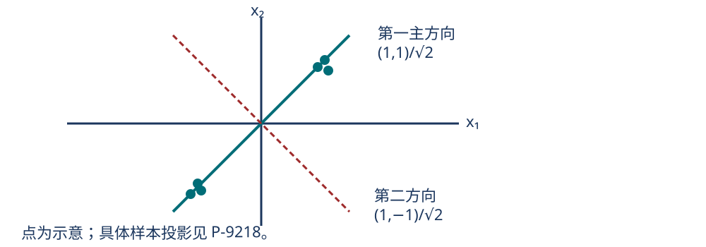
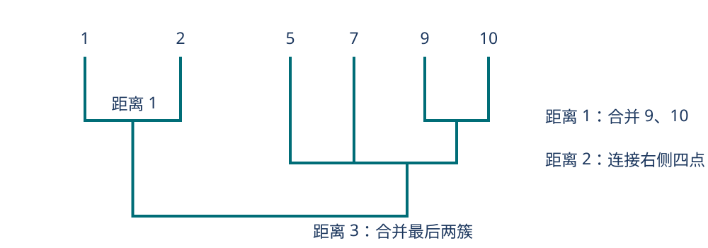

# 模式识别：从数据到分类决策

> 资料整理版：依据 8 份期末速成课课件整理，范围见导读与核对手记。

## 一页速览与导读

图 0-1 展示了从数据到分类与评价的复习路线。先学系统流程，再读统计决策与模型，最后学习特征处理和聚类；训练与测试应分别处理。

**图 0-1 模式识别全书主线**（整理自 B008-01、B008-08 第 21 页）。

本讲义面向首次系统复习的读者，以八份期末课件为资料范围。未提供对应版本的正式教学大纲和考核要求，因此章节顺序按课件主题与知识依赖组织。

## 第一章 概述与入门

遇到一张手写数字图片，计算机如何把像素变成“这是数字 3”？先采集，再清理数据，提取有用特征，最后按训练好的规则作决定。

图 1-1 展示模式识别系统的主要环节；性能评估为分类器改进提供反馈。

**图 1-1 模式识别系统流程**（整理自 B008-01 第 3—5 页）。

### K-9201｜模式识别解决什么问题

模式识别研究如何利用计算机自动处理和判读模式，核心任务之一是分类：依据观察到的信息，判断对象属于哪一类。模式可以是图像、声音或其他可测量数据。手写文字识别、语音识别、生物识别、交通与安防、遥感图像分析都是应用例子。

同一个对象可以有许多测量值，但并非每个值都有帮助。想识别数字时，原始像素描述图像；笔画走向和形状则可能更接近分类所需的信息。如何得到可靠、有效的信息，是分类前的重要工作。

### K-9202｜从采集到决策的五个环节

| 环节 | 要解决的问题 | 典型工作 |
| --- | --- | --- |
| 信息获取 | 从哪里获得描述对象的数据？ | 采集和测量信号、图像或数值，进行采样与量化。 |
| 预处理 | 怎样减轻噪声和尺度差异？ | 滤波、变换、编码、标准化、降噪等。 |
| 特征选择与提取 | 哪些信息有助于区分对象？ | 选择已有特征，或把原始表示变换为新的特征表示。 |
| 分类器设计 | 怎样得到可用的分类规则？ | 选择准则，利用样本训练并评估分类器，必要时调整。 |
| 分类决策 | 对一个待识别对象给出什么结果？ | 将对象的特征送入分类器，根据决策规则输出类别。 |

特征**选择**是在已有特征中挑选；特征**提取**则构造新的表示。提取经常用于压缩信息，但不要求所有变换都降低维数。

训练方式包括有监督、无监督和半监督。监督学习利用有标签样本；无监督学习在没有对应类别标签时寻找数据结构；半监督学习结合有标签与无标签样本。无监督并不意味着不能有任何先验知识，也不一定要求事先不知道类别数。

**自编例子。** 要区分苹果和橙子：相机采集照片；预处理调整图像；选择或提取颜色、形状等特征；用已知样本训练分类器；最后对新水果给出类别。若光照变化很大，仅凭颜色可能出错，因此要检查样本与实际环境是否相符。

**三句话带走**：模式识别要从观测数据得到对对象的判断；分类效果依赖数据、特征和分类器共同配合；训练得到的结果必须经过评估，不能把训练集上的表现直接当作新样本的表现。

| 复盘问题 | 快速回答 |
| --- | --- |
| 特征选择与提取有什么区别？ | 前者挑选已有特征，后者构造新表示。 |
| 训练与决策有什么区别？ | 前者建立规则，后者用规则处理新对象。 |
| 如何检验系统结构？ | 回答题册 P-9201。 |

#### 本章核对手记

| 条目 | 来源位置 | 核对说明 |
| --- | --- | --- |
| K-9201 | B008-01 第 2 页 | 分类与应用根据原课件整理。 |
| K-9202 | B008-01 第 3—5 页 | 课件称无监督学习无先验知识；此处说明无标签并不排除其他先验。训练集表现与新样本表现的区别为整理说明。 |

## 第二章 统计决策方法

一条鱼看起来既像鳕鱼又像鲑鱼，该怎么分类？先看两类鱼各自出现的频率，再看当前长度分别在两类中有多常见。图 2-1 的知识地图把这两条信息合并为后验概率，再选择合适的决策规则。

图 2-1 概括本章的主要概念：先验概率 + 类条件密度 → 贝叶斯公式 → 后验概率 → 最大后验／最小错误率，或结合损失表 → 最小风险决策。

**图 2-1 统计决策知识地图（整理自 B008-02）**。

### K-9203｜先验、类条件密度与后验

设真实类别为 $\omega_i$，观测特征为 $x$。先验 $P(\omega_i)$ 是观察 $x$ 前的类别概率；$p(x\mid\omega_i)$ 描述该类别下观测值的密度；后验 $P(\omega_i\mid x)$ 则是得到观测值后，该类别的概率。

当各类互斥且穷尽，且 $p(x)>0$ 时，贝叶斯公式为

$$P(\omega_i\mid x)=\frac{p(x\mid\omega_i)P(\omega_i)}{\sum_{j=1}^{M}p(x\mid\omega_j)P(\omega_j)}.$$

分子是该类对观测值的加权贡献；分母把所有类别的贡献相加，起归一化作用。连续特征的 $p(x\mid\omega_i)$ 是**概率密度**，不是“恰好取到 $x$”的概率；离散特征时，相应位置使用概率质量。

**例子**：鳕鱼和鲑鱼的先验分别为 $1/3$ 和 $2/3$，长度 $x=10$ 时的类条件密度分别为 $0.05$ 和 $0.5$。鳕鱼后验为 $(0.05/3)/(0.05/3+0.5\cdot2/3)=1/21\approx0.048$，鲑鱼后验为 $20/21\approx0.952$。课件以两条条件密度曲线示意，横轴标出 5.5、8.5 和 10；相应后验曲线显示两类概率随长度变化。计算细节见题册 P-9202。

### K-9204｜最大后验与最小错误率

最大后验规则把样本分给后验概率最大的类别。二分类时，若 $P(\omega_1\mid x)>P(\omega_2\mid x)$ 就选 $\omega_1$；反之选 $\omega_2$。相等时两者在这一规则下并列，可采用约定的平局处理方式。

为什么这样做？若选 $\omega_i$，判错的条件概率是 $1-P(\omega_i\mid x)$。所以在每个 $x$ 上选择最大后验，等价于选择最小条件错误率；对所有 $x$ 汇总也得到最小整体错误率。这一等价关系对应正确分类损失相同为 0、所有错误损失相同为 1 的情况；不同错误代价不同时应比较风险。

课件给出癌症筛查的数学例子：患癌先验 $0.005$，正常先验 $0.995$，患癌者阳性率 $0.95$，正常者阳性率 $0.01$。阳性后的患癌概率约为 $0.323$。这个结果说明阳性预测值同时受先验概率、阳性率影响；是否采取进一步检查要另行考虑损失和实际流程，不能仅凭最大后验直接作医疗决策。

### K-9205｜最小风险：把错误代价放进决策

不同错误的后果不一样。用 $\lambda(\alpha_i\mid\omega_j)$ 表示真实类别为 $\omega_j$ 时采取决策 $\alpha_i$ 的损失。观察到 $x$ 后，该决策的条件风险是各种损失按后验概率加权的平均：

$$R(\alpha_i\mid x)=\sum_{j=1}^{M}\lambda(\alpha_i\mid\omega_j)P(\omega_j\mid x),\qquad \alpha^*=\arg\min_i R(\alpha_i\mid x).$$

| 步骤 | 操作 |
| --- | --- |
| 1 | 用先验和类条件密度算各类后验概率。 |
| 2 | 按损失表逐行计算每个决策的条件风险。 |
| 3 | 选择风险最小的决策；相等时按预先约定处理。 |

课件细胞分类例子中，正常与异常的后验约为 $0.818$、$0.182$。若将异常误判正常的损失是 6，将正常误判异常的损失是 1，判正常的风险约为 $1.091$，判异常的风险约为 $0.818$，因此选异常；只按最大后验则选正常。两种规则的目标不同，结果不矛盾。详细计算见 P-9204。

**三句话带走**：贝叶斯公式把先验和观测证据合成为后验；相同错误代价下选最大后验可使错误率最小；错误代价不同时，要先算每个决策的条件风险。

| 复盘问题 | 答案 |
| --- | --- |
| 先验与后验的区别？ | 分别是观察特征之前与之后的类别概率。 |
| 两种规则何时等价？ | 所有正确决策损失为 0，所有错误决策损失相同为 1 等情形。 |
| 何时不能直接比较后验？ | 目标是最小化不等误判损失时，必须计算风险。 |

#### 本章核对手记

| 条目 | 来源位置 | 核对说明 |
| --- | --- | --- |
| K-9203、P-9202 | B008-02 第 2—6 页 | 原图中 $x=10$ 对应两类密度分别为 0.05、0.5；密度与点概率的区别为整理说明。 |
| K-9204、P-9203 | B008-02 第 7—8 页 | 第 8 页叠加文字遮住题干与推导；已从嵌入图片对象恢复原文并核对。例题仅用于数学计算。 |
| K-9205、P-9204 | B008-02 第 9—11 页 | 原解先把后验四舍五入再算风险得 1.092；直接用未舍入值计算约 1.091，分类结论相同。 |

## 第三章 概率密度函数估计

上一章要使用类条件密度 $p(x\mid\omega_i)$，但它常常没有现成答案。现在反过来：已经拿到一批样本，怎样估出产生这些样本的分布？

图 3-1 概括本章的主要概念：训练样本 → 选择估计方法 → 参数方法：假设分布形式、估计参数；非参数方法：利用样本直接估计密度 → 供分类决策使用。本章课件重点展开最大似然估计与贝叶斯估计。

**图 3-1 概率密度估计知识地图（整理自 B008-03）**。

### K-9206｜先选择估计路径

参数方法先选一个带未知参数的分布族，例如正态分布，再用样本估计均值、方差等参数。课件用身高示意三组参数 $(\mu,\sigma)=(1.6,0.2),(1.7,0.15),(1.8,0.1)$ 对应的不同曲线：均值改变曲线位置，标准差改变分布宽度。选定的分布族会影响结果；若真实数据与假设差别很大，得到的拟合也会受影响。

非参数方法不预先限定同样形式的有限维参数分布族，而是根据样本构造密度估计。课件列出直方图、$k$ 近邻估计和 Parzen 窗法；还列出最大似然、正态分布下的最大似然、EM 算法与多高斯参数求解、贝叶斯估计。后续页面只具体说明最大似然与贝叶斯估计的基本想法，其余名称在这份课件中没有详细推导。

### K-9207｜最大似然：让已观察样本的联合密度尽量大

假设样本 $X=(x_1,\ldots,x_N)$ 相互独立，且都来自密度 $p(x\mid\theta)$。看到数据后，把样本固定，让未知参数 $\theta$ 变化，似然函数就是

$$L(\theta;X)=p(X\mid\theta)=\prod_{i=1}^{N}p(x_i\mid\theta),\qquad \hat\theta_{\mathrm{ML}}=\arg\max_{\theta\in\Theta}L(\theta;X).$$

这里 $\Theta$ 是参数的允许范围。似然是固定数据后关于参数的函数；它本身不是参数的后验概率。取自然对数不改变正似然的大小顺序，同时将乘法变为加法：

$$\ell(\theta)=\log L(\theta;X)=\sum_{i=1}^{N}\log p(x_i\mid\theta).$$

| 解题步骤 | 要做什么 |
| --- | --- |
| 建模 | 写清分布、样本独立条件和参数范围，列出似然。 |
| 简化 | 在似然为正的范围取对数，把乘积改成求和。 |
| 求候选 | 若内部可导，令导数或梯度为零，求驻点；同时考虑参数边界及不可导位置。 |
| 检验 | 比较候选与边界，确认全局最大值；若上确界达不到，说明最大似然估计不存在。 |

**整理说明**：课件给出的“导数为零后解方程”适用于可导的内部极值；驻点不一定是最大值，最大值也可能出现在边界。

**自编例子**：一枚硬币独立投 10 次，正面出现 7 次，正面概率为 $p$。似然与 $p^7(1-p)^3$ 成正比；对数求导得 $7/p-3/(1-p)=0$，解得 $\hat p=0.7$。对数似然的二阶导数在 $(0,1)$ 内为负，且两端似然为零，因此该值是最大值。若 10 次全部正面，最大值在边界 $p=1$，不能靠内部导数为零得到。

### K-9208｜贝叶斯估计：把参数先验和样本结合

最大似然方法把待估参数看成固定但未知的量；贝叶斯方法给参数指定先验分布 $p(\theta)$，再用样本更新得到后验分布：

$$p(\theta\mid X)=\frac{p(X\mid\theta)p(\theta)}{\int_{\Theta}p(X\mid t)p(t)\,dt}.$$

分母要求有限且大于零；离散参数则把积分换成求和。得到后验分布后，可按具体损失函数选择点估计。最大后验估计使 $p(\theta\mid X)$ 最大；它一般不同于只最大化似然的估计，先验恰好不改变候选值排序时才可能一致。

**三句话带走**：密度估计从样本出发，为下一步分类提供分布信息；最大似然选择使观测数据的似然最大的参数；贝叶斯估计还使用参数的先验，且具体估计结果取决于后验与决策准则。

| 复盘问题 | 快速回答 |
| --- | --- |
| 最大似然是最大化参数的后验概率吗？ | 不是；它最大化固定样本下的似然。 |
| 解出导数为零的点就结束了吗？ | 还要检验最大值并考虑边界。 |
| 两种估计对参数的处理有什么区别？ | 最大似然视为固定未知；贝叶斯方法给参数指定先验分布。 |

#### 本章核对手记

| 条目 | 来源位置 | 核对说明 |
| --- | --- | --- |
| K-9206 | B008-03 第 2 页 | 方法清单照录；本份课件未展开清单中的全部方法。 |
| K-9207、P-9205 | B008-03 第 3—9、11 页 | 第 3 页三条正态曲线的纵轴数值与所标标准差不能直接按通常归一化正态密度核对，因此只采用不同参数产生不同曲线的定性关系；驻点和边界检查为整理说明。课件第 8 页称样本趋于无限时估计必收敛真值，一致性还需额外条件，不作无条件结论。 |
| K-9208、P-9206 | B008-03 第 10—11 页 | 后验公式及点估计说明为根据课件比较补充的整理说明。 |

## 第四章 线性分类器

如果两类点分布在一条直线的两边，我们能否用这条线给新点分类？线性分类器把这个画面推广到更高维空间；支持向量机进一步寻找训练数据之间较宽的间隔。

图 4-1 概括本章的主要概念：判别函数 → 直线／超平面及距离 → 根据样本选择参数 → 感知准则或最大间隔 SVM → 交叉验证与模型评价。

**图 4-1 线性分类知识地图（整理自 B008-04）**。

### K-9209｜判别函数与决策面

对输入 $x\in\mathbb R^d$，二类线性判别函数可写为 $g(x)=w^Tx+b$。约定 $g(x)>0$ 判为 $\omega_1$，$g(x)<0$ 判为 $\omega_2$；等于零时点落在界面，可按事先约定处理。多类时可为每类设置得分 $g_i(x)$，选择得分最大的类；二类比较可改写为 $g_1(x)-g_2(x)$ 的符号判断。

当 $w\ne0$ 时，$H=\{x:w^Tx+b=0\}$ 是 $d$ 维空间中的 $(d-1)$ 维超平面：二维中是一条直线，三维中是一个平面。若 $x_1,x_2$ 均在 $H$ 上，作差得 $w^T(x_1-x_2)=0$，因此 $w$ 垂直于平面内的方向，指向 $g$ 增大的正侧。

点 $x$ 到平面的**有符号距离**是 $(w^Tx+b)/\|w\|$，普通距离是 $|w^Tx+b|/\|w\|$。原点到平面的普通距离为 $|b|/\|w\|$；$b=0$ 时平面经过原点。固定 $w$ 的方向和长度时，改变 $b$ 会平移平面；位置由 $w$、$b$ 共同决定。

**自编例子**：$g(x_1,x_2)=3x_1+4x_2-10$。点 $(0,0)$ 的得分为 $-10$，在负侧，距界面 $|-10|/5=2$；法向量为 $(3,4)$。见 P-9208。

### K-9210｜从标注样本设计分类器与感知准则

训练样本给出特征与标签。选择判别函数形式后，设计反映分类目标的准则 $J$，再通过优化求参数。课件列出感知准则、最小平方误差准则、Fisher 准则和最小错分样本准则。

一种常用写法先给每个样本加上常数维度，并用类别标签统一方向：$\tilde x_i=(x_i^T,1)^T$，$y_i\in\{-1,+1\}$，令 $z_i=y_i\tilde x_i$，$a=(w^T,b)^T$。正确且不在边界上的样本满足 $a^Tz_i>0$。

感知准则针对错分或落在边界的样本集合 $M(a)=\{i:a^Tz_i\le0\}$ 定义

$$J_p(a)=\sum_{i\in M(a)}(-a^Tz_i).$$

批量修正可写成 $a_{k+1}=a_k+\rho_k\sum_{i\in M(a_k)}z_i$；单样本修正则每次只加一个当前错分样本的 $\rho z_i$，$\rho>0$。更新方向把相应样本往正确侧推动。在有限样本线性可分并满足常用感知器更新条件时，单样本算法经过有限次错误修正可找到分离解；线性不可分时不保证停止。注意 $J_p=0$ 也可能包含恰在边界的点，所以要另查严格正间隔。

课件第 11 页展示从 $a_1=0$、步长为 1 出发，依次按 $z_1,z_3,z_1,z_3,z_1$ 修正，到 $a_6$ 后各样本判别值为正，因此图中答案为 $a_6$；图没有提供各样本的明确坐标，不能据此编造数值向量。

### K-9211｜硬间隔支持向量机

在线性可分时，能把样本分开的平面通常不止一个。硬间隔支持向量机（SVM）选取使最近训练样本离决策面尽量远的平面。将参数按正倍数缩放，使最近样本满足 $y_i(w^Tx_i+b)=1$，则两侧支持平面为 $w^Tx+b=\pm1$，它们的间隔宽度为 $2/\|w\|$。

图 4-2 展示决策面和两侧支持平面。

**图 4-2 硬间隔支持向量机**（整理自 B008-04 第 15 页）。

最大化这个间隔等价于求解

$$\min_{w,b}\frac12\|w\|^2\quad\text{使得}\quad y_i(w^Tx_i+b)\ge1,\ i=1,\ldots,n.$$

标签为 $+1$ 的样本在正侧，标签为 $-1$ 的样本在负侧；等号处的样本位于间隔边界。此模型要求训练集线性可分。软间隔通过允许违反间隔并对其施加惩罚，处理噪声或不可分样本。

**整理说明**：课件同时使用“最近点到中间平面的距离”和“两侧支持平面之间的距离”描述间隔，二者相差一倍；这里分别称为单侧距离 $1/\|w\|$ 与间隔宽度 $2/\|w\|$。

### K-9212｜对偶问题、支持向量与核函数

对硬间隔约束引入 $\alpha_i\ge0$，拉格朗日函数为

$$L(w,b,\alpha)=\tfrac12\|w\|^2-\sum_i\alpha_i[y_i(w^Tx_i+b)-1].$$

对 $w,b$ 求驻点得到 $w=\sum_i\alpha_i y_i x_i$、$\sum_i\alpha_i y_i=0$。回代后，对偶问题可以写成

$$\max_{\alpha}\left(\sum_i\alpha_i-\tfrac12\sum_{i,j}\alpha_i\alpha_jy_iy_jx_i^Tx_j\right),\quad \alpha_i\ge0,\ \sum_i\alpha_iy_i=0.$$

等价地也可以将目标乘以 $-1$ 后求最小值。互补条件是 $\alpha_i[y_i(w^Tx_i+b)-1]=0$：若 $\alpha_i>0$，该点必在间隔边界；若点严格位于间隔之外，$\alpha_i=0$。反过来，位于边界不一定保证该点的乘子严格大于零。

对新样本，线性模型的得分是 $f(x)=\sum_i\alpha_i y_i x_i^Tx+b$，再按符号分类。核方法把内积替换为合适的核函数 $K(x_i,x)$，相当于在对应特征空间计算内积；线性 SVM 不必使用非线性核。核选择、软间隔和参数调整都有助于处理复杂数据，但不能保证任意数据完全可分或测试表现最佳。

### K-9213｜交叉验证与二分类指标

按课件流程，先准备数据并选择适用的特征处理、核及超参数，再训练模型和测试。$K$ 折交叉验证把训练数据分成 $K$ 份，每次用其中一份验证、其余份训练，轮流计算后汇总；留一法是每次留出一个样本。选择超参数时，标准化参数只能从每一折的训练部分拟合，再用于该折验证部分，避免数据泄漏；独立测试集用于最终评估，不能参与调参。

| 真实／预测 | 预测正 | 预测负 |
| --- | --- | --- |
| 真实正 | TP | FN |
| 真实负 | FP | TN |

$$\mathrm{SE}=\frac{TP}{TP+FN},\quad \mathrm{SP}=\frac{TN}{TN+FP},\quad \mathrm{ACC}=\frac{TP+TN}{TP+TN+FP+FN}.$$

$$\mathrm{MCC}=\frac{TP\cdot TN-FP\cdot FN}{\sqrt{(TP+FP)(TP+FN)(TN+FP)(TN+FN)}}.$$

敏感性 SE 衡量正样本中识别正确的比例；特异性 SP 衡量负样本中识别正确的比例；ACC 是整体正确比例。分母为零时对应指标不能按该式计算。课件还列出 AUC，它是 ROC 曲线下的面积，用于综合衡量不同阈值下的排序表现；不等于固定阈值下的准确率。

**三句话带走**：线性判别函数用超平面划分特征空间；硬间隔 SVM 在训练样本线性可分时寻找最大间隔；模型必须用未参与训练和调参的数据检验。

| 复盘问题 | 快速回答 |
| --- | --- |
| $g(x)$ 的值就是距离吗？ | 要除以 $\|w\|$ 才得到有符号距离，普通距离还要取绝对值。 |
| 硬间隔与软间隔区别？ | 硬间隔要求训练样本满足分离约束；软间隔允许违反并惩罚。 |
| 指标分母为零怎么办？ | 标为未定义，不能直接除零。 |

#### 本章核对手记

| 条目 | 来源位置 | 核对说明 |
| --- | --- | --- |
| K-9209、P-9208 | B008-04 第 2—8 页 | 原文有把带符号距离写作距离或范数的情况，已区分；超平面维数为 $d-1$；位置由 $w,b$ 共同决定。 |
| K-9210、P-9209 | B008-04 第 9—11 页 | 第 11 页图未给样本坐标，只保留图示修正次序和 $a_6$ 结论；边界样本与线性可分条件为整理说明。 |
| K-9211、K-9212 | B008-04 第 12—18 页 | 课件第 16 页文字对间隔表达混乱，按第 15 页 $2/\|w\|$ 和约束式推导；第 18 页由边界等号推出 $\alpha_i>0$ 过强，已按互补条件纠正。核映射不保证完全线性可分，最大间隔不保证真实风险最小。 |
| K-9213、P-9210 | B008-04 第 19—20 页 | 防止交叉验证数据泄漏、独立测试及指标分母条件为整理说明；原课件将交叉验证描述为防止过拟合，实际它主要用于评估和选择模型，不能保证消除过拟合。 |

## 第五章 非线性分类器

如果四个角上两类样本对角交错，一条直线怎样画也分不开。可以把多条简单边界组合起来，或先变换特征，再学习分类规则。

图 5-1 概括本章的主要概念：线性不可分 → 分段边界／特征变换／核方法／多层网络 → 前向计算 → 反向传播梯度与更新 → 检查分类结果。

**图 5-1 非线性分类知识地图（整理自 B008-05）**。

### K-9214｜为什么需要非线性分类

线性不可分可能来自样本噪声、类别重叠，也可能来自类别本身的几何结构。应先判断数据和目标，再选方法：分段线性判别函数可组合多条边界；非线性特征变换和核方法可改变可分结构；多层神经网络通过多个非线性单元组合形成复杂决策边界。课件还提到用于图像的卷积神经网络（CNN）。单层线性感知器只能产生线性边界，多层网络若所有激活都是线性函数，层与层相乘仍等价于线性变换，无法因此解决异或。

### K-9215｜多层感知器与异或

多层感知器（MLP）是前馈网络：输入经一个或多个隐藏层到输出层。课件展示的结构相邻层全连接、同层无连接、没有循环反馈；每个单元先求加权和，再经过激活函数。隐藏层提供中间表示，输出层据此给出结果。

课件给出的异或网络采用阶跃函数 $f(t)=1\ (t\ge0)$、$f(t)=0\ (t<0)$：

$$y_1=x_1+x_2-0.5,\qquad y_2=x_1+x_2-1.5,\qquad g=f(f(y_1)-f(y_2)-0.5).$$

| $x_1$ | $x_2$ | $f(y_1)$ | $f(y_2)$ | $g$ |
| ---: | ---: | ---: | ---: | ---: |
| 0 | 0 | 0 | 0 | 0 |
| 0 | 1 | 1 | 0 | 1 |
| 1 | 0 | 1 | 0 | 1 |
| 1 | 1 | 1 | 1 | 0 |

图 5-2 将课件中的两条线与异或样本重绘在一起。

**图 5-2 异或分类边界**（整理自 B008-05 第 5 页）。

第一个隐藏单元判断 $x_1+x_2\ge0.5$，第二个判断 $x_1+x_2\ge1.5$；输出单元保留两条边界之间的区域，恰好表示二值异或。该例的输入限定为 0、1，见 P-9211。

### K-9216｜反向传播：把误差对参数的影响传回去

BP 是反向传播（backpropagation）的简称，是利用链式法则计算损失对网络参数梯度的方法；它不是网络结构本身，也不是单独的参数更新规则。前馈网络可使用 BP 配合梯度下降等优化方法训练。

| 步骤 | 要做的事 |
| --- | --- |
| 初始化 | 设定网络结构、初始权重和偏置。 |
| 前向 | 输入样本，逐层计算激活和预测结果。 |
| 算损失 | 比较预测与目标，例如平方误差。 |
| 反向 | 从输出层向前，按链式法则求各参数梯度。 |
| 更新与复核 | 按优化方法更新权重和偏置，重复训练，并用验证数据检查效果。 |

例如 $z=wa+b$、$o=\sigma(z)$、$E=\tfrac12(o-t)^2$ 时，$\partial E/\partial w=(o-t)\sigma'(z)a$。一步梯度下降为 $w\leftarrow w-\eta\,\partial E/\partial w$，$\eta>0$。这里每一项都有角色：误差 $(o-t)$、激活斜率 $\sigma'(z)$ 和输入 $a$ 相乘，得到权重对误差的影响。

对多层网络，令第 $l$ 层输入和激活分别为 $z_j^{(l)}=\sum_i w_{ji}^{(l)}a_i^{(l-1)}+b_j^{(l)}$、$a_j^{(l)}=\sigma(z_j^{(l)})$，定义 $\delta_j^{(l)}=\partial E/\partial z_j^{(l)}$。平方损失下输出层有 $\delta_j^{(L)}=(a_j^{(L)}-t_j)\sigma'(z_j^{(L)})$，隐藏层则有

$$\delta_j^{(l)}=\sigma'(z_j^{(l)})\sum_k w_{kj}^{(l+1)}\delta_k^{(l+1)},\qquad \frac{\partial E}{\partial w_{ji}^{(l)}}=\delta_j^{(l)}a_i^{(l-1)}.$$

这与课件图中逐层计算误差项、调整连接权值的流程对应；符号正负会随误差项定义不同而变化，更新时必须与定义配套。

**整理说明**：异或手工构造使用不连续阶跃函数，不能直接用普通导数训练；BP 例子通常采用可用于求梯度的激活函数，如 sigmoid。课件将 BP 描述为有导师学习中的网络训练，BP 求梯度本身也可用于其他可微损失。

**三句话带走**：一条直线不能解决所有分类问题；多层非线性网络能组合简单边界表达异或；BP 利用链式法则求梯度，优化方法再用梯度更新参数。

| 复盘问题 | 快速回答 |
| --- | --- |
| 多层线性变换为何不够？ | 多个线性变换复合仍是线性变换。 |
| BP 是网络结构还是算法？ | 是计算梯度的方法，不等同于网络结构。 |
| 训练误差很低是否足够？ | 还要用未参与训练的数据评估。 |

#### 本章核对手记

| 条目 | 来源位置 | 核对说明 |
| --- | --- | --- |
| K-9214、K-9215、P-9211 | B008-05 第 2—5 页 | 原例阈值、连线权重和阶跃定义已列入；输出逐项验算。单层感知器只形成线性边界；多层网络需非线性激活才能得到非线性映射。 |
| K-9216、P-9212 | B008-05 第 4、6—7 页 | 课件将 MLP 也称 BP 网；整理区分网络结构与梯度算法，补充可微激活、优化和验证条件。 |

## 第六章 其他分类方法

给一个新样本分类，不一定要先写出一条直线：可以问附近的样本属于什么类，也可以沿着一连串问题走到一个结论，或让多个分类器共同投票。

图 6-1 概括本章的主要概念：已标注样本 → 最近邻／$k$ 近邻；递归划分 → 决策树／随机森林；多轮加权训练 → AdaBoost 集成。

**图 6-1 分类方法知识地图（整理自 B008-06）**。

### K-9217｜最近邻与 $k$ 近邻

最近邻法先选择距离，再寻找离待分类样本最近的已标注样本，把其类别作为预测。欧氏距离是 $d(x,z)=\sqrt{\sum_j(x_j-z_j)^2}$。例如 $P=(4,6)$ 到 $B=(5,5)$ 的距离为 $\sqrt2$。最近邻依赖附近样本与标签；样本稀疏、噪声、特征尺度差异或不合适的距离都可能影响结果。

$k$ 近邻（KNN）先选出 $k$ 个最近样本，再对其类别投票，票数最多的类别为预测结果。$k=1$ 退化为最近邻。若第 $k$ 位有距离并列，或类别票数并列，需要预先指定处理规则；多类问题中票数最多不一定超过半数。

| 步骤 | 操作 |
| --- | --- |
| 选距离 | 根据特征和任务选择度量；尺度不一致时考虑在训练数据上拟合标准化。 |
| 找邻居 | 计算到各训练样本的距离，排序选出 $k$ 个。 |
| 投票 | 统计类别，按事先规定的并列规则确定输出。 |

课件还列出剪辑近邻法、压缩近邻法名称，本份材料没有展开具体算法。完整训练样本用于逐点查询时，预测计算量可能较大。

### K-9218｜决策树和集成分类

决策树像连续提问：内部节点按某个特征或阈值分支，叶节点给出预测。数值特征可以按阈值分裂，类别特征也可按取值分裂；课件用疾病判断画树，但那只是示意，实际医疗判断不能由这张简化图代替。

随机森林通过多个具有随机性的决策树组成集成模型，再汇总其结果。AdaBoost 则按轮次训练弱分类器，调整样本权重并加权组合；不同方法的训练方式和适用条件不能混为一谈。集成可能提高表现，但不能保证一定优于每一个单独模型。

### K-9219｜AdaBoost 的样本权重与分类器权重

设二分类标签 $y_i\in\{-1,+1\}$，第 $m$ 个弱分类器输出 $f_m(x)\in\{-1,+1\}$。按课件记法，初始化 $w_i=1/N$；每轮按当前权重训练分类器，计算加权错误率

$$e_m=\sum_{i=1}^N w_i\mathbf1[y_i\ne f_m(x_i)],\qquad c_m=\log\frac{1-e_m}{e_m}.$$

对于 $0<e_m<1/2$，$c_m>0$。更新 $w_i\leftarrow w_i\exp(c_m\mathbf1[y_i\ne f_m(x_i)])$，再归一化使权重和为 1；错分样本相对正确样本的权重因此增加。最终输出 $\operatorname{sign}(\sum_m c_mf_m(x))$。当 $e_m=0$ 时对数公式不能直接代入，可把完美分类器作为终止条件；当 $e_m\ge1/2$ 时不能按上述“优于随机”的前提直接继续。

课件图示采用另一记法：$\alpha_m=\tfrac12\log((1-e_m)/e_m)$。所以 $e_1=0.30$ 时 $\alpha_1\approx0.424$，对应本节 $c_1\approx0.847$；二者相差因子 2，配套权重更新方式也不同，不能混用。第 2、3 轮示例给出约 $e_2=0.21,\alpha_2=0.65$ 和 $e_3=0.14,\alpha_3=0.92$。

**三句话带走**：近邻方法用附近样本的类别判断新样本；决策树把判断过程拆成一串条件；AdaBoost 逐轮调整样本权重，再把多个弱分类器加权组合。

| 复盘问题 | 快速回答 |
| --- | --- |
| 最近邻并列一定选横坐标较大的点吗？ | 不一定；必须有预定的并列规则。 |
| 决策树只能处理非数值特征吗？ | 不是，数值特征可以按阈值分裂。 |
| 弱分类器错误率降低时其正权重怎样变化？ | 在 $0<e<1/2$ 内，错误率越低，权重越大。 |

#### 本章核对手记

| 条目 | 来源位置 | 核对说明 |
| --- | --- | --- |
| K-9217、P-9213、P-9214 | B008-06 第 2—6 页 | 第 4 页 $P$ 到 $A$ 的距离应为 $\sqrt{13}$，原文写 $\sqrt{17}$；$B,C$ 并列最近且未提供类别，原文按横坐标选 $B$ 不是最近邻的一般规则。第 6 页题解的距离展开遗漏平方，数值与正确欧氏距离一致。 |
| K-9218、P-9215 | B008-06 第 7—8 页 | 原文称决策树用于非数值特征，已补充数值阈值分裂。第 8 页树的节点和分支未标注、未给唯一建树准则；原始数据保留在题册，不虚构唯一解。 |
| K-9219、P-9216 | B008-06 第 9—12 页 | 公式页 $c=\log((1-e)/e)$ 与图示页 $\alpha=\frac12\log((1-e)/e)$ 为不同的权重约定；补充 $e=0$ 和 $e\ge1/2$ 边界。 |

## 第七章 特征选择与提取

一张照片可能有成千上万个像素，但判断任务未必需要每个像素。我们可以保留部分原特征，也可以把原特征重新组合，压缩成较少的新特征。

图 7-1 概括本章的主要概念：原始特征 → 选择原有子集（误识率／可分性准则，分支定界搜索）或提取新特征（PCA／K-L 变换）→ 验证保留的信息与分类效果。

**图 7-1 特征处理知识地图（整理自 B008-07）**。

### K-9220｜特征选择、评价与搜索

特征选择从原有 $D$ 个特征中挑出 $d$ 个，保留所选特征原来的含义。课件的目标是在满足分类要求时减少特征；评价可以直接使用分类器误识率，也可以使用可计算的可分性指标，例如类内与类间距离、概率分布、熵或统计检验。不同准则的最优子集可能不同，减少特征也不必然提升测试效果。

选定准则后，固定 $d$ 的选择有 $\binom Dd$ 种组合。课件介绍的分支定界从全部特征开始逐层删除特征，直到剩 $d$ 个；将组合按约定顺序组织成树以免重复。若目标是最大化、且某节点的分数能作为所有后代分数的**可靠上界**，它已经低于当前最好叶节点分数 $B$ 时，就可剪掉整条分支。每次发现更好的叶节点，更新 $B$。若评价函数不具备所需上界，直接剪枝可能漏掉最优解；若需要列出所有并列最优解，上界等于 $B$ 的分支不能简单丢掉。

课件例题给五个特征的重要性 $0.2,0.5,0.3,0.1,0.4$，选择两个。在**另行采用组合得分为单项得分之和**的前提下，选择 $x_2,x_5$，总分 $0.9$。特征统计独立本身并不自动证明任意评价函数具有可加性。

### K-9221｜PCA：寻找方差最大的投影方向

特征提取用函数将原特征变换成新特征；新特征通常不再对应单一原始物理量。主成分分析（PCA）从中心化数据的协方差矩阵出发，寻找方差较大的正交方向，并保留前 $d$ 个方向。它不使用类别标签，所以最大方差方向不一定是最能区分类别的方向。

设列向量 $x_i\in\mathbb R^D$，样本均值 $\mu=\frac1N\sum_i x_i$，中心化数据 $z_i=x_i-\mu$；样本协方差 $S=\frac1{N-1}\sum_i z_iz_i^T$。求 $S$ 的特征值和单位正交特征向量，按特征值从大到小选出 $d$ 个组成矩阵 $U_d$，再计算 $y_i=U_d^Tz_i$。

| 步骤 | 结果 |
| --- | --- |
| 中心化 | 每个样本减去训练集均值；是否标准化依任务和单位决定。 |
| 求协方差及特征分解 | 得到各方向和对应方差。 |
| 选方向、投影 | 取较大特征值对应方向，得到低维坐标。 |
| 近似重构 | $\hat x_i=\mu+U_dy_i$；删去方向后一般有重构误差。 |

保留全部正交方向时，投影和逆变换可精确恢复中心化数据；降维时只有原数据恰在所保留子空间才精确恢复。PCA 主成分互不相关，但不一定相互独立。标准化、均值和投影矩阵都应只用训练数据拟合，再应用于验证或测试数据。

### K-9222｜K-L 变换与类内散度

K-L（Karhunen–Loève）变换在有限维数据中可用协方差矩阵的正交特征向量进行变换；课件把 PCA 作为这一思路的基本形式。按特征值大小截取成分时，在正交线性投影和平方重构误差的条件下，保留最大特征值对应方向可最小化平均重构误差。变换分量互不相关，不足以单独推出独立；该方法也不自动最大化类间差异。

若已知类别，课件给出加权类内协方差矩阵 $S_w=\sum_jP(\omega_j)\Sigma_j$，其中 $\Sigma_j=E[(x-\mu_j)(x-\mu_j)^T\mid\omega_j]$。它描述各类内部变化，但仅对 $S_w$ 做特征分解并不等同于同时优化类间分离；还要结合所用判别准则。

图 7-2 示意十个样本的主要变化方向。

**图 7-2 样本与主方向示意**（整理自 B008-07 第 8 页）。

同一组十个对称样本的例题中，普通样本协方差的最大特征向量是 $(1,1)^T/\sqrt2$；若用课件方式计算类内矩阵，$S_w=0.4I$，两个特征值相等，任何单位方向都是它的特征向量。课件选 $(1,1)^T/\sqrt2$ 是一种有效选择，但不是由 $S_w$ 唯一确定。具体计算见 P-9218、P-9219。

**三句话带走**：选择是挑原特征，提取是构造新特征；PCA 按方差选正交方向，不使用类别标签；做降维和建模时必须同时检查保留的信息、目标和测试效果。

| 复盘问题 | 快速回答 |
| --- | --- |
| 独立特征的分数一定可加吗？ | 不一定，评价函数必须另有可加条件。 |
| PCA 降维能无损恢复所有数据吗？ | 一般不能，舍弃方向造成重构误差。 |
| 相关系数为零能否推出独立？ | 一般不能。 |

#### 本章核对手记

| 条目 | 来源位置 | 核对说明 |
| --- | --- | --- |
| K-9220、P-9217 | B008-07 第 2—5 页 | 原例由独立直接推可加，已改成显式假设；分支定界需可证明的后代上界。 |
| K-9221、P-9218 | B008-07 第 6—8 页 | 降维后课件把重构写成等号；一般只能近似。课件样本协方差以 $N-1$ 为分母，保留该约定。 |
| K-9222、P-9219 | B008-07 第 9—11 页 | 课件把不相关称独立并称必然反映类间差异，已纠正。第 11 页类内矩阵为 $0.4I$，重根时方向不唯一；原式总均值书写缺少每类权重，本例对称结果仍为零。 |

## 第八章 非监督模式识别与聚类

没有现成标签时，我们仍可以根据相似程度把数据分组。但算法给出的是数学上的簇，是否对应有意义的实际类别，还要结合任务解释和检验。

图 8-1 概括本章的主要概念：无标签样本 → 相似性与目标函数 → 硬 C 均值／模糊 C 均值／层次聚类 → 解释与评价；初始化、距离和簇数都会影响结果。

**图 8-1 聚类知识地图（整理自 B008-08）**。

### K-9223｜聚类与监督分类

监督分类利用带标签样本学习预测规则；聚类通常不使用类别标签，而按所选距离、相似性或分布模型寻找数据结构。簇数可以预先指定，也可以结合数据与评价方法选择。聚类编号只是编号，不能直接当成实际类别名称。

课件列出基于概率分布、基于相似性的动态聚类、模糊聚类和分级聚类。动态聚类要选定相似性度量、质量准则、初始划分与迭代方法；课件列举 C 均值、ISODATA 及基于样本与核的相似性方法。

### K-9224｜硬 C 均值（K-means）

给定 $C$ 个簇，将每个样本分到一个簇。以欧氏平方距离为准则，类内误差平方和为

$$J_e=\sum_{j=1}^{C}\sum_{y\in\Gamma_j}\|y-m_j\|^2,\qquad m_j=\frac1{N_j}\sum_{y\in\Gamma_j}y.$$

| 步骤 | 操作 |
| --- | --- |
| 初始化 | 指定簇数 $C$ 和初始中心。 |
| 分配 | 按最近中心分配所有样本，距离并列按固定规则处理。 |
| 更新 | 对每个非空簇计算样本均值作为新中心。 |
| 重复 | 反复分配与更新，直到分配稳定或达到停止条件。 |

标准批量 K-means 每轮先完成全部分配，再统一更新均值；课件也讲逐点移动后立即更新中心的变体。固定其他变量时，最近中心分配不会增大平方误差；对固定非空簇，均值使平方误差最小。因此迭代目标不增，但初始化不同可能落到不同局部解，不能保证全局最优。出现空簇时需按预定策略重新初始化或处理。

课件的逐点修正从 $\Gamma_k$ 将 $y$ 移到 $\Gamma_j$，原簇大小 $N_k>1$、目标簇大小 $N_j>0$。移动后目标函数改变量是

$$\Delta J_e=\frac{N_j}{N_j+1}\|y-m_j\|^2-\frac{N_k}{N_k-1}\|y-m_k\|^2.$$

只有 $\Delta J_e<0$ 时该次移动严格降低误差。目标中心更近足以使不等式成立，但不是必要条件，因为移动还会改变两个簇的均值。移动后只需重算这两类的中心和误差。两中心分别更新为

$$m'_k=m_k-\frac{y-m_k}{N_k-1},\qquad m'_j=m_j+\frac{y-m_j}{N_j+1}.$$

见 P-9221。

### K-9225｜ISODATA 与模糊 C 均值

ISODATA 也通过样本均值迭代更新聚类中心，并可按条件拆分或合并簇。课件拿逐点更新的 C 均值与批量调整后的 ISODATA 比较；实际 K-means 也有批量实现，不能把“批量”当作区分二者的唯一标准。

硬划分中，一个样本属于某个簇或不属于；模糊 C 均值允许样本对多个簇具有 $0$ 到 $1$ 的隶属度，常见形式要求每个样本对各簇的隶属度和为 1。它交替根据中心更新隶属度、根据隶属度更新中心，直到满足停止条件；需要单一标签时，可按规则选择隶属度最大的簇。隶属度表达模型中的归属程度，不自动等同于类别概率。

### K-9226｜层次聚类与簇间距离

聚合型层次聚类先将每个样本作为一个簇，再逐步合并最相近的簇，形成树状图；分裂型则从一个整体逐步拆分。可以按预定簇数停止，也可根据合并距离选择截断位置。不同的簇间距离会改变合并过程：

| 方法 | 两簇距离 |
| --- | --- |
| 单链接 | 两簇所有跨簇点对距离的最小值。 |
| 全链接 | 两簇所有跨簇点对距离的最大值。 |
| 平均链接 | 所有跨簇点对距离的平均值。 |
| 中心距离 | 两簇中心之间的距离。 |

单链接容易出现链式连接；跨簇距离相同时，具体先合并哪一对由平局规则决定。课件的一维例题在 $1,2,5,7,9,10$ 上使用最短距离：先合并 $\{1,2\}$ 与 $\{9,10\}$，再在距离 2 处合并 $5,7,\{9,10\}$；两簇截断时得到 $\{1,2\}$ 和 $\{5,7,9,10\}$。详细计算见 P-9223。

图 8-2 展示课件例题的一种并列处理方式。

**图 8-2 单链接层次合并**（整理自 B008-08 第 18—19 页）。

**三句话带走**：聚类按照选定的相似性组织无标签数据；均值类算法交替分配样本和更新中心；层次方法的连接方式和截断位置决定最后分组。

| 复盘问题 | 快速回答 |
| --- | --- |
| K-means 每次都能得到全局最优吗？ | 不能，结果依赖初始化且可能为局部解。 |
| 模糊隶属度就是概率吗？ | 不能直接等同。 |
| 平均链接与中心距离是同一个定义吗？ | 不是；前者平均跨簇点对距离，后者比较两个中心。 |

#### 本章核对手记

| 条目 | 来源位置 | 核对说明 |
| --- | --- | --- |
| K-9223、K-9224、P-9220 | B008-08 第 2—7、11—12 页 | 第 7 页误差公式的内层求和写成对所有样本，按第 5 页的簇内求和修正；局部解、空簇和批量更新条件补充。 |
| K-9224、P-9221 | B008-08 第 8—10 页 | 原文称误差下降“只有”新中心更近才成立；反例说明并非必要。源簇为空或只有一个样本时原公式分母不适用。 |
| K-9225、P-9222 | B008-08 第 13—16 页 | ISODATA 的批量与逐点比较仅对应课件所述版本；K-means 同样可批量更新。 |
| K-9226、P-9223 | B008-08 第 17—20 页 | 第 17 页左侧文字显示被覆盖，但可从同页 PDF 文本层恢复；第 20 页把中心距离标为 average-link，已按定义区分平均链接与中心距离。 |
| 全书主线 | B008-08 第 21—22 页 | 第 21 页训练／测试流程作为全书总览依据；第 22 页为结束页。 |

## 重点与易错点速查

| 级别与依据 | 重点 | 回看 |
| --- | --- | --- |
| 必须掌握；原课件强调 | 贝叶斯公式、最大后验与最小风险的区别：不同代价要计算条件风险。 | K-9203—K-9205；P-9202—P-9204 |
| 必须掌握；原课件强调 | 最大似然选择使样本似然最大的参数；还要检查边界与最大值。 | K-9207；P-9205、P-9207 |
| 必须掌握；原课件强调 | 超平面方向、点到平面的距离、硬间隔约束与支持向量。 | K-9209、K-9211、K-9212；P-9208、P-9210 |
| 重要；原课件例题 | 异或需要非线性结构；反向传播计算梯度，优化器更新参数。 | K-9215、K-9216；P-9211、P-9212 |
| 重要；原课件例题 | 近邻要明确距离和并列规则，决策树须根据给定样本与准则建立。 | K-9217、K-9218；P-9213—P-9215 |
| 重要；原课件例题 | PCA 的方向由协方差特征向量决定；不相关并不必然独立，降维后一般只能近似重构。 | K-9221、K-9222；P-9218、P-9219 |
| 重要；原课件强调 | K-means 的初始化影响结果；层次聚类需指定簇间距离与截断方式。 | K-9224、K-9226；P-9220—P-9223 |
| 补充；整理判断 | 所有预处理、特征提取和调参应限制在训练数据内，独立测试用于最终评价。 | K-9213、K-9221 |

## 来源与范围

本书以原始资料中的八份课件为依据：

| 编号 | 原始课件 | 范围 |
| --- | --- | --- |
| B008-01 | [概述与入门](原始资料/01概述与入门.pdf) | 系统组成和基本概念 |
| B008-02 | [统计决策方法](原始资料/02统计决策方法.pdf) | 贝叶斯决策、风险与例题 |
| B008-03 | [概率密度函数估计](原始资料/03概率密度函数估计.pdf) | 估计方法清单、最大似然与贝叶斯估计 |
| B008-04 | [线性分类器](原始资料/04线性分类器.pdf) | 判别面、感知器、支持向量机和评价 |
| B008-05 | [非线性分类器](原始资料/05非线性分类器.pdf) | 异或、多层网络与反向传播 |
| B008-06 | [其他分类方法](原始资料/06其他分类方法.pdf) | 近邻、决策树和 AdaBoost |
| B008-07 | [特征选择与提取](原始资料/07特征选择与提取.pdf) | 搜索、PCA 和 K-L 变换 |
| B008-08 | [非监督模式识别](原始资料/08非监督模式识别.pdf) | 均值、模糊和层次聚类 |

原课件没有提供正式教学大纲、课程学时或教材版本；方法清单中未展开的部分，不能据此认定已经覆盖课程全部知识。各章核对手记保留原题疑点与更正，逐页逐图映射和来源哈希见 [整理记录](整理记录.md)。
