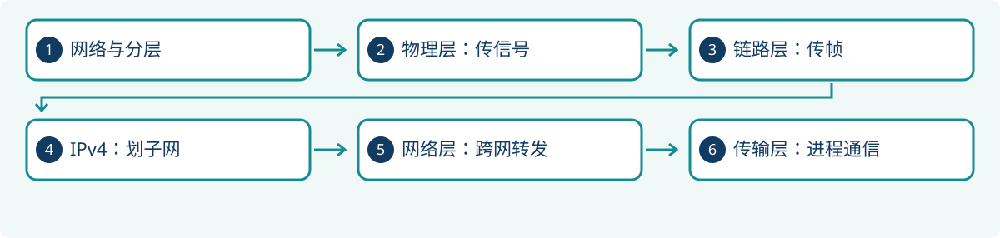

# 计算机网络｜讲义

> 资料整理版 1.0｜2026-11-27｜依据现有 95 页期末速成课件整理；课程大纲与适用版本未提供。

## 阅读说明

本稿面向首次复习计算机网络的学生，来源为一份 95 页期末速成课件，封面主讲人署名李老师；适用学校、教材版本、学期和正式课程大纲未提供。本次先按课件主题整理，不能把已有页面当成完整课程范围。

## 一页速览

先认识网络怎样分工，再看信号怎样通过链路，接着学习地址和跨网转发，最后把数据送到应用进程。每章学完先做章末自查，再用题册对应题目练习。

图 0-1 全书学习路线。整理自 S-B011-01 第 2、17、29、50、69、83 页，自绘；箭头表示建议学习顺序。

## 一、网络概述与分层

图 1-1 网络概述知识地图。整理自 S-B011-01 第 1—15 页，自绘；箭头表示建议学习顺序。

想让两台电脑通信，既要有传送信号的线路，也要约定数据格式和处理步骤。网络分层把复杂任务拆开：每层负责一部分，层与层之间通过接口协作。

### K-42000｜网络是什么、怎样连接

计算机网络是通过通信设施互连、能够交换信息和共享资源的自主计算机系统集合。**网络**包含节点和连接节点的链路；**互联网**把多个网络互连；**因特网**是全球范围的互联网。接入服务商（ISP）为用户提供接入服务。

课件从资源构成角度将计算机网络分为硬件与软件；从逻辑功能角度区分**资源子网**和**通信子网**。前者提供和使用计算、数据等资源，后者负责在节点间传递数据；这是理解分工的模型，实际设备可能同时承担多种功能。

课件按覆盖范围列出个域网 PAN、局域网 LAN、城域网 MAN 和广域网 WAN；它还按有线／无线、传输速率、广播／点到点分类。覆盖范围只是分类依据之一，不应只凭面积推定设备和管理方式。

| 课件拓扑 | 连接关系 | 理解要点 |
| --- | --- | --- |
| 总线型 | 多个节点共享一条主干 | 主干故障可能影响多个节点 |
| 星型 | 各节点通过链路连接中心节点 | 中心节点故障可能影响整个星型网络 |
| 树型 | 节点形成分支层次 | 上层连接中断会影响相应下层分支 |
| 环型 | 节点依次首尾相连 | 传送方向和故障处理取决于实现 |
| 网状型 | 节点之间有多条连接 | 可以设计多条路径，但不保证任意单点故障都无影响 |

电路交换先建立连接、再使用资源传送并释放；报文交换以完整报文为单位存储转发；分组交换把报文拆成较小分组再转发。分组可以共享链路，但排队和转发也会带来时延。课件的分类题与结构题见题册 P-42000。

### K-42001｜OSI、TCP/IP 和五层教学模型

**协议**是通信双方对消息格式、顺序及处理规则的约定；**服务**是下层向上层提供的功能；**接口**是相邻层使用服务的约定。OSI 是一个七层参考模型，TCP/IP 常用四层模型；教材中的五层模型用于教学对照，并非说每个实际协议栈都必须严格照此拆分。

| OSI 层次（自上而下） | 主要作用与课件举例 | TCP/IP 四层对照 |
| --- | --- | --- |
| 应用层 | 为应用程序提供网络功能，如 HTTP、FTP、SMTP | 应用层 |
| 表示层 | 数据表示、编码与转换；课件举加密／解密为例 | 应用层 |
| 会话层 | 会话建立和管理；课件以认证、授权、计费说明会话准备 | 应用层 |
| 传输层 | 为进程间通信提供传输服务，课件以“段”称其数据单元 | 传输层 |
| 网络层 | 使用逻辑地址和路由实现跨网络转发，数据单元可称分组或包 | 网际层 |
| 数据链路层 | 相邻节点之间传送帧并进行链路控制 | 网络接入层 |
| 物理层 | 在介质上传送比特信号 | 网络接入层 |

发送时，上层数据交给下层并逐层添加相应控制信息；接收端按协议逐层处理。具体协议的数据单元名称与控制字段由相应协议定义。课件列出的模型辨析题见 P-42001。

### K-42002｜速率、吞吐量与时延

**速率**是单位时间传输的比特数，常用 bit/s；**带宽**可表示链路支持的最高数据传输能力；**吞吐量**是单位时间内实际通过指定位置的数据量。链路速率、接口能力、竞争流量和协议开销都可能影响实际吞吐量。课件用主机接口、线路和网络设备接口速率的最小值表示理想链路的瓶颈上限，实际有效吞吐量不能因此直接等同于上限。

| 时延 | 如何计算或理解 |
| --- | --- |
| 发送时延 | 数据量（bit）÷发送速率（bit/s） |
| 传播时延 | 传输距离（m）÷信号传播速度（m/s） |
| 处理时延 | 节点检查和处理数据所耗时间 |
| 排队时延 | 数据在缓存中等待发送所耗时间 |

例如按课件约定 1 MB = $2^{20}$ B、1 B = 8 bit，100 MB 在 100 Mb/s 链路上的发送时延为 $100\times2^{20}\times8/(100\times10^6)=8.388608$ 秒。若把 MB 作为十进制 $10^6$ B，则为 8 秒；不能混用数据量与速率的单位。更多原题及距离计算见 P-42002。

**三句话带走。** 网络把设备和网络连接起来以交换信息和共享资源。分层用协议、服务和接口分工，链路性能可用速率、吞吐量和不同时延描述。计算前先确认分层口径、数据单位和实际传输条件。

**本章自查。**

| 问题 | 回答要点 |
| --- | --- |
| 星型网络的中心节点出问题会怎样？ | 依赖该节点的连接可能全部中断。 |
| 物理层和数据链路层的数据单元是什么？ | 教学模型中分别为比特和帧。 |
| 发送时延与传播时延怎样区别？ | 前者看数据量与速率，后者看距离与传播速度。 |

### 重点与易错点

| 级别与依据 | 必须分清什么 | 对应 |
| --- | --- | --- |
| 必须掌握｜整理判断 | 协议约定通信规则，服务由下层提供，接口连接相邻层 | K-42001；P-42001 |
| 必须掌握｜整理判断 | 发送时延看数据量和发送速率；传播时延看距离和传播速度 | K-42002；P-42002 |
| 重要｜课件重点 | 交换方式、拓扑与分层模型各有不同分类依据 | K-42000—K-42001；P-42000—P-42001 |

### 本章来源对照

| 条目 | 来源位置 | 核对状态 |
| --- | --- | --- |
| K-42000 / P-42000 | S-B011-01 第 3—6 页 | 已对照原文与示意图；补入资源子网和通信子网 |
| K-42001 / P-42001 | S-B011-01 第 7—10 页 | 已对照层次图与题目；第 10 页题 5 选项重叠 |
| K-42002 / P-42002 | S-B011-01 第 11—15 页 | 已对照图题；单位、带宽和吞吐量口径已说明 |

### 来源对照与待核事项

S-B011-01 第 1—15 页为网络概述、模型及性能例题，第 16 页为物理层封面；第 3—15 页图文及题目已逐项复核。原课件第 14 页将双向业务速率相加作为总吞吐量，需明确统计口径；第 15 页按 1 MB = $2^{20}$ B 计算。详见整理记录。

## 二、物理层：让比特通过介质

图 2-1 物理层知识地图。整理自 S-B011-01 第 17—27 页，自绘；箭头表示建议学习顺序。

一串 0 和 1 不能自己穿过网线或光纤，需要转换为电、光或无线信号；接收端再根据约定还原数据。物理层关心接口、信号和传输条件。

### K-42003｜信号、信道与通信方向

课件将信号区分为模拟信号与数字信号：前者用连续变化的物理量表示信息，后者使用离散可区分状态。数据要在通信线路上传递，需转换为电、光等适合介质的信号。课件将通信系统概括为信源、信号转换器、信道、接收端转换器和信宿。信源产生要传递的信息，信道提供信息传输通路，信宿接收信息；同一传输介质可以通过复用承载多条信道。物理层接口的课件分类包括机械、电气、功能和过程特性，分别涉及连接形态、信号电气条件、线路功能及操作顺序。

串行通信依次发送数据位，并行通信通过多条并行通路同时发送；实际速度还受时钟、布线和实现限制。

| 方向 | 允许的方向与课件例子 |
| --- | --- |
| 单工 | 只能从一端到另一端，如广播接收 |
| 半双工 | 两端都可发送，但不能同时双向发送，如对讲机 |
| 全双工 | 两个方向可以同时通信，如电话 |

收发双方要按共同时间基准识别边界；课件列出位同步和字符同步。具体同步机制取决于编码和协议。

### K-42004｜介质、码元、编码与复用

| 介质 | 课件列出的特点 |
| --- | --- |
| 同轴电缆 | 屏蔽能力较好，安装与成本取决于规格 |
| 双绞线 | 包括非屏蔽 UTP、屏蔽 STP，常用于近距离连接 |
| 光纤 | 以光传输，容量大、质量好，分单模与多模；不受外部电磁干扰，但并非没有其他噪声或故障 |
| 无线电波 | 课件举调频接收机和海事无线电为例；传播距离依频率、环境和功率而变 |
| 微波 | 课件列地面微波接力与卫星通信；链路设计需考虑视距和遮挡 |
| 红外 | 课件举遥控器、电脑红外接口为例；具体距离与速率取决于实现 |
| 可见光 | 课件以 LED 光传输信号为例；可见光信道仍需考虑遮挡和接收条件 |

**码元**是信号在一个符号时间内采用的可区分状态；若每个符号可取 $M$ 种等可能状态，理论上每个符号可表示 $\log_2 M$ bit。基带传输直接使用基带信号，实际可用距离和性能随介质、编码、速率及设备而变，不能把课件的示例距离当成所有系统的上限。

数字线路编码把比特序列变成信号变化。课件中，不归零编码 NRZ 用高、低电平表示 1、0，连续同值时缺少变化，不天然提供每位的同步跳变；曼彻斯特编码在位中间跳变，课件约定 1 为高到低、0 为低到高；差分曼彻斯特使用边界是否跳变区分数据，课件约定 1 为边界不变、0 为边界跳变。不同资料的电平／数据约定可能相反，画图必须先写明采用哪一种。课件第 21 页的两电平例子按时间依次表示 `1 0 0 1 1`；第 22 页不归零波形按 `1` 高、`0` 低依次表示 `1 1 0 0 1 0 1`，同一电平连续时跨越多个码元时间。

| 复用方式 | 区分各路的方法 |
| --- | --- |
| 频分 FDM | 分配不同频带，同一时间传送 |
| 时分 TDM | 分配不同时间片，共享通路 |
| 波分 WDM | 利用光的不同波长复用 |
| 码分 CDM | 使用可区分的码序列共享传输资源 |

课件第 23 页用频率分割概括全部复用方式；时分和码分并不只是按频率划分，以上按各方式的资源维度分别解释。相关选择题见 P-42003。

### K-42005｜中继、奈奎斯特和香农公式

中继器对收到的信号进行再生或整形后转发；集线器是多端口的物理层中继设备，一个端口收到信号后通常向其他端口转发。集线器不会像以太网交换机那样根据 MAC 地址选择目的端口。

**定义。** 按课件理想无噪声、带宽为 $W$ Hz 的低通信道模型，最大码元速率为 $2W$ baud。若每个码元有 $M$ 种可区分状态，则最大比特率为 $R=2W\log_2 M$ bit/s。baud 表示每秒码元数，bit/s 表示每秒比特数；两者不能不加条件地画等号。

对带宽为 $W$ Hz、信号与噪声平均功率比为 $S/N$ 的加性高斯白噪声信道，香农容量公式为 $C=W\log_2(1+S/N)$ bit/s；若信噪比用分贝给出，先由 $10\log_{10}(S/N)$ 换算成线性功率比。这是给定模型下的理论上限，不代表实际链路一定能达到。两类公式及原题运算见 P-42004、P-42005。

**速率题步骤卡。**

| 步骤 | 需要做的事 |
| --- | --- |
| 识别 | 题目给出无噪声码元状态数，还是带噪声信道的信噪比？ |
| 选式 | 前者使用奈奎斯特模型，后者使用香农模型；条件同时存在时各自给出约束 |
| 换算 | kHz 化为 Hz；若信噪比是 dB，先换成线性功率比 |
| 验算 | 标清结果是 baud 还是 bit/s，并说明采用的信道模型 |

**三句话带走。** 物理层用约定好的信号和介质传送比特。编码解决比特到信号的表示，复用让多路通信共享资源；不同复用方式区分的资源不同。计算速率时先分清码元、比特、带宽单位和信噪比的表示方法。

**本章自查。**

| 问题 | 回答要点 |
| --- | --- |
| 半双工与全双工有何区别？ | 前者双向但交替，后者可同时双向。 |
| 时分和频分怎样区分？ | 分别以时间片和频带区分各路。 |
| 信噪比 30 dB 的线性功率比是多少？ | $S/N=10^{30/10}=1000$。 |

### 重点与易错点

| 级别与依据 | 核心辨析 | 对应 |
| --- | --- | --- |
| 必须掌握｜整理判断 | 码元率与比特率不同；计算前先确定每个码元的信息量 | K-42004—K-42005；P-42004—P-42005 |
| 必须掌握｜整理判断 | 奈奎斯特和香农公式的前提不同，噪声功率比需正确换算 | K-42005；P-42005 |
| 重要｜课件重点 | 单工、半双工、全双工按发送方向与是否同时划分 | K-42003；P-42003 |

### 本章来源对照

| 条目 | 来源位置 | 核对状态 |
| --- | --- | --- |
| K-42003 | S-B011-01 第 18—19 页 | 已对照信道模型、串并行图及通信方向 |
| K-42004 / P-42003 | S-B011-01 第 20—24 页 | 已对照介质、波形及原题；介质表述边界已说明 |
| K-42005 / P-42004—P-42005 | S-B011-01 第 25—27 页 | 已对照公式、原题与选项；数值已独立复算 |

### 本章来源对照与待核事项

S-B011-01 第 17—27 页为物理层目录、通信方向、介质、编码、复用、设备与计算题；第 28 页为数据链路层封面。第 18—27 页已对照原图波形、符号约定及题目；更多来源问题见整理记录。

## 三、数据链路层：把一段链路变成可靠的数据传送单元

图 3-1 数据链路层知识地图。整理自 S-B011-01 第 29—48 页，自绘；箭头表示建议学习顺序。

从一台机器到另一台机器，数据可能经过多个路由器。每一段相邻节点之间都要识别帧的边界，再根据链路协议检查和转发。

### K-42006｜物理链路、帧和透明传输

**物理链路**是相邻节点间的实际传输通路；**数据链路**是在通路上配合相关硬件、软件和协议形成的数据传输关系。数据链路层把网络层数据封装为帧，帧一般由帧首、数据部分和帧尾组成。最大传输单元 MTU 指给定链路可以承载的网络层数据包最大长度；课件以常见以太网 MTU 1500 字节为例，具体数值依链路配置而定。

**透明传输**要让接收端分清“数据中的特殊值”和“帧的边界”。字节填充可在数据中出现需要转义的字节时添加转义字节，接收端再按协议去除；同步比特流可在连续五个 1 后插入一个 0，接收端在相同条件下删除该填充位。边界标志和填充范围要以具体协议为准。

### K-42007｜奇偶校验与 CRC

课件把奇偶校验与 CRC 列为检错方法，并提到海明码可用于纠错；检错与纠错能力取决于编码方案及错误模式。

奇校验是在原数据后增加校验位，使包含校验位在内的 1 的总数为奇数；偶校验则使其为偶数。课件中 `1101101` 有 5 个 1，因此奇校验加 `0`、偶校验加 `1`。若偶数个位发生翻转，奇偶性可能保持不变，单个奇偶位无法检测所有错误。

**方法。** 循环冗余校验 CRC 的常见计算步骤：先把 $r$ 次生成多项式写成 $r+1$ 位二进制系数；在原数据后补 $r$ 个 0；用生成多项式对应的位串做模 2 除法；将 $r$ 位余数接到原数据后发送。模 2 减法逐位等同异或，不发生借位。接收端用同一除数检查收到的码字；余数非零说明检测到错误，但余数为零不保证一定没有错误。原例见题册 P-42006、P-42007。

**CRC 运算步骤卡。**

| 输入／步骤 | 操作与检查 |
| --- | --- |
| 生成多项式 | 按各次项系数写位串；最高次数为 $r$，位串长度为 $r+1$ |
| 补零 | 原始数据右侧补 $r$ 个零 |
| 模 2 除 | 当前最高位为 1 时与除数逐位异或，为 0 时向后推进；不借位 |
| 输出与检验 | 保留 $r$ 位余数并接在原数据后；接收端再按相同除数检查 |

### K-42008｜PPP 和以太网

点到点链路连接链路两端；PPP 由链路控制协议 LCP、网络控制协议 NCP 及在链路中封装网络层数据的机制组成。课件展示的 PPP 帧包括标志、地址、控制、协议、信息和帧校验序列；具体字段压缩等情况依协商与协议约定。异步传输可按约定用 `7D` 转义特殊字节，同步传输可采用连续五个 1 后填 0；接收时执行相反处理。

课件第 38 页给出一个未压缩、使用 2 字节 FCS 的 PPP 帧例子：

| 字段 | 标志 F | 地址 A | 控制 C | 协议 P | 信息 | FCS | 标志 F |
| --- | --- | --- | --- | --- | --- | --- | --- |
| 课件图示长度 | 1 B | 1 B | 1 B | 2 B | 不超过 1500 B | 2 B | 1 B |

这是课件的示例，字段压缩、协商的最大接收单元和 FCS 长度可使实际格式不同。第 39 页异步字节转义例中，`7E`、`7D`、`03` 分别转成 `7D 5E`、`7D 5D`、`7D 23`；在此示例中，插入 `7D` 后，原字节与 `20`（十六进制）做异或。哪些控制字符必须转义由协议及协商决定。

共享介质的以太网采用 CSMA/CD 的教学模型：发送前监听，发送时检测冲突，发现冲突后停止发送、发送强化冲突信号并退避重试。最短帧的直觉是：发送方在发送结束前，要有足够时间让最远端冲突信号传播回来。按课件简化模型，最低发送位数为 $2\times$单程传播时延$\times$比特率；还需考虑协议规定、设备和链路的具体约束。现代交换式全双工链路不使用 CSMA/CD。

课件第 41 页比较了传统 10 Mb/s 以太网示例：10BASE-5 粗同轴电缆段长 500 m，10BASE-2 细同轴电缆段长 185 m，10BASE-T 双绞线段长 100 m，10BASE-F 光纤示例为 2000 m。它们分别针对所列标准的链路条件，不能作为所有以太网的统一距离上限。

以太网帧含目的地址、源地址、类型／长度、数据与 FCS 等字段；课件示例中的常规 MAC 地址为 48 位。MAC 地址通常写成十六进制，但也可能由软件配置或使用随机地址，不能把“永不变化”作为普遍规则。原例题见 P-42008。

### K-42009｜网桥、交换机和 VLAN

网桥或二层交换机根据接收帧的**源 MAC 地址和进入端口**学习转发表，根据**目的 MAC 地址**决定转发；未知单播在允许的同一广播域内向除入口外的相关端口泛洪，已知目的端口等于入口时通常过滤。生成树协议 STP 在存在冗余二层连接时选择无环的转发拓扑，通过控制端口转发状态避免交换环路；连接或配置变化时拓扑可能重新计算。

VLAN 将交换网络划分为逻辑上的二层广播域；不同 VLAN 通信通常需要三层转发及相应策略，同一 VLAN 可以跨交换机扩展。

课件用 Access 与 Trunk 区分常见端口用途：前者通常连接终端并归属一个未标记 VLAN，后者可在交换设备间承载多个 VLAN 的帧，具体标记与本征 VLAN 等规则需按设备配置。课件第 47 页的 802.1Q 标签示意分为 16 位标签协议标识、3 位优先级、1 位 CFI/DEI 和 12 位 VLAN 标识。常见 802.1Q 标签增加 4 字节；若以太网帧数据部分最大 1500 字节，且计入目的／源地址、类型及 FCS、不计前导码和帧间隙，单标签帧最大长度为 1522 字节。课件列出 100BASE-T 的 100 Mb/s、千兆以太网的 1 Gb/s 和 10GE 的 10 Gb/s。高速以太网标准和设备能力各有约束，不能只凭“千兆”判断所有物理参数。题册 P-42009—P-42010 给出课件例题。

**三句话带走。** 数据链路层把网络层数据封装为帧，并使用边界识别和差错检测维护链路通信。校验码提高错误发现能力，但检验通过不等于证明绝对无误。交换、碰撞检测和 VLAN 计算都要先说明链路模型与帧长度统计范围。

**本章自查。**

| 问题 | 回答要点 |
| --- | --- |
| 为什么要进行透明传输？ | 防止数据中的特殊位串或字节被误认为帧边界。 |
| CRC 余数为零能证明无错误吗？ | 不能；只能说明该校验没有检出错误。 |
| 交换机用什么学习、用什么转发？ | 用源地址和入口学习，用目的地址决定转发。 |

### 重点与易错点

| 级别与依据 | 核心辨析 | 对应 |
| --- | --- | --- |
| 必须掌握｜整理判断 | 透明传输防止数据误认成边界；CRC 通过不能证明绝对无错 | K-42006—K-42008；P-42006—P-42007、P-42011 |
| 必须掌握｜整理判断 | 交换机用源 MAC 学习、用目的 MAC 转发 | K-42009；P-42009 |
| 重要｜课件重点 | VLAN 隔离二层广播域；带标签帧长度需明确计数边界 | K-42009；P-42010 |

### 本章来源对照

| 条目 | 来源位置 | 核对状态 |
| --- | --- | --- |
| K-42006—K-42007 / P-42006—P-42007 | S-B011-01 第 30—37 页 | 已对照图文；奇偶表及 CRC 已复算 |
| K-42008 / P-42008、P-42011 | S-B011-01 第 38—43 页 | 已对照帧格式、转义示例和题目；位串已逐位核对 |
| K-42009 / P-42009—P-42010 | S-B011-01 第 44—48 页 | 已对照设备、标签示意和题目；冲突域与帧统计边界已说明 |

### 本章来源对照与待核事项

S-B011-01 第 30—48 页包括链路功能、校验、PPP、以太网与 VLAN。第 34 页用十进制整除作直观类比，不能替代模 2 多项式运算；第 40 页位串填充例见题册 P-42011。第 43 页 250 bit 是题设理想传播模型结果，不自动等同于以太网标准最小帧长；第 44 页关于集线器冲突域的概括需结合级联拓扑。详见整理记录。

## 四、IPv4 地址与子网划分

图 4-1 IPv4知识地图。整理自 S-B011-01 第 50—67 页，自绘；箭头表示建议学习顺序。

一栋楼有楼号和房间号，IPv4 地址与掩码也可把地址划为网络前缀和主机部分。先确定前缀，再计算网络地址、广播地址和主机范围。

### K-42010｜IPv4 地址、掩码与特殊范围

IPv4 地址有 32 位，常分为四个 8 位组并写成点分十进制，每组为 0—255。子网掩码由连续的前导 1 和其后的 0 组成，前导 1 的数量称为前缀长度；例如 `255.255.255.0` 是 `/24`。地址与掩码逐位做 AND 得到所属网络地址。

二进制的 8 位从左到右权值依次是 128、64、32、16、8、4、2、1；把为 1 的位相加即可得到该字节的十进制值。例如 `11100000` 是 $128+64+32=224$。掩码每字节常见值包括 0、128、192、224、240、248、252、254、255，具体可用值取决于前面字节是否已经全为 1。

IP 地址用于网络层寻址；数据链路层使用的目的 MAC 通常指向本链路的接收设备，跨网段时该设备一般是下一跳路由器。具体转发取决于路由、邻居解析及链路类型。

课件介绍传统分类地址：A 类首字节 1—126、默认 `/8`；B 类 128—191、默认 `/16`；C 类 192—223、默认 `/24`；D 类 224—239 用于组播，E 类 240—255 为保留范围。`127.0.0.0/8` 用于回环；`169.254.0.0/16` 为链路本地地址范围。分类地址是理解旧题的历史模型，现代路由通常使用明确的 CIDR 前缀，不能只看首字节决定实际掩码。

常见私有 IPv4 地址块为 `10.0.0.0/8`、`172.16.0.0/12` 和 `192.168.0.0/16`；它们不在公共互联网中作为全局可路由的源／目的地址直接转发，但可以在私有网络内使用。课件相关选择题见 P-42012。

### K-42011｜等长子网：借位和地址范围

把一个前缀为 `/p` 的地址块等分成 `/q` 子网，借用 $q-p$ 位时有 $2^{q-p}$ 个子网；每个子网包含 $2^{32-q}$ 个地址。在普通 IPv4 广播子网且主机位至少两位时，主机位全 0 是网络地址、全 1 是广播地址，通常可分配主机数为 $2^{32-q}-2$。`/31` 点到点链路和 `/32` 主机路由有不同用法，不能机械套此减二规则。

例如 `61.179.150.39/28` 有 4 位主机位，每块 16 个地址；39 落在 32—47 这一块。网络地址为 `61.179.150.32`，广播地址为 `61.179.150.47`，普通可分配范围是 `.33`—`.46`。课件还给出 `192.168.0.101/27`：最后一字节 `101` 的二进制为 `01100101`，掩码最后一字节为 `11100000`，逐位 AND 为 `01100000`，即 96，所以它属于 `192.168.0.96/27`。子网划分及八个 `/20` 子网的完整例子见 P-42013、P-42014。

**子网计算步骤卡。**

| 步骤 | 操作 |
| --- | --- |
| 识别前缀 | 将点分掩码换成 `/q`，确定网络位和主机位 |
| 计算块大小 | 每块地址数为 $2^{32-q}$；在对应字节按块边界分组 |
| 定位地址 | 找包含给定地址的块，第一地址为网络地址、最后地址为广播地址 |
| 检查范围 | 普通广播子网可分配范围去掉首尾；点到点 `/31` 等特殊情况另判 |

课件部分题目将子网数按 $2^n-2$ 计算，另一些题目将全 0 和全 1 子网计入；现代做法通常允许使用这两个子网。本讲义保留原题答案并明确采用的口径，避免将“主机地址减二”与“子网数量”混为一谈。

### K-42012｜变长子网与路由聚合

变长子网掩码 VLSM 允许把同一地址块划成大小不同的子网。先估算各子网所需地址，通常按较大需求先分配与边界对齐的地址块，再检查各块互不重叠且仍在原地址范围内。

课件示例将 `192.168.0.0/24` 用于 100、50、20 台主机。分配时从需求最大的网络开始：

| 子网前缀 | 主机需求 | 普通可用数 | 普通主机范围 |
| --- | --- | --- | --- |
| 192.168.0.0/25 | 100 | 126 | 192.168.0.1—192.168.0.126 |
| 192.168.0.128/26 | 50 | 62 | 192.168.0.129—192.168.0.190 |
| 192.168.0.192/27 | 20 | 30 | 192.168.0.193—192.168.0.222 |

剩余地址块可继续规划；设备地址、网关和保留地址仍需要在各块内安排。

CIDR 使用“地址/前缀长度”表示连续地址块。路由聚合要求找出共同前缀，并检查聚合块是否覆盖不属于预期的额外地址。例如 `212.56.132.0/24` 至 `212.56.135.0/24` 恰好组成 `212.56.132.0/22`。再看课件的反例：`192.168.1.0/24` 和 `192.168.2.0/24` 虽相邻，却不能恰好合并为一个 `/23`，因为它们分处不同的 `/23` 边界。覆盖两者的最小单一前缀是 `192.168.0.0/22`，还会包含 `.0.0/24` 和 `.3.0/24`；只有允许覆盖这些额外地址时才能使用该聚合。IPv4 前缀长度可为 0—32；课件中“13—27 位”不是 CIDR 的普遍限制。

**三句话带走。** IPv4 掩码把地址分成网络前缀和主机部分。等长子网按借用位数决定子网数量，主机位决定每个块的地址数量。变长分配和聚合都要核对边界、重叠及实际适用的特殊地址规则。

**本章自查。**

| 问题 | 回答要点 |
| --- | --- |
| 地址和掩码如何得到网络地址？ | 按位 AND，或把主机位清零。 |
| 从 /24 划成 /27 有多少子网？ | 借 3 位，按允许全零和全一子网的口径为 8 个。 |
| 连续地址块一定能无额外地址地合并吗？ | 不一定；还需大小匹配且按聚合边界对齐。 |

### 重点与易错点

| 级别与依据 | 核心辨析 | 对应 |
| --- | --- | --- |
| 必须掌握｜整理判断 | 求网络地址时主机位清零；网络地址和广播地址通常不能分配给普通主机 | K-42010—K-42011；P-42013—P-42014 |
| 必须掌握｜整理判断 | 子网数是否计入全零和全一子网，要核对题目采用的口径 | K-42011；P-42013 |
| 重要｜课件重点 | VLSM 分配先看需求与边界；聚合须核对是否多覆盖地址 | K-42012；P-42015—P-42016 |

### 本章来源对照

| 条目 | 来源位置 | 核对状态 |
| --- | --- | --- |
| K-42010 / P-42012 | S-B011-01 第 50—55 页 | 已对照二进制表、分类图与题目；分类与现代 CIDR 口径已区分 |
| K-42011 / P-42013—P-42014 | S-B011-01 第 56—58、61—63 页 | 已对照图题与计算；原题子网数口径不一 |
| K-42012 / P-42015—P-42016 | S-B011-01 第 59—60、64—67 页 | 已对照分配、聚合与规划图题；地址范围已复算 |

### 本章来源对照与待核事项

S-B011-01 第 50—67 页为 IPv4、等长与变长子网、CIDR、地址规划和题目。第 57、61 页与第 62、63 页对全零／全一子网是否计入使用不同口径；第 58 页第一行主机范围有数字漏写；第 59 页将 CIDR 前缀限制在 13—27 位不具普遍性。题册保留原答及修正依据；第 50—67 页原图与题目已复核。

## 五、网络层

图 5-1 网络层知识地图。整理自 S-B011-01 第 69—81 页，自绘；箭头表示建议学习顺序。

网络层负责把分组从一个网络送到另一个网络：路由选择决定走哪条路，分组转发决定收到的分组从哪个接口出去。

### K-42013｜IP 转发与 ARP

网络层服务可按教学模型区分面向连接的虚电路与无连接的数据报服务。IPv4 提供数据报服务：各分组可独立转发，网络不保证按序或一定送达。

一般跨网段发送时，发送方依据路由将分组交给下一跳。以太网等链路上，ARP 根据本链路的 IPv4 地址查找对应 MAC：发送请求广播，目标设备回复，结果可缓存。若最终目的地在其他网段，要解析的是**下一跳网关**的地址，而非直接在本链路查找远端主机。

在不经过 NAT 等地址改写的普通转发例子中，端到端源、目的 IP 地址保持不变；每经过一个以太网链路，帧的源、目的 MAC 地址按该链路重新封装。TTL 等首部字段仍会变化。

### K-42014｜IPv4 首部和分片

IPv4 版本字段值为 4；首部长度字段为 4 位，以 4 字节为单位，取值 5—15，对应 20—60 字节；总长度包括首部和数据，最大为 65535 字节。协议字段标识上层协议，例如 6 表示 TCP，17 表示 UDP。TTL 每经过路由器递减，耗尽后分组被丢弃；初始 TTL 由发送端设置，课件所列 128 不是固定值。IPv4 首部校验和只校验首部。

当 IPv4 分组超过出口链路 MTU 且允许分片时，可拆成多个分片。相同原分组的片使用相同标识；DF=1 表示不允许分片，MF=1 表示后面还有片，MF=0 表示最后一片；片偏移以 **8 字节**为单位。普通 IPv4 分片在目的主机重组。

课件第 72 页示例有 3800 字节数据，分成 1400、1400、1000 字节三片，偏移分别为 0、175、350，MF 分别为 1、1、0；每片还要加 IP 首部。分片大小需符合实际 MTU 和首部长度，不能把 1400 当成固定值。

**分片计算步骤卡。**

| 步骤 | 操作 |
| --- | --- |
| 求载荷上限 | 用出口 MTU 减去该分片的 IPv4 首部长度 |
| 切分数据 | 除最后一片外，数据长度取不超过上限的 8 字节整数倍 |
| 填首部 | 按原数据中的起始字节位置除以 8 填偏移；后面还有分片时 MF 为 1 |
| 检查 | 每片总长度包含自己的首部，所有数据段无遗漏、无重叠；确认 DF 允许分片 |

### K-42015｜路由表与路由协议

直接路由对应路由器直接连接的网络；静态路由由管理员配置；动态路由通过协议交换信息并按协议规则更新。查询转发表时通常优先使用与目的地址匹配的最长前缀。是否选择某条路由还取决于具体配置及协议规则。

课件将 RIP、OSPF 归为内部网关协议，将 BGP 列为外部网关协议。RIP 以跳数为度量，15 跳可达、16 表示不可达；OSPF 使用链路状态。课件称 RIP 只支持分类地址，但 RIP 版本不同：RIPv1 不携带子网掩码，RIPv2 支持无分类前缀。原图路由表例题见 P-42018。

**选下一跳步骤卡。**

| 步骤 | 操作 |
| --- | --- |
| 定位目的地址 | 取分组的目的 IP，不用最终目的 MAC 选 IP 路由 |
| 匹配前缀 | 与路由表中的前缀逐项比较；存在多项时优先最长匹配 |
| 找出口 | 按命中路由确定出接口及下一跳；默认路由可匹配其他未命中的地址 |
| 链路封装 | 在需要时解析本链路下一跳地址，再按链路协议封装 |

真实设备还会先按路由协议、管理距离等选出进入转发表的路由；本步骤从已有转发表出发。

### K-42016｜ICMP、隧道与 NAT

课件把 ICMP 报文分成差错报告和查询两类。差错报告例子包括目的不可达、超时、参数问题和重定向；查询报文例子包括回显请求／应答和时间戳请求／应答。不同类型触发条件不同，接收端或网络策略也可能限制响应。

ICMP 可报告目的不可达、超时等网络问题，也有回显请求与应答等查询报文；ping 常利用回显测试连通性，traceroute 类工具利用逐步变化的 TTL 探测路径。能否收到响应还受过滤等因素影响。

源点抑制是课件中的历史 ICMP 类型，现已废弃，不应作为现代拥塞控制方案。IP 隧道将一个分组封装进另一个分组，在隧道出口解封装；VPN 可借助隧道连接不同网络，加密取决于具体方案。NAT 可转换地址，常见出站场景把私有源地址映射到公网地址，返回流量再按映射转换；端口转换可让多个连接共享公网地址。

**三句话带走。** 网络层按路由表把分组送向下一跳。ARP 解决本链路的 IPv4 到 MAC 地址映射，分片用标识和偏移支持目的端重组。地址是否保持不变还要看是否经过 NAT 等转换。

**本章自查。**

| 问题 | 回答要点 |
| --- | --- |
| 跨网段发送时 ARP 查谁的 MAC？ | 查本链路下一跳的 MAC。 |
| IPv4 片偏移以什么为单位？ | 8 字节。 |
| 普通转发与 NAT 有何区别？ | 普通转发按路由选下一跳；NAT 可改写 IP 地址及端口。 |

### 重点与易错点

| 级别与依据 | 核心辨析 | 对应 |
| --- | --- | --- |
| 必须掌握｜整理判断 | 跨网发送时 ARP 查下一跳 MAC；普通转发中 IP 与 MAC 的变化范围不同 | K-42013；P-42017、P-42019 |
| 必须掌握｜课件重点 | IPv4 分片偏移单位为 8 字节，最后一片 MF 为 0 | K-42014；P-42017、P-42020 |
| 重要｜整理判断 | 查路由看目的前缀和下一跳；NAT、隧道会影响地址观察 | K-42015—K-42016；P-42018—P-42020 |

### 本章来源对照

| 条目 | 来源位置 | 核对状态 |
| --- | --- | --- |
| K-42013—K-42014 / P-42017 | S-B011-01 第 70—73 页 | 已对照分层、ARP、首部和分片图题 |
| K-42015 / P-42018 | S-B011-01 第 74—75 页 | 已对照协议、拓扑与路由表；原表网段已纠正 |
| K-42016 / P-42019—P-42020 | S-B011-01 第 76—81 页 | 已对照图题；历史 ICMP 与原题误印已说明 |

### 本章来源对照与待核事项

S-B011-01 第 68—81 页覆盖网络层、ARP、IPv4 首部、路由、ICMP、VPN、NAT 及题目。第 74 页对 RIP 的概括未区分版本；第 75 页直连网段首字节误写；第 77 页将 172.16.0.0—172.31.255.255 标为 /16，正确为 /12。第 78 页源点抑制题保留历史答案。第 70—81 页图文及题目已对照。

## 六、传输层

图 6-1 传输层知识地图。整理自 S-B011-01 第 83—95 页，自绘；箭头表示建议学习顺序。

网络层把数据送到主机，传输层再借助端口把数据交给相应应用。端口号为 16 位，范围 0—65535；常见默认端口有 HTTP 80、HTTPS 443、FTP 控制连接 21、SMTP 25、POP3 110、DNS 53，实际服务端口可配置。

### K-42017｜UDP 与 TCP

UDP 无连接、面向报文，首部固定 8 字节，包含源端口、目的端口、长度和校验和，各 2 字节。长度包括首部和数据，最小为 8 字节。UDP 自身不提供 TCP 式可靠交付和拥塞控制，但应用可以实现自己的可靠性与速率控制；UDP 支持单播、多播与广播，具体取决于网络层和配置。TFTP 通常使用 UDP；DNS 可以使用 UDP，也可以使用 TCP。

TCP 面向连接、面向字节流，提供可靠、有序的字节流交付，使用序号、确认与重传等机制；它是全双工连接。TCP 不保留应用写入的消息边界。首部长度为 20—60 字节；序号指向数据中的字节位置，确认号表示下一步期望收到的字节序号。TCP 的可靠性不意味着网络永不出错：连接异常时应用仍可能收到失败通知。

| TCP 首部字段 | 作用 |
| --- | --- |
| 源／目的端口 | 标识通信两端的传输层端点 |
| 序号、确认号 | 表示发送数据位置和期望收到的下一个字节位置；ACK 标志置位时确认号有效 |
| 数据偏移 | 指出 TCP 首部长度，从而定位数据起点 |
| 窗口 | 通告接收窗口，用于流量控制 |
| 校验和 | 对 TCP 首部、数据及计算用伪首部进行校验 |
| URG、ACK、SYN、FIN 等标志 | 标示紧急指针、确认、建立连接和关闭发送方向等控制含义 |
| 选项和填充 | 承载协商等信息并使首部满足长度对齐要求 |

课件第 84 页把“一个包能装下的用 UDP，多个包用 TCP”当作规律，这不能决定使用何种协议；协议取决于应用需求。第 83、86 页分别将 UDP 误写成 UTP、UPD。

### K-42018｜连接、可靠传输与窗口

TCP 通常通过三次握手建立连接。按课件的序号示例：客户端发送 `SYN=1, seq=x`；服务端回复 `SYN=1, ACK=1, seq=y, ack=x+1`；客户端再回复 `ACK=1, seq=x+1, ack=y+1`。这样双方分别确认对方初始序号。双方各自关闭发送方向，常见关闭过程是 FIN、ACK、FIN、ACK 四个报文；实际报文可合并。FIN 和 SYN 均占一个序号。课件的常见关闭图中，主动关闭端发送 FIN 后进入 FIN-WAIT，确认对方 FIN 后进入 TIME-WAIT；等待 2MSL 再关闭是该示意过程的一部分，实际状态变化取决于两端关闭顺序。

停止等待是理解可靠传输的简化模型：发送后等待确认，超时可重传。TCP 用字节序号、累计确认、重传计时器和滑动窗口等机制允许多个字节在途；SACK 可向发送方报告已收到的非连续数据块，帮助判断需要重传的部分。它不是简单规定“只在超时后重传”。

### K-42019｜流量控制和拥塞控制

流量控制关注接收端容量：接收方通告接收窗口 rwnd，限制发送方未确认数据；拥塞控制关注网络承载能力，使用拥塞窗口 cwnd 等控制发送。简化模型中，可发送的在途数据受二者较小值限制；实际实现还受其他条件影响。

课件使用的经典模型：慢开始阶段窗口按轮次近似倍增；达到慢开始门限 ssthresh 后按拥塞避免近似每轮加 1 个报文段。超时后将门限调整为原窗口的一半，并把窗口设为 1 个报文段重新慢开始；收到三个重复确认可触发快重传，快恢复按所采用的具体算法调整窗口。以上是课件的简化模型，不等于所有 TCP 实现的精确规则。课件第 93 页把避免网络拥塞写进流量控制定义，应与拥塞控制区分。

课件第 94 页图示先从窗口 1 增长到 16，再线性增长至 24；发生超时后，将门限改为 12、窗口重置为 1。随后增长至 16 时收到三个重复确认，图中把门限和窗口都降为 8，再作线性增长。这是该图的教学模型，快恢复的实际窗口调整取决于所用算法。

**三句话带走。** 传输层通过端口把数据交给应用，TCP 和 UDP 提供不同服务。TCP 的序号、确认与重传帮助实现可靠有序传输，窗口控制在途数据。流量控制看接收方能力，拥塞控制看网络状态，课件的窗口计算依赖简化约定。

**本章自查。**

| 问题 | 回答要点 |
| --- | --- |
| TCP 与 UDP 如何处理应用数据边界？ | TCP 是字节流；UDP 保留报文边界。 |
| TCP 确认号表示什么？ | 下一步期望收到的字节序号。 |
| 流量控制与拥塞控制各关注什么？ | 前者关注接收能力，后者关注网络承载。 |

### 重点与易错点

| 级别与依据 | 核心辨析 | 对应 |
| --- | --- | --- |
| 必须掌握｜整理判断 | TCP 是可靠有序字节流；UDP 保留报文边界 | K-42017；P-42021 |
| 必须掌握｜课件重点 | 确认号是下一个期望字节的序号，不是前一个报文的编号 | K-42018；P-42022 |
| 重要｜整理判断 | 流量控制面向接收能力，拥塞控制关注网络承载；计算题先约定轮次 | K-42019；P-42023 |

### 本章来源对照

| 条目 | 来源位置 | 核对状态 |
| --- | --- | --- |
| K-42017 / P-42021 | S-B011-01 第 84—87 页 | 已对照首部图与题目；协议选择规则已纠正 |
| K-42017—K-42018 / P-42022 | S-B011-01 第 88—92 页 | 已对照 TCP 首部、连接状态与序号图题 |
| K-42019 / P-42023 | S-B011-01 第 93—95 页 | 已对照窗口图与题目；原题计算依赖额外约定 |

### 本章来源对照与待核事项

S-B011-01 第 82—95 页覆盖传输层、TCP／UDP、连接、可靠传输及流量和拥塞控制；课件止于第 95 页，没有给出完整课程大纲。第 84 页按报文大小决定 TCP／UDP 的说法不成立；第 87 页把面向连接服务普遍等同可靠有序，第 95 页慢开始选择题选项表述不准确，详见题册。第 84—95 页图文及题目已对照。

## 学习地图与课程要求

课件按网络概述、物理层、数据链路层、IPv4 地址、网络层和传输层展开；本讲义按这一依赖关系编排。其目录不能证明该校对应学期的完整考试范围：本次没有正式教学大纲、学时、考核方式或参考书信息，不能据此判断全部课程知识覆盖情况。

| 课件主题 | 来源位置 | 本讲义与题册 |
| --- | --- | --- |
| 网络概述与分层 | 第 1—15 页 | K-42000—K-42002；P-42000—P-42002 |
| 物理层 | 第 16—27 页 | K-42003—K-42005；P-42003—P-42005 |
| 数据链路层 | 第 28—48 页 | K-42006—K-42009；P-42006—P-42011 |
| IPv4 与子网 | 第 49—67 页 | K-42010—K-42012；P-42012—P-42016 |
| 网络层 | 第 68—81 页 | K-42013—K-42016；P-42017—P-42020 |
| 传输层 | 第 82—95 页 | K-42017—K-42019；P-42021—P-42023 |

## 范围与核对手记

| 条目与来源 | 原资料情况 | 整理处理 |
| --- | --- | --- |
| P-42001，第 10 页 | “分组”和“数据报”选项有重叠 | 保留原选 C，说明数据报是分组的一种 |
| K-42002、P-42002，第 12—15 页 | 二进制字节、吞吐量统计方向及带宽与发送速率的口径需明确 | 逐项写明计算条件与原例结果 |
| P-42003，第 24 页 | 光纤题把“不受噪声影响”说得过于绝对 | 保留原选 C，区分电磁干扰与其他噪声 |
| P-42008，第 43 页 | 题设简化模型算得 250 bit | 保留计算，不将其当作以太网通用最短帧标准 |
| P-42013，第 57、61—63 页 | 是否计入全零、全一子网口径不一致；“至少 30”题有多个满足选项 | 保留课件原答，分别给出条件与不同口径 |
| P-42014、P-42016，第 58、67 页 | 主机地址范围分别有数字漏写、把广播地址当主机地址 | 根据题设网段与掩码更正，列出原误写 |
| K-42012，第 59 页 | 将 CIDR 前缀长度限定为 13—27 | 标出 IPv4 前缀可为 0—32 |
| P-42018，第 75 页 | 路由表直连网段写成 171.16.2.0 | 按图中接口更正为 172.16.2.0/24 |
| K-42016、P-42019，第 76—78 页 | 私有地址块前缀误写；源点抑制为历史类型 | 更正 172.16.0.0/12，保留历史答案并说明其状态 |
| P-42020，第 80—81 页 | 题目编号、选项重复；动态路由表述过宽 | 保留原选及题面问题，给出课件解析的意图 |
| K-42017、P-42021、P-42023，第 84、87、95 页 | 协议选择规律和慢开始定义过度概括，窗口例题缺少约定 | 标出适用边界，列明计算假设 |

## 来源与附件说明

S-B011-01 为[计算机网络.pdf](原始资料/计算机网络.pdf)，共 95 页，封面署名李老师；学校、教材版本、学期、课件日期与正式大纲均未提供。正文每章的来源对照表列出条目和原页；来源哈希、逐页核对及历史版本见[整理记录](整理记录.md)。各章知识地图与全书路线为根据课件主题重绘的可编辑 SVG，存放于 `附件/图示/`。
